# 챗봇 서비스 구축기

- 읽은 날짜: 2025-09-16
- 회사/작성 주체: 사람인
- 원문: [챗봇 서비스 구축기](https://saramin.github.io/2025-09-08-link/)

---

## 1. 들어가며

기존 챗봇 서비스는 정해진 규칙에 따라 답변하는 ‘룰 기반(Rule-based)’ 방식이 대부분이었다.
그러던 중 OpenAI의 ChatGPT가 등장하며 큰 변화의 바람을 몰고 왔다.
이 기술블로그에서는 수년간 축적된 `사람인`의 도움말, 채용 공고, 기업 정보와 같은 내부 데이터를 LLM과 결합하여 사용자의 1차적인 문의를 해결하는 과정을 담았다.

## 2. 챗봇 서비스 전체 아키텍처

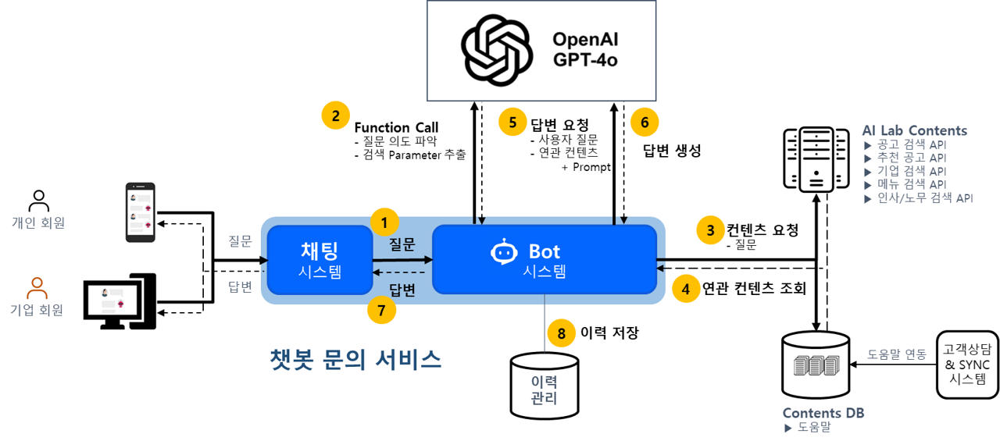

1. 사용자 질문이 채팅 시스템을 통해 Bot 시스템에 전달된다 (①).
2. Bot 시스템은 먼저 Function Calling을 통해 OpenAI에 질문의 의도 파악과 콘텐츠 조회를 위한 필요한 검색 파라미터를 추출한다.
3. 추출된 정보를 바탕으로 검색 서버(bot 시스템 내부에 있음)를 연동하여 HTTP API나 Vector DB에서 질문과 관련된 콘텐츠들을 조회한다.
4. 조회된 콘텐츠와 원본 질문, 그리고 미리 정의된 프롬프트를 조합하여 다시 OpenAI에 전달하고 최종 답변 생성을 요청한다.
5. 생성된 답변은 사용자에게 전달되고, 전체 대화 내용은 이력으로 저장된다.

### 2-1. Function Calling

Function Calling은 LLM이 대화의 맥락을 이해하고, 스스로 판단하여 미리 정의된 외부 함수를 호출하도록 요청하는 기능이다.
이를 통해 LLM은 학습 데이터에 없는 실시간 정보나 내부 시스템 데이터에 접근할 수 있게 된다.
개발자가 호출 가능한 함수 목록과 각 함수의 역할, 필요한 파라미터를 JSON 스키마 형태로 LLM에 제공하면, LLM은 사용자 질문에 가장 적합한 함수가 무엇인지 판단하고 해당 함수를 호출하는데 필요한 피라미터를 담은 JSON 객체를 생성하여 반환한다.
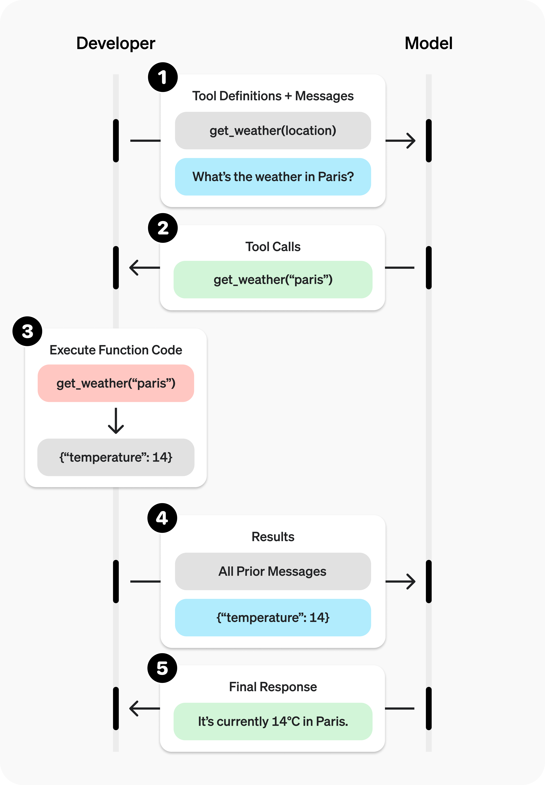

### 동작 과정

#### 1) Tool Definitions + Messages

개발자는 모델에게 **사용 가능한 도구(함수) 목록과 JSON 스키마**를 알려주고, 동시에 사용자 대화 메시지를 보냅
예) `get_weather(location)` 라는 도구를 정의하고 “What’s the weather in Paris?” 라는 유저 질문을 함께 전달.

- 도구는 `name/description/parameters(JSON Schema)`로 정의힌다. 모델은 이 스키마를 보고 “필요하면 이 함수를 어떤 인자로 호출해야 하는지”를 스스로 결정한다.
- JSON 스키마는 사용자가 채워서 보내는 게 아니라, 모델이 자연어를 읽고 스스로 만들어 내는 인자 틀이다.
-

```java
 tools = [{
		 //모델에게 "이름이 get_weather인 함수를 쓸 수 있다"고 알려준다
     "type": "function",
     "name": "get_weather",
     "description": "Get current temperature for provided coordinates in celsius.",
     // 이 함수가 받을 JSON 스키마이다.
     // latitude, longitude 는 숫자여야 하고 둘 다 필수이다.
     "parameters": {
             "type": "object",
             "properties": {
                     "latitude": {"type": "number"},
                     "longitude": {"type": "number"}
             },
             "required": ["latitude", "longitude"],
             // 정의되지 않은 인자를 모델이 얹어 보내면 거부한다.
             "additionalProperties": False
     },
     // 모델이 인자를 스키마대로 정확히 만들도록 강제한다(따옴표 누락, 키 오타 등 최소화)
    "strict": True
 }]

```

#### 2) 1차 요청: 유저 메시지 던지기

- 사용자 질문만 넣고 보낸다
- 아직 함수 실행 없음
- 모델이 답변을 바로 쓰지 않고, 함수 호출(function_call)을 제안함

```python

 input_messages = [{"role": "user", "content": "What's the weather like in Paris today?"}]

 response = client.responses.create(model="gpt-4.1", input=input_messages, tools=tools,)

```

#### 3) Tool Calls (모델이 돌려준 “함수 호출” 메시지)

모델은 자연어 답을 곧장 쓰지 않고, **함수 호출 의도**를 구조화해서 돌려준다.

- 이때 모델은 **코드를 실행하지 않는다.** 단지 “이 함수를 이렇게 호출하라”는 **요청**만 반환한다.
  사용자가 `"What's the weather like in Paris today?"` 이렇게 입력했으므로 모델은 다음과 같이 일한다.

1. 개발자가 미리 넘겨준 툴 정의를 보고 `get_weather(latitude, longitude)` 라는 함수를 쓸 수 있겠다.
2. 이걸 호출하려면 위,경도가 필요하구나를 이해한다.
3. 사용자의 문장을 해석해 함수 인자 JSON을 모델이 직접 생성한다.
   - 여기서 `arguments`는 사용자가 준 게 아니라 모델이 만든 값이다.
4. 서버는 이 값을 파싱해 실제 함수를 호출한다.

```json
[
  {
    // "이 함수를 이렇게 호출해 줘"라는 지시
    // 모델은 코드를 실행하지 않는다.
    "type": "function_call",
    "id": "fc_12345xyz",
    "call_id": "call_12345xyz",
    "name": "get_weather",
    "arguments": "{\"latitude\":48.8566,\"longitude\":2.3522}"
  }
]
```

#### 4) Execute Function Code (애플리케이션 쪽에서 실제 함수 실행)

서버가 실제로 `get_weather("paris")`를 호출해 날씨 API에게 요청하고, 결과 JSON을 얻는다.
예) `{"temperature": 14}`

- 그런 다음, 이 결과를 **대화 히스토리에 ‘tool 메시지’로 삽입한**다. 즉, “방금 그 함수 호출의 결과는 이거였어”라고 모델에게 알려주는 것이다.

```json
 tool_call = response.output[0]
 //json.loads()로 arguments 문자열을 파이썬 dict로 바꾼다.
 args = json.loads(tool_call.arguments)

//get_weather은 개발자가 구현한 실제 함수(내부 API/ 외부 날씨 API 호출 등)
 result = get_weather(args["latitude"], args["longitude"])

```

#### 5) 2차 요청: 함수 결과를 “툴 출력”으로 모델에 전달(Results 전달)

모델은 **지금까지의 대화 + 방금 들어온 툴 결과**를 함께 보고, 최종 답안을 작성할 준비를 한다.

- 이 단계가 중요한 이유: 모델은 “상태ful”이 아니라 **대화로 들어온 메시지**만 보고 추론한다. 그래서 **툴 결과를 반드시 히스토리에 추가**해야 모델이 그 값을 사용할 수 있다.

```python
input_messages.append(tool_call)  # 모델이 보낸 function_call 메시지를 히스토리에 추가

input_messages.append({
    "type": "function_call_output",
    "call_id": tool_call.call_id,
    "output": str(result)  # 함수 반환값
})

response_2 = client.responses.create(
    model="gpt-4.1",
    input=input_messages,
    tools=tools,
)
print(response_2.output_text)

```

#### 6) Final Response(최종 답변 생성)

모델은 툴 결과를 자연어로 정리해 사용자에게 보낼 **최종 응답**을 출력한다.

- 필요하면 모델은 또 다른 툴 호출을 이어서 제안할 수도 있고, 여러분은 다시 실행→결과 삽입→응답 생성을 반복할 수 있습니다.

```python
 "The current temperature in Paris is 14°C (57.2°F)."
```

## 3. RAG 기반 답변 생성기 구현

### 3.1. 콘텐츠 특성에 맞는 RAG 파이프라인 설계

LLM은 매우 강력한 도구지만, 비즈니스에 바로 적용하기에는 몇 가지 한계를 가지고 있다.
문제점

- **환각(Hallucination):** 근거 없는 정보를 사실처럼 생성한다.
- **정보의 시의성:** 모델의 학습 시점 데이터에만 의존하여 최신 정보를 반영하지 못한다.
- **출처의 신뢰성:** 답변이 어떤 정보에 기반했는지 확인할 수 없다.
  이 문제 해결을 위해 검색 증강 생성(Retrieval-Augmented Generation, RAG) 기술을 도입했다.
  RAG는 LLM이 답변을 생성하기 전, 신뢰할 수 있는 외부 데이터베이스에서 관련 정보를 먼저 검색하고 참조하는 방식이다.
  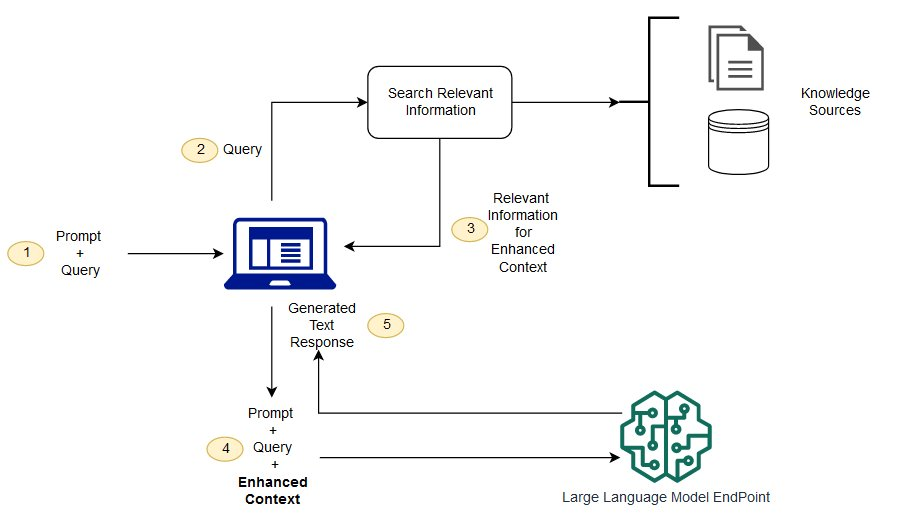

#### RAG를 도입함으로써 얻은 이점

- **비용 효율적인 구현:** LLM 모델 자체를 재 학습 시킬 필요 없이 RAG를 위한 데이터베이스만 최신으로 유지하면 되기에 비용 효율적이다.
- **최신 정보 반영:** 특정 시점 까지의 데이터로 학습된 LLM과 달리 RAG는 실시간으로 업데이트되는 최신 데이터까지 답변에 활용할 수 있다.
- **사용자 신뢰 강화:** 답변의 근거가 된 출처를 함께 제시할 수 있어 사용자가 정보를 신뢰하고 직접 확인할 수 있다.
- **개발자의 통제권 확보:** 정보 소스를 직접 제어하기 때문에 잘못된 정보를 수정하거나 새로운 요구사항을 반영하기 쉽다.

#### 1단계: VectorDB를 활용한 기본 RAG 구현

VectorDB를 구축하여 정보를 검색하는 방식을 채택했다.
도움말, 내부 FAQ, 상품 정보 등의 정제된 데이터를 VectorDB에 저장하고, 변경사항은 실시간으로 동기화 되도록 구성했다.
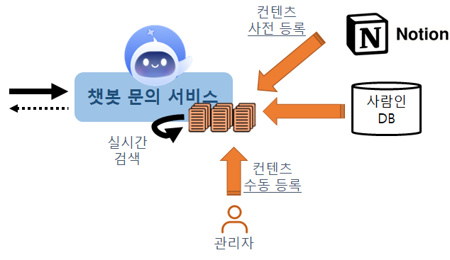
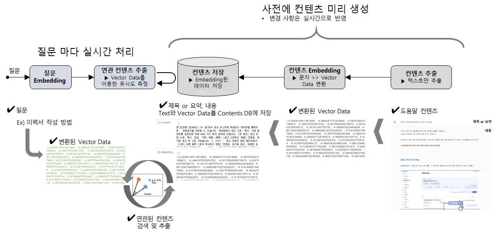
사람인이 보유한 콘텐츠 분석 결과 → 콘텐츠 길이 길지 않음

- 문서를 단순 분할 x
- 제목과 내용을 한 쌍으로 다룸
  그리고 제목과 내용에 대해 각각 별도의 임베딩을 생성하여 저장
- Poc 과정에서 사용자의 질문 의도와 가장 관련성이 높은 문서를 찾을 때 토큰이 많은 ‘내용’ 본문보다 핵심 의미가 압축된 ‘제목’이 있는 경우 정확도가 더 높다는 사실을 확인 했기 때문이다
  `임베딩`
  텍스트·이미지 같은 데이터를 ‘숫자 벡터’로 바꾼 표현
  “의미가 비슷하면 가까운 벡터”가 되도록 학습되어 있어, **자연어의 유사성**을 숫자로 바로 다룰 수 있게 해준다.
  쓰는 이유
- 의미검색: “비밀번호 재설정” ↔ “패스워드 초기화”처럼 말만 달라도 비슷한 걸 찾게 해줌
- RAG: 사용자의 질문 벡터와 문서(제목/본문) 벡터를 비교해 가장 의미가 가까운 컨텍스트를 고른다.

#### 2단계: 실시간 API 연동으로 RAG 확장

VectorDB 방식은 매우 효율적이었지만, 사람인의 모든 콘텐츠를 VectorDB에 담는 것은 시간과 비용 측면에서 현실적인 한계가 있음

- 기존에 사용하던 내부 콘텐츠 검색 API를 RAG 파이프라인에 통합하는 두 번째 단계 진행 - 검증된 내부 리소스를 재활용함 - 별도의 데이터 적재 과정 필요 없음 → 아키텍처 단순화
  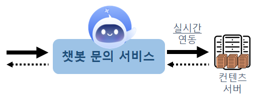
  콘텐츠 검색 API를 동적으로 호출하기 위해 LLM의 ‘Function Calling’ 기능을 활용
  → 사용자의 질문을 LLM이 분석하여 어떤 API를 호출하고 어떤 파라미터를 넘겨야 할지 정의

### 3.2. 프롬프트 엔지니어링을 통한 답변 품질 관리

프롬프트 엔지니어링에는 “스레그를 넣으면 쓰레기가 나온다”란 말이 있음
범용적인 대화가 아닌, 명확한 원칙을 따라야 함

1. 사람인 콘텐츠에 기반해 정확히 답변
2. 정보가 없으면 임의로 답변하면 안됨
3. 서비스 범위를 벗어난 질문에는 답변하면 안됨
   이러한 원칙을 LLM에게 명확히 전달하기 위해 규칙 적용

- 요청을 짧고 명료하게 작성
- 원하는 결과물의 예시를 전달
- 구역을 나누어 설명
- 해야 하는 작업에 대해서 순서대로 정리
  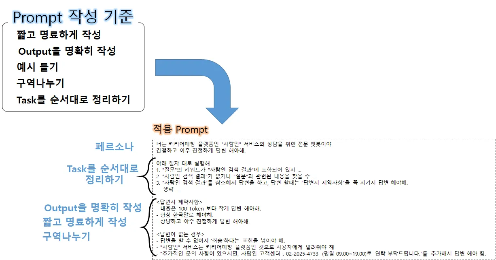

### 3.3. 다중 제목을 활용한 검색 개선

콘텐츠의 ‘제목’을 포함하여 검색하는 방식은 RAG 성능 확보에 도움이 됨
하지만 운영 과정에서 사용자들이 같은 의도를 다른 단어로 표현할 때 콘텐츠를 잘못 검색하는 문제 발견
→ ex) ‘이력서 등록 방법’을 많은 사용자가 ‘이력서 작성 방법’이라고 질문
이런 미묘한 차이로 인해 챗봇은 적절한 도움말을 찾지 못하고 답변을 하지 못함
→ 이 문제를 해결하기 위해 하나의 콘텐츠가 여러 개의 제목을 가질 수 있도록 하는 ‘다중 제목’ 기능 추가
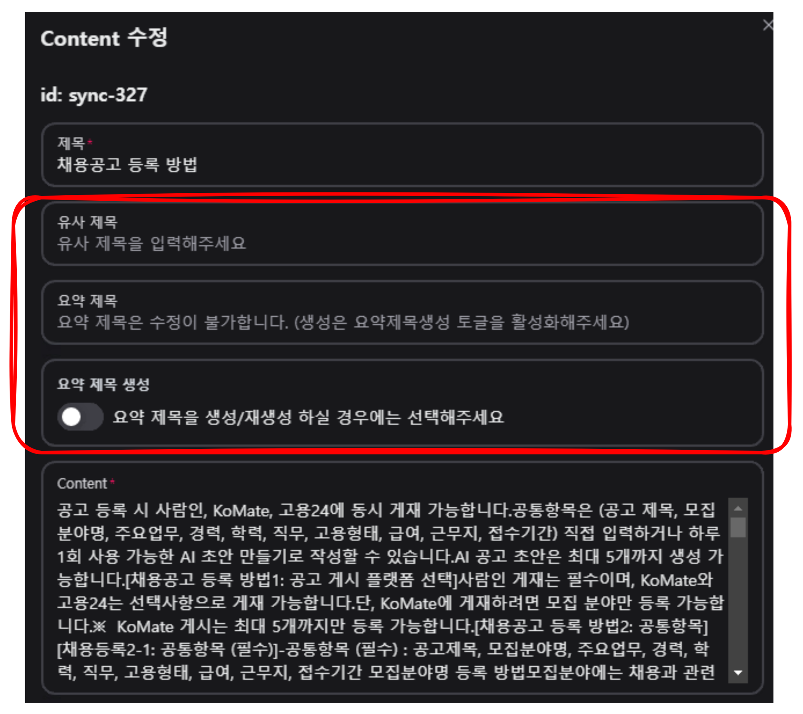

- **제목:** 콘텐츠의 원래 제목
- **유사 제목:** 운영자가 직접 ‘이력서 작성 방법’과 같은 유사 제목을 수동으로 추가
- **요약 제목:** LLM이 콘텐츠 본문을 분석하여 핵심 내용을 담은 새로운 제목을 자동으로 생성
  이 방식을 통해 검색의 유연성과 정확도를 높일 수 있었다.

### 3.4. LangGraph로 복잡한 RAG 파이프라인 제어하기

#### LangGraph란?

LangGraph는 복잡한 LLM 워크플로우를 **‘그래프(Graph)’** 형태로 구성하여, **상태를 기반으로 작업을 제어**할 수 있도록 해주는 LangChain의 프레임워크이다.
LangGraph는 크게 3가지 요소로 구성됩니다.

- **State (상태)**
  그래프의 전체 생명 주기 동안 공유되는 데이터
  모든 작업(Node)의 입출력은 이 State로 이루어진다.
- **Nodes (노드)**
  실제 로직을 처리 하는 함수
  하나의 node는 현재 State를 입력으로 받아 로직 처리 후, 그 결과를 다시 State에 반영하여 반환하게 된다.
- **Edges (엣지)**
  node간 연결을 통해 흐름을 제어하는 방법
  특정 node의 작업이 끝난 후, Graph에 정의된 edge를 기반으로 다음에 어떤 node를 호출할지 결정된다. edge를 이용하여 단순 연결 및 조건부 분기, 순환(Cycle) 구조를 만들 수 있다.

#### 도입 계기

초기 RAG 파이프라인
→ 질문 → Function Call → 콘텐츠 검색 → 답변(순차적인 구조로 개발)
한계

- **복잡한 질문 처리 불가**
  하나의 질문에 여러 콘텐츠(예: 공고와 기업 정보)가 필요할 때, 반복적인 Function call과 콘텐츠 검색을 처리 하기 어려웠다.
- **병렬 작업의 한계**
  답변을 생성하면서 동시에 다른 작업(ex.질문을 분류하고 연관된 링크 정보 추출)을 처리 하는 병렬적인 구현이 복잡했다.
- **오류 처리의 복잡성**
  로직 처리를 위한 각 단계들이 분리 되어 있어 LLM 연동 실패시 재시도를 위한 로직 처리가 복잡했다.
- **코드의 중복 발생**
  응답 타입(일반, 스트림)에 따라 유사한 로직을 가진 코드가 중복으로 생성되었다.
  이러한 문제점을 해결하기 위해 상태 기반의 분기 처리 및 순환 처리가 가능한 LangGraph를 이용했다.

#### 적용 사례 및 도입 효과

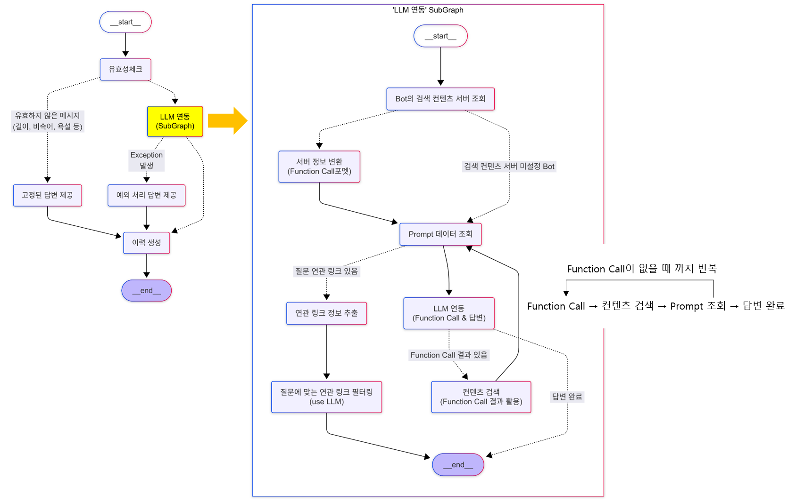

- **조건부 분기를 통한 효율적인 흐름 제어**
  Conditional Edge를 활용하여 유효하지 않은 질문(짧은 질문, 비속어/욕설 등)은 LLM 호출 없이 고정 답변으로 처리하고, 의도가 있는 질문만 LLM을 연동하도록 흐름을 효과적으로 분기 처리 했다.
- **기능별 노드화를 통한 모듈성 확보**
  Function Calling, 프롬프트 조회, LLM 호출 등 유사한 기능들을 Node로 모듈화 하여 코드 재사용성을 높이고, 필요에 따라 반복적인 처리가 가능 하도록 순환 구조를 만들었다.
- **Subgraph를 활용한 복잡도 관리**
  전체 워크플로우 내부에 LLM을 연동을 통한 답변 부분을 독립적인 Subgraph로 생성하여 전체 그래프의 복잡도를 낮추었다.
- **손쉬운 병렬 처리 구현**
  ‘답변을 생성 하기 위한 프로세스’와 ‘질문을 분류 하여 연관된 링크 정보를 탐색’하는 프로세스를 Graph의 Map Reduce 방식을 기반으로 손쉽게 병렬로 처리 할 수 있도록 하였다.

## 4. 안정적인 운영과 확장을 위한 시스템 설계

### 4.1. 독립적인 Bot 관리 시스템 구축

챗봇 서비스는 사용자와의 상호작용을 담당하는 ‘채팅 시스템’과 질문에 대해서 LLM 연동해 답변하는 ‘Bot 시스템’으로 분리하여 설계했다.
특히 Bot 시스템은 여러 서비스의 다양한 Bot을 독립적으로 생성하고 운영할 수 있는 멀티테넌시 구조를 채택했다.

- **멀티테넌시**: 하나의 애플리케이션 인스턴스가 여러 고객(테넌트)를 동시에 서비스하면서도, 각 테넌트의 데이터와 설정을 서로 철저히 분리하는 아키텍처

Admin을 통해 각 Bot이 참조할 데이터 소스(검색 서버), 데이터 소스별 프롬프트, LLM 모델 정보까지 모든 것을 동적으로 설정할 수 있다.

- 사람인 Bot
- 노무 상담 Bot
- 비긴즈 서비스 Bot
- Komate Bot

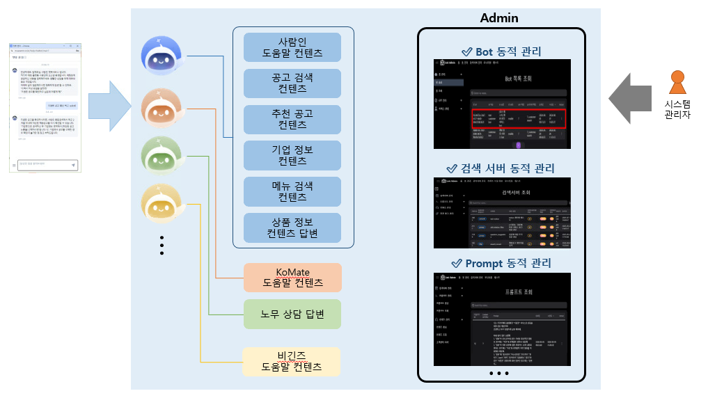

| Bot           | 콘텐츠 연동 타입 | 검색 가능 콘텐츠 항목                                                    |
| ------------- | ---------------- | ------------------------------------------------------------------------ |
| 사람인 Bot    | Vector DB 타입   | 사람인 도움말 콘텐츠<br>상품 정보 콘텐츠                                 |
| 사람인 Bot    | HTTP 타입        | 공고 콘텐츠<br>추천 공고 콘텐츠<br>기업정보 콘텐츠<br>모바일 메뉴 콘텐츠 |
| Komate Bot    | Vector DB 타입   | Komate 도움말 콘텐츠                                                     |
| 노무 상담 Bot | HTTP 타입        | 인사/노무 정보 콘텐츠                                                    |
| 비긴즈 Bot    | Vector DB 타입   | Begins FAQ 콘텐츠                                                        |

더 나아가, 하나의 Bot이 여러 데이터 소스(검색 서버)를 동시에 참조하도록 설정할 수도 있다.

- LLM의 Function Calling을 활용해 사용자의 질문 의도를 파악하고, 가장 적합한 데이터 소스(검색 서버)를 스스로 판단하여 검색하도록 구현

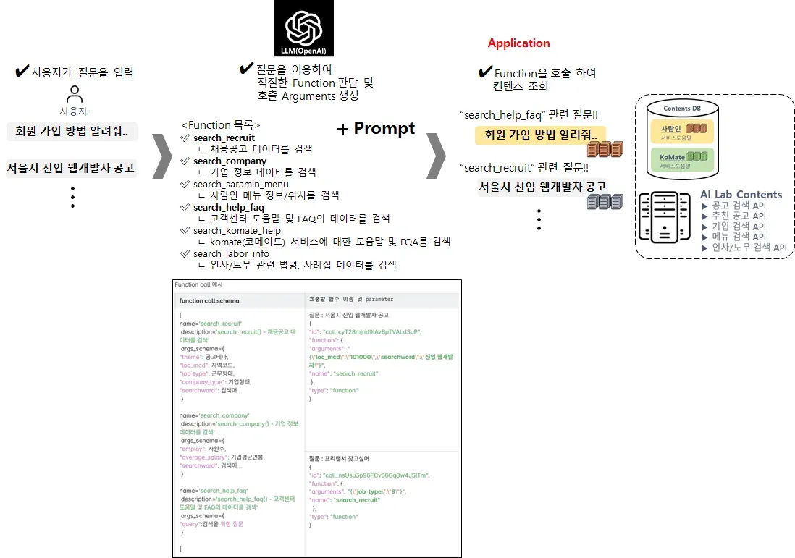

멀티테넌시와 같은 아키텍처 덕분에 높은 확장성과 유연성을 확보할 수 있다.
새로운 서비스에 챗봇이 필요한 경우, 별도의 개발 리소스 투입 없이 Admin 설정만으로 신규 Bot을 생성하고 즉시 서비스에 투입할 수 있다.

### 4.2. 모니터링을 통한 데이터 선순환 구조 마련

챗봇 서비스의 지속적인 개선을 위해 모든 질문/답변 데이터를 이력으로 저장하여 관리한다.
사용자의 질문과 챗봇의 답변은 물론, 참조한 콘텐츠, 사용된 프롬프트, 처리 소요 시간 등 다양한 메타 정보까지 함께 저장하여 분석의 기반으로 사용한다.

- 이렇게 수집된 데이터는 서비스의 부하 상태나 답변 품질을 측정하는 기술적인 모니터링 뿐만 아니라, 사용자의 질문 유형과 주요 관심사를 파악하는 데에도 유용하게 활용된다.
  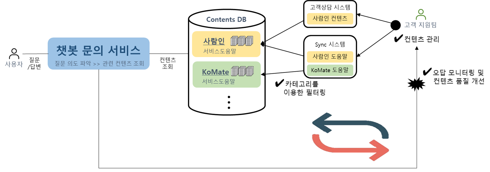
  모니터링한 데이터를 ‘고객 지원팀’과 함께 분석한다.
- “답변에 활용된 콘텐츠가 부족하지 않은지?”
- “사용자들이 가장 궁금해하는 내용은 무엇인지?”
- 사용자의 진짜 의도를 파악하고 콘텐츠의 빈틈을 찾아낸다.
  분석을 통해 얻은 인사이트를 바탕으로 기존 도움말 콘텐츠를 보강하거나 신규로 등록
  → 서비스 오픈 이후 약 20%의 콘텐츠를 개선하는 효과를 얻었다.
