# RAG, 들어는 봤는데… 내 서비스엔 어떻게 쓰지?

- 읽은 날짜: 2026-03-15
- 회사/작성 주체: 우아한형제들
- 원문: [RAG, 들어는 봤는데… 내 서비스엔 어떻게 쓰지?](https://techblog.woowahan.com/25900/)

---

### 들어가며
교육 운영 환경에서는 정보가 한곳에 모여 있지 않다.
교육생 정보와 교육 자료는 데이터베이스에 있고, 부가 자료는 Google Drive에 있고, 일정은 Google Calendar에 흩어져 있다.
문제는 사용자가 하나의 질문에 답하기 위해 여러 시스템을 직접 오가야 한다는 점이었다.
예를 들어 “이번 주 수요일 교육 자료가 어디 있지?” 라는 질문에 답하려면 일정, 자료, 관련 문서를 각각 확인해야 했다.
이 불편함을 줄이기 위해 교육 운영 정보를 자연어로 검색할 수 있는 시스템을 만들고자 했다.
---
## 왜 RAG가 필요했는가
LLM은 강력하지만 학습 데이터에 없는 내부 정보는 알 수 없다.
특히 교육 운영 데이터처럼 비공개 정보이거나 자주 바뀌는 정보는 LLM만으로 정확하게 답변하기 어렵다.
질문할 때마다 관련 파일이나 문서를 직접 함께 넣어주는 방식도 가능하다.
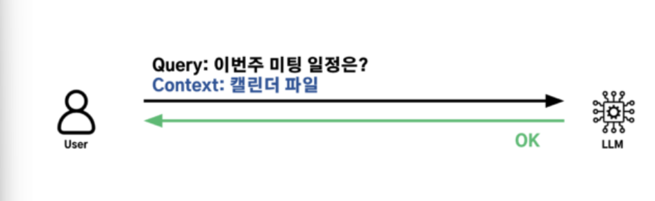
하지만 이 방식은 질문마다 적절한 컨텍스트를 사람이 직접 준비해야 하므로 운영이 번거롭고 실수 가능성도 높다.
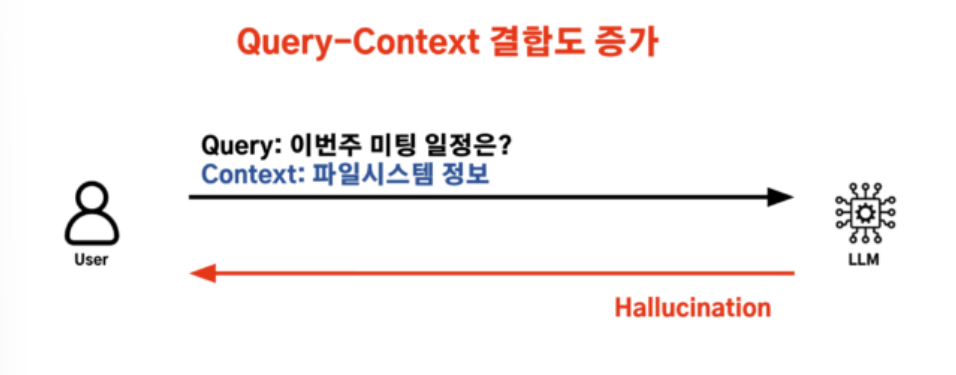
결국 필요한 것은 사용자 질문에 맞는 정보를 시스템이 자동으로 찾고, 그 결과를 바탕으로 답변을 생성하는 구조였다.
이 문제를 해결하기 위해 RAG를 도입했다.
---
## 초기에는 MCP를 먼저 시도했다
MCP는 LLM이 외부 데이터 소스에 접근할 수 있도록 표준화된 프로토콜로, LLM에 요청하면 프로토콜을 통해 외부 데이터를 자동으로 가져옵니다.
처음에는 MCP(Model Context Protocol)를 활용해 LLM이 외부 데이터 소스를 직접 조회하도록 시도했다.
아이디어 자체는 자연스러웠다.
LLM이 필요한 데이터를 직접 가져오면 별도 검색 서버를 두지 않아도 될 것처럼 보였다.
하지만 실제 적용에서는 한계가 분명했다.
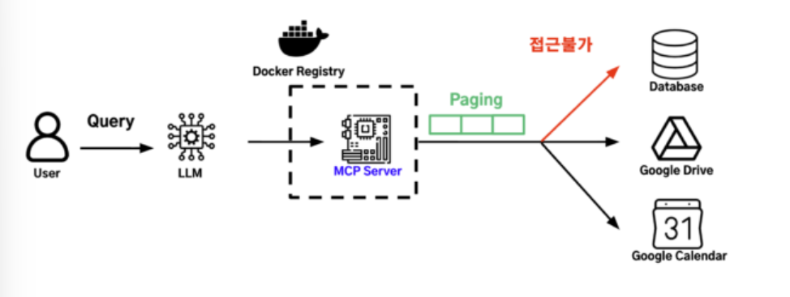
모든 사용자가 MCP를 지원하는 LLM 환경을 써야 했고, 로컬 실행 구조 때문에 VPC 내부 데이터베이스 같은 격리된 리소스에 접근하기 어려웠다.
또한 LLM의 도구 호출은 항상 안정적이지 않았다.
어떤 요청은 잘 처리했지만, 어떤 요청은 검색을 반복하다 Context Window를 과도하게 사용하기도 했다.
즉 MCP는 연결 표준으로는 의미가 있었지만,교육 운영 시스템의 주 데이터 접근 경로로 쓰기에는 제어성과 안정성이 부족했다.
---
## RAG 서버를 직접 구현
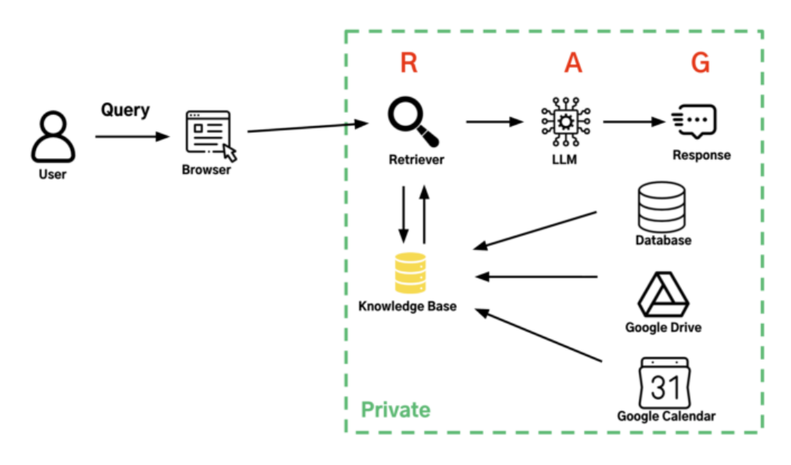
최종적으로는 사용자가 브라우저에서 질문만 입력하면 백엔드가 필요한 데이터를 조회하고, 검색 결과를 바탕으로 답변을 생성하는 RAG 서버 구조를 선택했다.
이 방식의 장점은 명확했다.
데이터 접근과 검색 흐름을 백엔드에서 직접 통제할 수 있었고,
데이터베이스와 같은 VPC 안에서 동작하도록 구성해 격리된 내부 리소스에도 접근할 수 있었다.
또한 검색 횟수, 반환할 데이터 수, 프롬프트에 포함할 컨텍스트 양을 코드로 제한할 수 있어 MCP 방식에서 겪었던 불안정성도 크게 줄일 수 있었다.
---
## 세 가지 파이프라인으로 구현
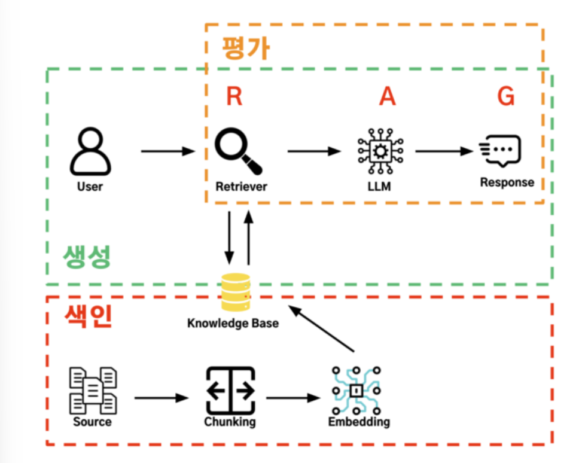
RAG 시스템은 색인, 생성, 평가의 세 파이프라인으로 나누어 설계했다.
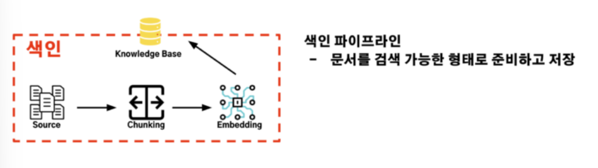
색인 파이프라인에서는 DB, Drive, Calendar의 데이터를 수집하고,검색 가능한 단위로 나눈 뒤 임베딩하여 저장했다.
생성 파이프라인에서는 사용자 질문과 가장 관련성 높은 청크를 검색하고, 그 내용을 기반으로 답변을 만들었다.
평가 파이프라인에서는 검색 결과가 질문과 얼마나 관련 있는지, 답변이 컨텍스트에만 근거했는지, 최종 답변이 질문에 제대로 답하고 있는지를 점검했다.
이렇게 나누니 문제가 생겼을 때 어느 단계에서 품질이 떨어지는지비교적 명확하게 확인할 수 있었다.
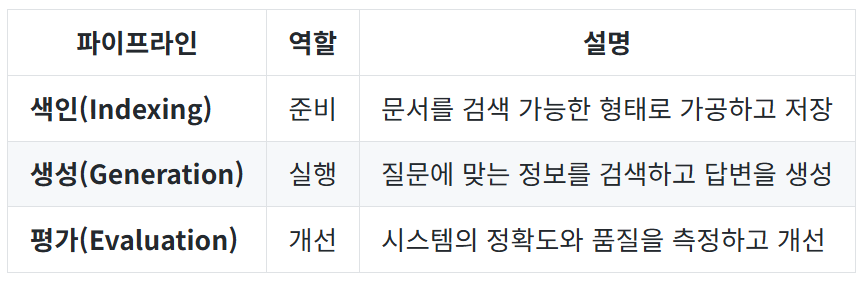
---
## 색인 파이프라인
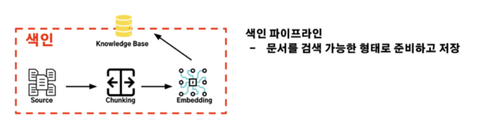
색인 파이프라인은 원본 데이터를 검색 가능한 형태로 바꿔 저장하는 과정이다.
즉 Source에 있던 데이터를 로딩, 청킹, 임베딩을 거쳐 Knowledge Base에 넣는 단계다.
### 4-1. 로딩: 데이터 소스 연결과 수집
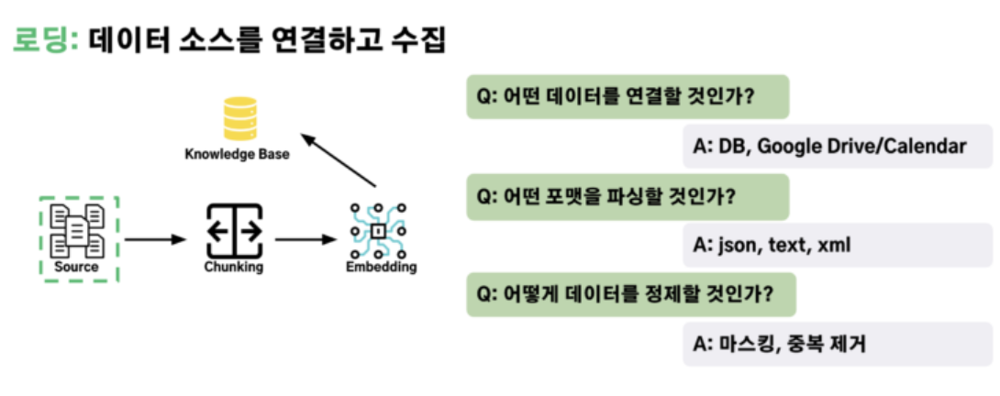
로딩은 DB, Google Drive, Google Calendar 같은 여러 데이터 소스에서 필요한 정보를 가져오는 단계다.
핵심은 형식이 다른 데이터를 한 가지 내부 형태로 정리하는 것이다.
### 4-2. 청킹 : 검색 가능한 단위로 분할
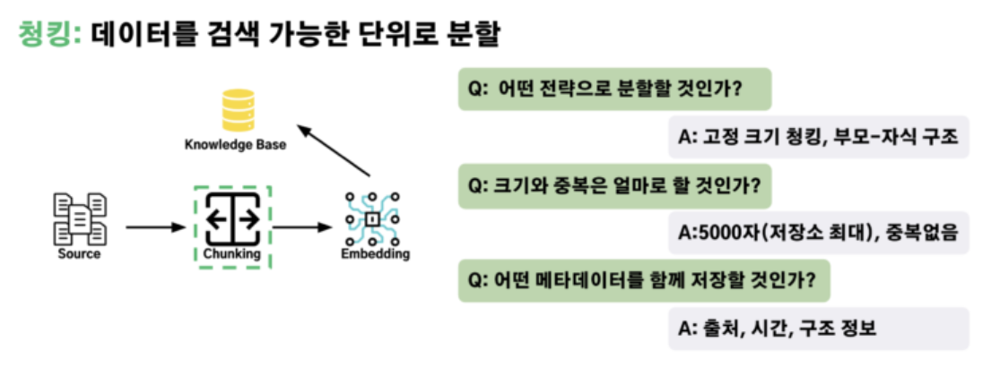
청킹은 긴 데이터를 검색 가능한 조각으로 나누는 단계다.
너무 작으면 문맥이 끊기고, 너무 크면 검색 품질과 속도가 떨어지기 때문에 적절한 크기 조절이 중요하다.
### 4-3. 임베딩: 숫자 벡터로 변환
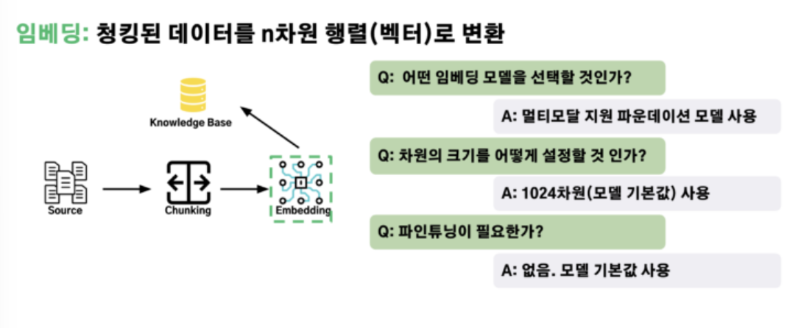
임베딩은 텍스트를 숫자 벡터로 바꾸는 단계다.
이 과정을 거쳐야 질문과 문서가 의미적으로 얼마나 비슷한지 계산할 수 있다.
### 4-4. 저장소: 벡터 데이터 저장과 검색
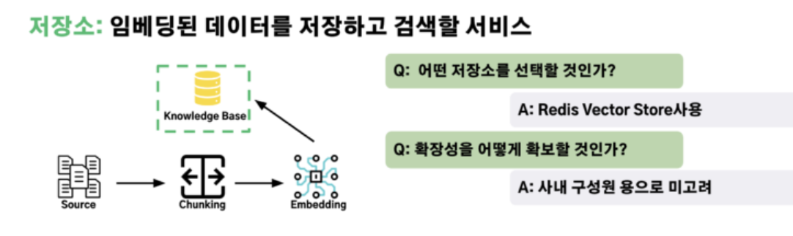
저장은 임베딩된 벡터와 메타데이터를 저장소에 보관하는 단계다.
교육 운영 RAG에서는 기존 Redis 인프라를 활용하기 위해 Redis Vector Store를 사용했고, 빠른 검색 지연과 재적재 속도를 장점으로 가져갔다.
---
## 5단계. 생성 파이프라인 구현
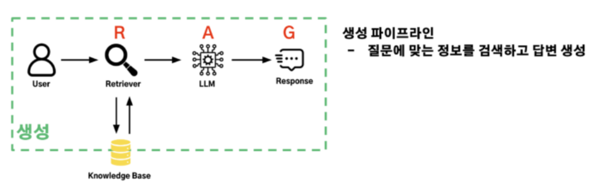
생성 파이프라인은 질문에 맞는 정보를 찾고, 그 정보를 바탕으로 답변을 만드는 과정이다.
이 단계는 검색, 증강, 생성으로 구성된다.
### 5-1. 검색
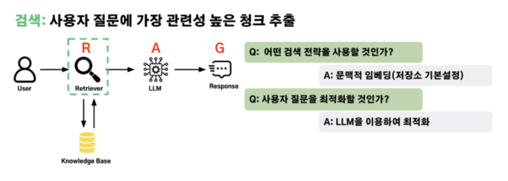
검색은 색인 파이프라인에서 저장된 벡터 데이터를 바탕으로, 사용자 질문과 가장 의미적으로 유사한 청크를 찾아오는 요소이다.
캘린더 예시에서 “이번 주 미팅 일정은?”이라는 질문이 들어오면, 질문 역시 벡터로 변환한 뒤 저장소에서 가장 가까운 일정 데이터를 골라오는 과정이다.
단순 키워드 매칭이 아니라 의미적 유사도를 기준으로 찾기 때문에, 질문 표현이 달라도 관련 문서를 찾아올 수 있다.
### 5-2. 증강
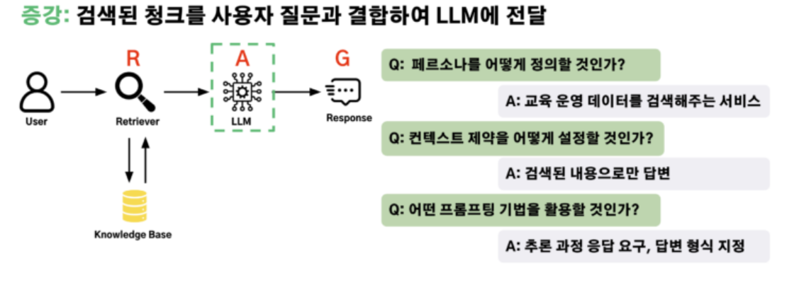
증강은 검색 단계에서 찾아온 청크를 사용자 질문과 결합하여, LLM이 올바른 답변을 생성할 수 있도록 프롬프트를 구성하는 요소이다.
캘린더 예시에서 검색된 일정 데이터를 그대로 LLM에게 전달하는 것이 아니라, "너는 교육 운영 데이터를 검색해주는 서비스야"처럼 역할을 정의하고, 검색된 컨텍스트와 사용자 질문을 일정한 형식으로 엮어 전달하는 과정이다.
단순히 데이터를 붙여넣는 것이 아니라, LLM이 정확하게 답변할 수 있도록 틀을 만들어주는 것이 핵심이다.
### 5-3. 생성
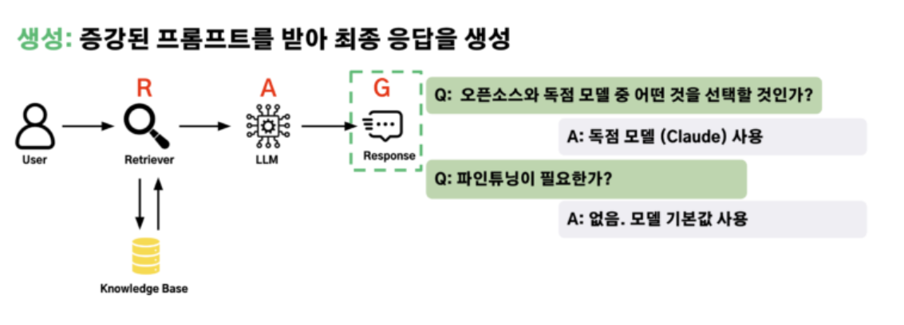
생성은 증강 단계에서 구성된 프롬프트를 LLM에게 전달하여, 사용자에게 돌려줄 최종 답변을 만들어내는 요소이다.
캘린더 예시에서 검색된 일정 데이터를 단순히 나열하는 것이 아니라, "이번 주 미팅은 수요일 오후 3시, 금요일 오전 10시 2건입니다."처럼 사용자의 질문에 맞는 자연스러운 문장으로 종합해 돌려주는 과정이다.
결국 이 단계의 품질은 모델 자체보다, 앞에서 얼마나 좋은 데이터를 검색하고 잘 구성했는지에 크게 좌우된다.
---
## 6단계. 평가 파이프라인 구현
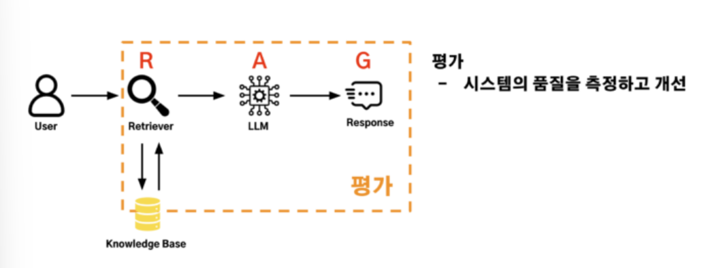
평가 파이프라인은 RAG가 실제로 잘 동작하는지 확인하는 단계다.
검색과 생성이 돌아간다고 해서 곧바로 좋은 RAG가 되는 것은 아니다.
가져온 컨텍스트가 질문과 맞는지, 답변이 검색된 내용에만 근거하는지, 최종 답변이 질문에 제대로 답하는지를 따로 확인해야 한다.
### 6-1. 컨텍스트 관련성
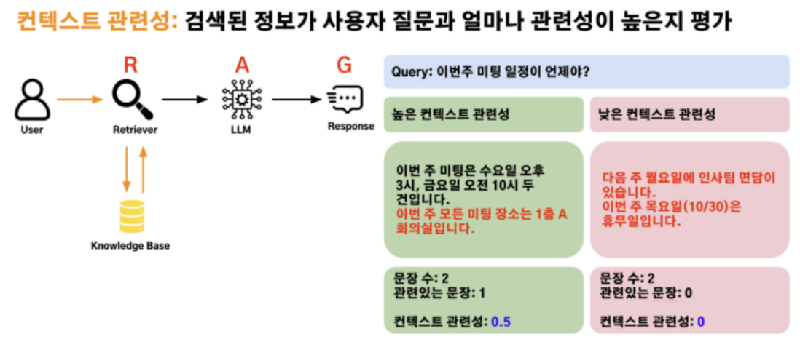
컨텍스트 관련성은 검색된 청크가 사용자 질문과 얼마나 잘 맞는지 보는 지표다.
질문과 상관없는 문서가 많이 섞이면 이후 생성 단계가 잘 동작해도 답변 품질이 떨어진다.
즉 검색 품질을 가장 먼저 점검하는 기준이다.
### 6-2. 답변 충실성
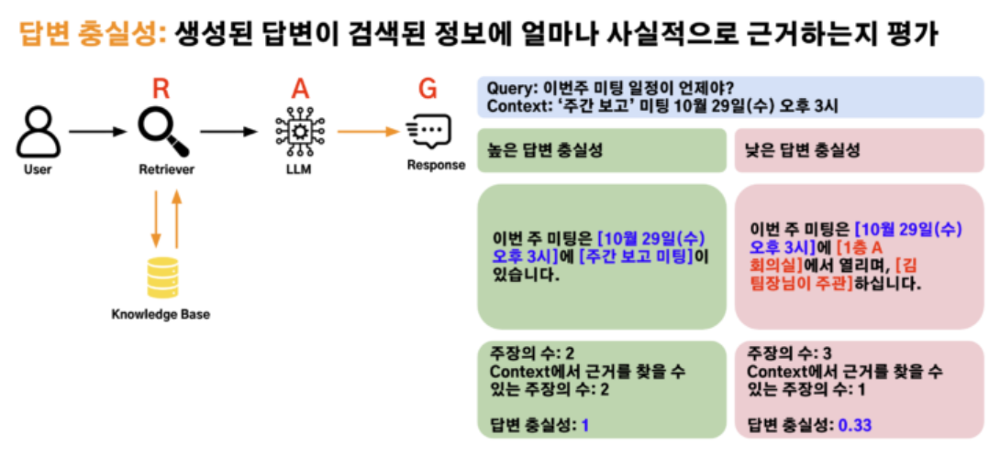
답변 충실성은 생성된 답변이 검색된 컨텍스트 안에서만 만들어졌는지 보는 지표다.
이 값이 낮으면 모델이 검색 결과에 없는 내용을 추측해서 답했을 가능성이 크다.
즉 환각을 줄이기 위한 핵심 평가 기준이다.
### 6-3. 답변 관련성
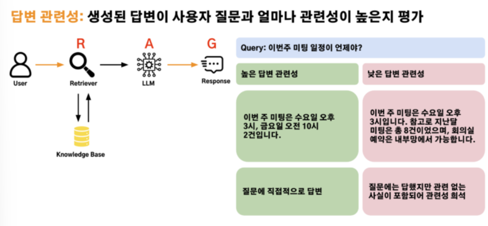
답변 관련성은 최종 답변이 사용자의 질문에 직접적으로 답하고 있는지 보는 지표다.
검색은 잘했더라도 답변이 질문의 핵심을 놓치거나 불필요한 내용을 길게 덧붙이면 이 지표가 낮아진다.
즉 “맞는 정보를 찾았는가”와 별개로 “그 정보로 제대로 대답했는가”를 확인하는 기준이다.
### 6-4. 평가에서 중요했던 점
처음부터 복잡한 자동 평가를 만들기보다 소수의 대표 질문으로 직접 확인하는 방식이 더 현실적이었다.
또 평가 지표는 하나만 보면 안 된다.
검색이 문제인지, 환각이 문제인지, 답변 방식이 문제인지
각 지표를 나눠 봐야 병목 지점을 찾을 수 있다.
즉 평가는 단순 점수 확인이 아니라 RAG를 개선하기 위한 진단 도구에 가깝다.
---
## 마무리
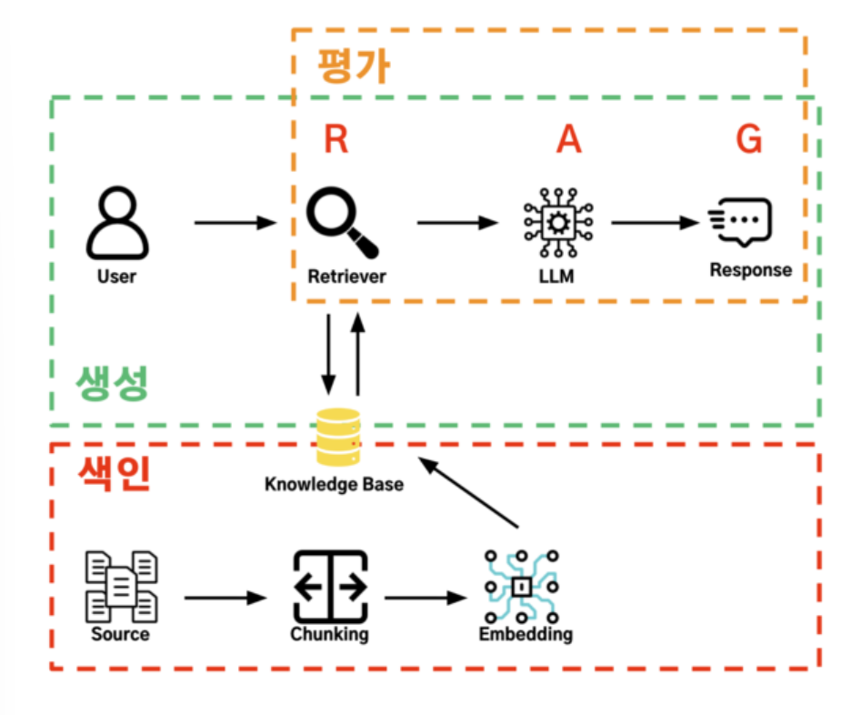
교육 운영 시스템에 RAG를 적용하면서 내린 결론은 분명했다.
RAG는 단순히 LLM에 검색 기능을 붙이는 기술이 아니다.
분산된 내부 데이터를 질문에 맞는 근거로 찾아오고, 그 근거를 바탕으로 신뢰 가능한 답변을 만드는 전체 시스템 설계에 가깝다.
초기에는 MCP도 시도했지만, 실제 운영 환경에서는 데이터 접근성, 제어 가능성, 안정성이 더 중요했다.
그래서 최종적으로는 백엔드가 검색과 컨텍스트를 통제하고, LLM은 정리된 정보를 바탕으로 답변하도록 하는 RAG 서버 구조가 더 적합했다.
가장 큰 교훈은 처음부터 완벽하게 만들려고 하기보다
전체 파이프라인을 빠르게 검증하고, 평가 지표를 통해 약한 부분을 반복적으로 개선하는 것이 훨씬 효과적이었다는 점이다.
결국 좋은 RAG는 좋은 모델 하나로 만들어지는 것이 아니라, 좋은 데이터 수집, 좋은 청킹, 좋은 검색, 좋은 프롬프트, 그리고 좋은 평가가 함께 만들어낸 결과라고 볼 수 있다.
---
## 느낀점
과거 프로젝트에서 RAG를 구현했을 때는 저장된 정보를 활용해 의미 있는 답변을 만드는 데만 집중했다. 하지만 RAG 설계 과정을 다룬 기술 블로그를 보며, 내가 구현했던 것은 전체 RAG 중 생성 단계에 가까웠다는 점을 알게 되었다.
RAG는 단순히 답변을 생성하는 기술이 아니라, 데이터를 검색 가능하게 준비하는 색인 단계와 결과의 품질을 검증하는 평가 단계까지 함께 설계해야 하는 구조라는 점이 인상 깊었다.
언젠가는 생성 단계에 그치지 않고, 색인 단계와 평가 단계까지 직접 구현해보며 RAG를 더 깊이 이해해보고 싶다.

