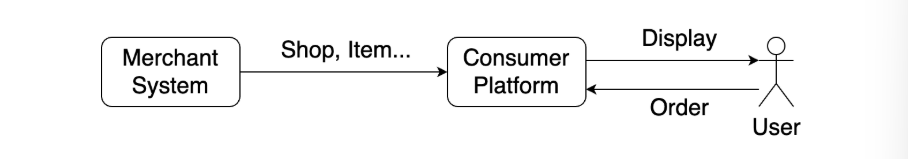
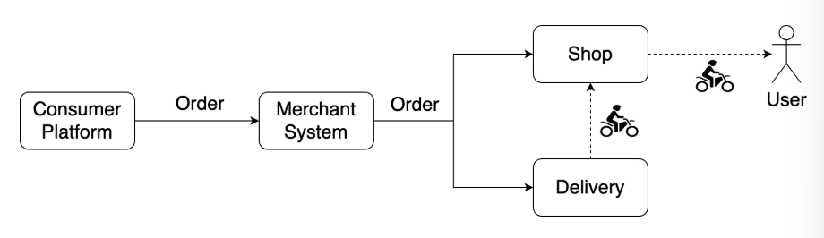
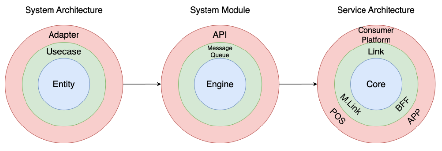
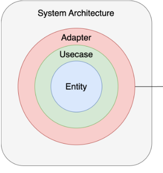
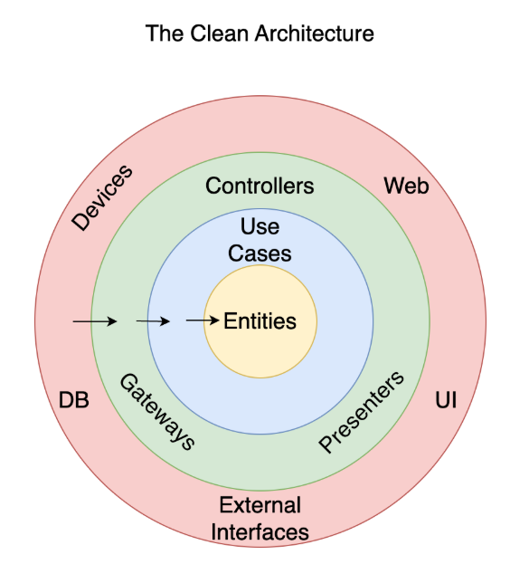
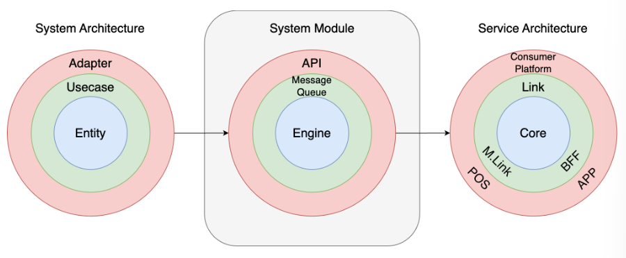
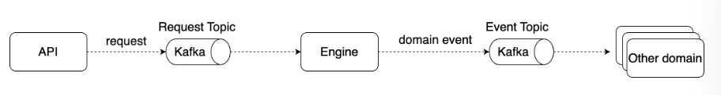
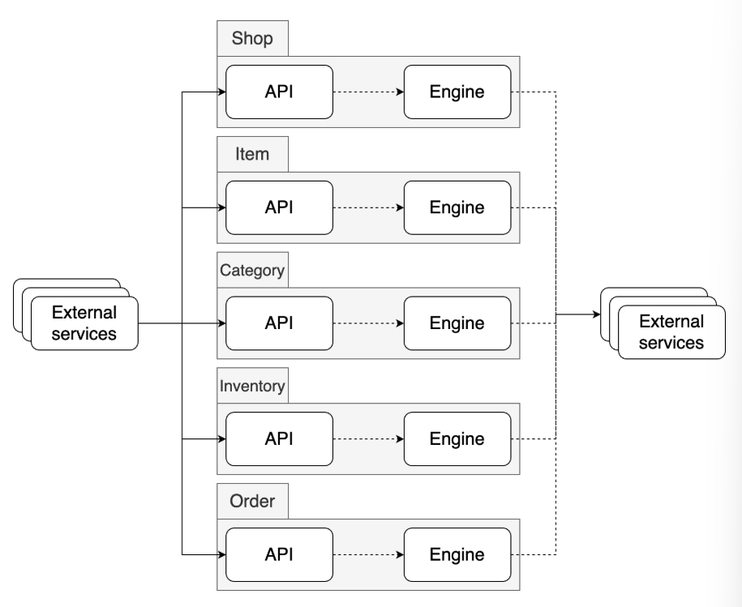
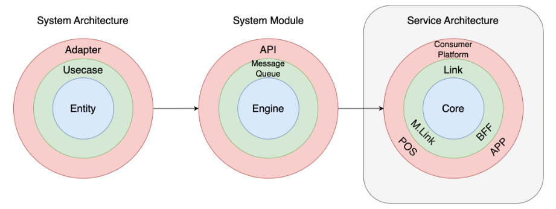
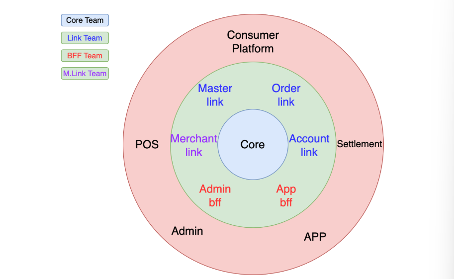

# DDD를 Merchant 시스템 구축에 활용한 사례를 소개합니다

- 읽은 날짜: 2025-11-19
- 회사/작성 주체: LY Corporation
- 원문: [DDD를 Merchant 시스템 구축에 활용한 사례를 소개합니다](https://techblog.lycorp.co.jp/ko/applying-ddd-to-merchant-system-development)

---

ABC Studio의 개발 팀은 DDD를 활용해 소매 상품 판매를 위한 새로운 Merchant 시스템을 론칭

## 새로운 Merchant 시스템 소개

기존 시스템 : 주로 음식 배달 서비스를 위한 시스템
→ 이를 기반으로 소매 상품 판매 서비스도 전개중
그렇다 보니 소매 상품 판매에 적합한 형태로 서비스를 구성하지 못함
→ 기존 시스템과 독립적인 Merchant 시스템 개발 시작
Merchant 시스템 내부에서는 소비자 플랫폼에게 점포나 상품과 같은 판매에 필요한 정보를 제공하면, 소비자 플랫폼에서는 이 정보를 바탕으로 사용자에게 상품을 전시하고 판매한다.

소비자 플랫폼에서 판매된 주문 정보는 Merchant 시스템으로 전달되고, Merchant 시스템은 이를 다시 점포와 배달원에게 전달해 사용자에게 상품이 배달되도록 한다.

## 도메인 정의

Merchant 시스템은 상품 판매에 필요한 정보 생성 및 제공까지만 담당하고, 이후 실제로 소비자에게 판매하는 영역은 소비자 플랫폼으로 위임한다.
일반적인 전자 상거래에서 정의하는 도메인의 상당 부분을 덜어내고, 상품을 판매하기 위한 핵심/공통 정보만을 다루는 범위로 도메인을 정의했다.

- 점포(shop)
- 상품(item)
- 카테고리(category)
- 재고(inventory)
- 주문(order)

## DDD를 활용한 서비스 구성

아래 그림은 DDD를 활용해 서비스의 각 시스템을 구성하는 시스템 아키텍처부터 전체 서비스 아키텍처를 구성한 과정을 간략하게 나타낸 그림이다.

### 시스템 아키텍처 구성

시스템을 구현하는 개발 아키텍처는 클린 아키텍처를 따르도록 구현했다.
클린 아키텍처를 따른 이유?

- 참고할 수 있는 책이 얇았다.
- DDD 전문가가 아니고, 앞으로 새로 합류할 인원 또한 그렇지 않을 가능성이 높다.
  → 시스템을 구현하는 방법은 모두가 쉽게 이해하고 따를 수 있는 방법이어야 한다.
  클린 아케텍처의 중심에는 도메인 엔티티가 있고, 도메인 엔티티에 접근할 수 있는 유스케이스를 통해 외부 인터페이스 어댑터를 구현한다.
  여기서 중요한 점은, 클린 아키텍처에서 계층 간 의존성은 내부 방향으로만 허용하기 때문에 도메인 엔티티에서는 외부 환경에 영향을 주지 않고 도메인 코드를 모델링할 수 있다는 것이다.
  따라서 클린 아키텍처는 DDD를 적용하기에 적합한 아키텍처로 평가받고 있다.
  

### 시스템 모듈 구성

각 도메인 서비스는 각자의 역할에 맞춰 여러 개의 모듈로 구성해 서비스한다.
여기서 모듈은 크게 도메인의 비즈니스 로직을 처리하는 엔진과 외부 요청을 받는 API로 구분된다.
→ 시스템의 가용성과 확장성을 확보하고, 외부 시스템의 요청을 받는 부분과 도메인 로직을 처리하는 부분을 레이어로 분명히 구분해서 모듈 개발과 유지 보수 관점에서 편의를 얻기 위해서이다.
API는 프로토콜의 변화를 명확히 공유할 수 있도록 gRPC로 제공했고, API와 엔진 간 요청 전달에는 Apache Kafka를 이용했다.

흐름을 살펴보면, API 로 들어온 요청은 내부 토픽을 통해 엔진으로 전달되며, 엔진은 전달받은 요청을 처리해 도메인 이벤트를 이벤트 토픽으로 발행해서 다시 이를 필요로 하는 외부 도메인으로 전달한다.
각 도메인은 모두 위와 같은 구조로 동일하게 구현해 아래와 같은 구조로 외부에 서비스를 제공한다.

위 구조는 모든 구간이 비동기로 설계돼 있다.
따라서 전체 시스템이 빠른 API 응답 능력과 요청한 작업이 언젠가는 처리될 것이라는 최종 일관성을 기대하는 경우에는 적합
but 요청을 즉각 처리해서 그 결과를 바로 응답해야 하는 시스템에는 적합 x
→ Merchant 시스템은 많은 요청을 받아 빠르게 응답하는 능력이 우선 필요했으며, 대부분의 상황에서 도메인 작업을 즉각 처리하는 것은 필요하지 않았기에 위 구조를 사용할 수 있었다.

### 서비스 아키텍처 및 팀 구성

소비자 플랫폼은 일본 내 서비스이기 때문에 일본 팀과 협업해야 했다.
한국 팀에서 생각하는 핵심 도메인의 역할과 책임을 일본 팀에게 공유하면서 핵심 도메인은 외부 환경에 영향을 받지 않아야 한다는 공감대를 형성하는 과정을 거침
서로 공감대를 형성하는 과정에서 각 도메인의 역할이 조정되는 등의 결정사항들이 도출 → ADR(Architecutural Decision Record)을 사용해 기록
ADR: 구축하려는 소프트웨어 아키텍처의 중요한 측면에서 내려진 결정을 기술하는 문서
→ 회의 후 시간이 지나면 ‘그때 회의에서 이렇게 하는 것으로 했던 것 같은데?’라고 생각하게 되는 경우가 많기 때문

#### 팀 구성

Core팀: 핵심 도메인 개발을 담당
Link팀: 소비자 플랫폼과의 연계를 담당
BFF팀: 앱과 관리자 기능을 위해 백엔드 서비스를 제공
Merchant Link 팀: POS 연계를 담당
각자의 도메인 역할에만 충실할 수 있도록 구성

각자의 역할을 명확히 정의한 후 시스템을 구성하고, 이에 맞게 아래와 같이 팀을 조직해 다른 도메인의 영역을 침범하는 실수를 줄임

## 마치며

전체의 중심에 핵심 도메인이 자리하고, 핵심 도메인의 바깥에는 이를 추상화하고 외부와 연계하는 계층이 존재해 각자의 역할에만 충실할 수 있게끔 구성돼 있다.
이와 같은 구성 덕분에 여러 다른 소비자 플랫폼이 등장해도 핵심 도메인의 변화는 최소화하고 연계 계층에만 영향이 미친다.
이번 사례를 겪으면서 시스템 아키텍처와 같은 기술 관점의 경험도 중요하지만, 도메인의 역할과 책임을 논의해 결정한 뒤 팀 간에 공감대를 형성해 이를 바탕으로 조직을 구성하는 것도 꼭 필요한 의미 있는 경험이라고 느꼈다.

## 느낀점

도메인 관점에서 핵심 역할을 나누고 정해진 규칙에 맞게 도메인에 접근함으로써 안정적인 설계를 할 수 있다는 것의 중요성을 느꼈고 DDD를 좀 더 공부해서 프로젝트에서 도메인 주도 설계를 해봐야겠다.
