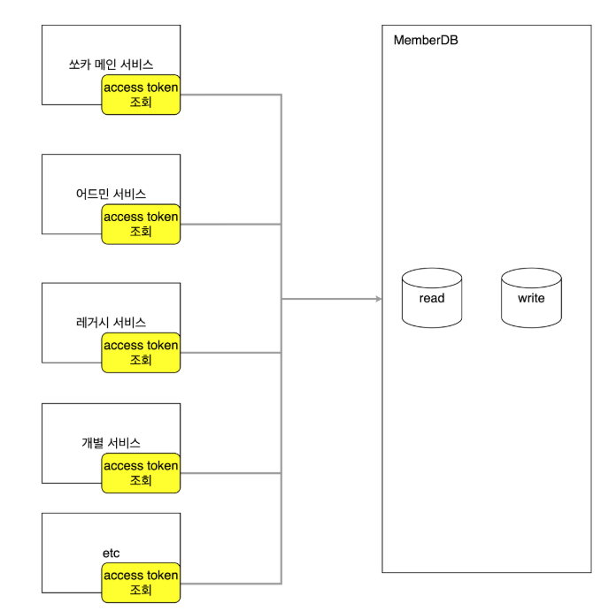
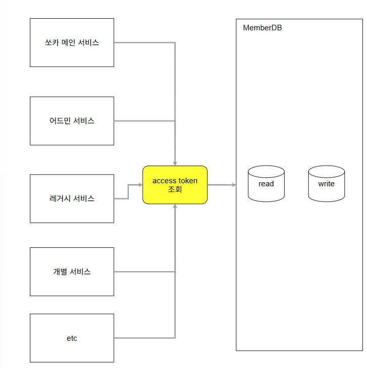
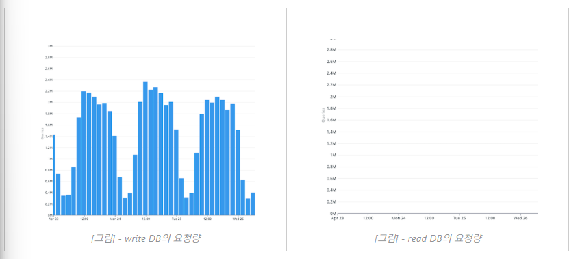
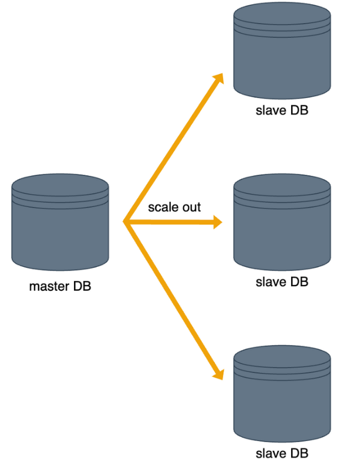
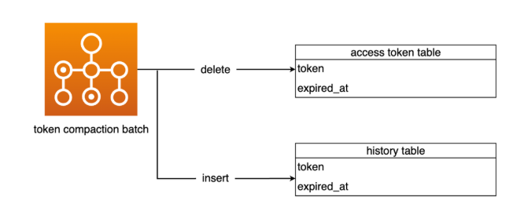
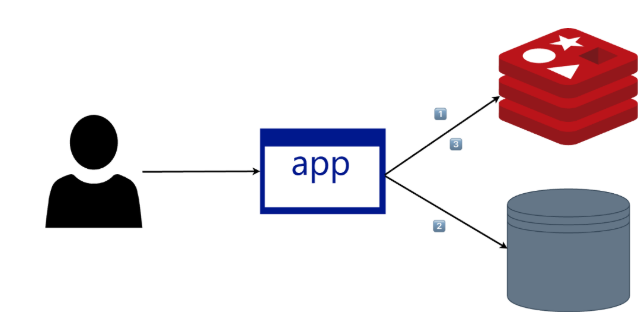
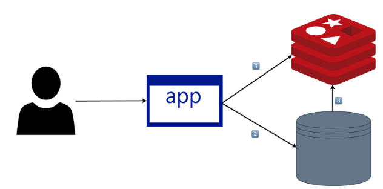
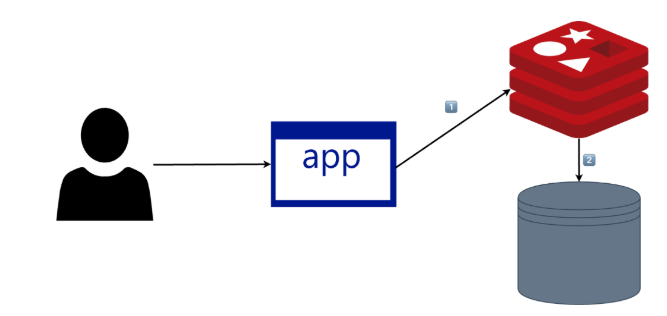
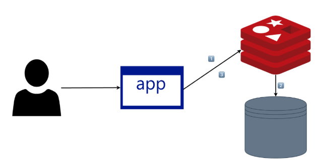

# 쏘카의 대규모 인증토큰 트래픽 대응 : 개발기

- 읽은 날짜: 2025-12-30
- 회사/작성 주체: 쏘카
- 원문: [쏘카의 대규모 인증토큰 트래픽 대응 : 개발기](https://tech.socarcorp.kr/dev/2023/06/27/handling-authentication-token-traffic-01.html)

---

## 1. 인증 토큰 로직을 전용 서비스로 분리

### 1.1 문제 상황


초기 구조에서는:

- 인증 토큰을 다루는 메인 계정 서비스
- PHP로 작성된 레거시 서비스 여러 개
- 기타 레거시 서비스들
  모두가 **각자 DB에 직접 접속해서 인증 토큰을 조회/갱신**하고 있었다.
  이 구조의 문제는 다음과 같다.
- DB 연결 설정을 바꾸려면
  → 인증 토큰을 쓰는 **모든 서비스**를 찾아서 설정을 수정해야 한다.
- 인증 로직을 수정하려면
  → 여러 프로젝트에 똑같은 패치를 반복해야 한다.
- 어느 한 서비스라도 빼먹으면
  → 설정이 엇갈리거나, 일부만 변경되어 장애가 날 수 있다.
  즉, **같은 인증 기능이 여러 코드베이스에 분산된 상태**라서
  설정 변경, 스키마 변경, 정책 변경에 반복 작업과 실수 가능성이 커진 상황이었다.

### 1.2 해결 방법 – 인증 검증 전용 계정 서비스


해결 방향은 단순하다.

- DB에 직접 접근하는 주체를 줄이고
- **“인증 토큰 검증/발급/관리”는 계정 서비스 하나만 담당하도록** 만드는 것.
  각 서비스는:
- DB에 직접 쿼리를 날리지 않고
- 계정 서비스의 API를 통해 “이 토큰이 유효한지”, “로그아웃 처리해달라” 같은 요청만 보낸다.
  이렇게 하면:
- DB 연결 설정 변경, 스키마 변경은 **계정 서비스 한 곳에서만** 처리하면 된다.
- 인증 정책을 바꾸더라도, 로직을 수정할 곳은 계정 서비스뿐이다.
- 중복 구현이 제거되고, 기능 변경 시 영향 범위가 명확해진다.
  정리하면, 첫 단계는 **인증 관련 책임을 하나의 서비스로 통합하는 리팩터링**이었다.

---

## 2. DB 부하 분산 – write/read 분리

### 2.1 문제 상황


구성은 이미 다음과 같았다.

- write DB (마스터)
- read only DB (슬레이브들)
  하지만 실제 쿼리는 대부분:
- 서비스 코드가 **write DB만 바라보도록 설정**되어 있어
- 단순 조회도 전부 write DB로 몰리는 상황이었다.
  결과적으로:
- write DB는 **읽기/쓰기 요청을 모두 처리**하면서 부담이 커지고,
- read DB는 거의 활용되지 못하고 있었다.

### 2.2 해결 방향 – scale out, read DB 적극 활용

선택지 두 가지를 비교했다.

1. scale up: write DB 스펙을 키움
   - 일시적인 해결책이며, 이미 고사양 장비를 쓰고 있다면 한계가 있다.
   - 장애 없는 교체도 쉽지 않다.
2. scale out: read DB를 늘리고, **읽기 트래픽을 분산**시킴 - read replica를 추가적으로 확장할 수 있다. - 쓰기와 읽기의 부하를 분리할 수 있다.
   여기서는 **scale out + read DB 활용 극대화**를 선택했다.
   

### 2.3 적용 방식 1 – LazyConnectionDataSourceProxy + readOnly 트랜잭션

일반적으로 많이 쓰는 방식은 다음과 같다.

- `LazyConnectionDataSourceProxy`를 사용해서,
- 트랜잭션이 시작될 때 커넥션을 확정하지 않고,
- 실제로 커넥션이 필요해지는 시점에 “이 트랜잭션이 readOnly인지” 검사한 뒤
  -\> read라면 read DB, 그 외에는 write DB로 라우팅하는 방식이다.
  예시 코드는 다음과 같은 형태가 된다.

```kotlin
class DynamicRoutingRoutingDataSource : LazyConnectionDataSourceProxy() {
    lateinit var writeDataSource: DataSource
    lateinit var readDataSource: DataSource

    override fun getTargetDataSource(): DataSource {
        return if (TransactionSynchronizationManager.isCurrentTransactionReadOnly()) {
            readDataSource
        } else {
            writeDataSource
        }
    }
}


```

- `@Transactional(readOnly = true)`인 경우 → read DB
- 일반 트랜잭션 or 쓰기 트랜잭션 → write DB

### 2.4 적용 방식 2 – MariaDB Aurora Protocol (드라이버 레벨 분산)

쏘카 프로젝트에서는 다음 조건 때문에 다른 방식을 택했다.

- 개발 기간이 짧고, 코드 변경을 최소화해야 했다.
- 새로 만든 계정 서비스는 **Aurora protocol을 지원하는 MariaDB Connector 2.7** 버전을 사용하고 있었다.
  MariaDB Aurora 프로토콜을 이용하면:
- 드라이버 URL에 write endpoint와 read endpoint를 같이 넣어주고
- 드라이버가 내부적으로 write/read를 분산 처리한다.
- failover까지 지원한다.
  형식 예시는 다음과 같다.

```yaml
spring:
  datasource:
    url: jdbc:mariadb:aurora/<write_cluster_endpoint>,<read_cluster_endpoint>
    hikari:
      driver-class-name: org.mariadb.jdbc.Driver
```

이 방법의 장점은:

- 코드 레벨 변경을 최소화하면서
- write/read 부하 분산과 장애 대응까지 동시에 얻을 수 있다는 점이다.
  Aurora 프로토콜이 3.x에서는 지원되지 않는 제약은 있지만,
  당시 환경에서는 **가장 빠르게 효과를 낼 수 있는 선택지**였다.

### 2.5 결과

- 인증 토큰 조회 요청이 write DB와 read DB로 나뉘어졌고,
- write DB에 몰리던 부하가 read DB로 분산되었다.
- 그 결과, write DB의 과부하 위험이 낮아지고, 응답 속도도 개선되었다.

---

## 3. 인증 토큰 테이블에서 만료 토큰 분리

### 3.1 문제 상황

인증 토큰 테이블은 다음과 같이 운영되고 있었다.

- 현재 유효한 토큰뿐 아니라,
- 이미 만료된 토큰도 **같은 테이블에 계속 보관**하고 있었다.
- 전체 row 수는 약 2,800만 건 수준.
  InnoDB의 B+tree 인덱스 특성상:
- 검색은 `O(log n)`으로 빠르지만,
- 데이터 삽입/삭제/수정 시 트리 재구성 비용이 발생한다.
- 데이터가 많을수록 인덱스 유지 비용이 커진다.
  실제 문제는 다음과 같이 나타난다.
- 쓰기 작업 시 인덱스 재구성과 row 이동이 오래 걸리고,
- 해당 구간에는 락이 잡히기 때문에,
- **읽기 작업도 락 대기**로 인해 지연된다.
  즉, 조회 성능을 위해 인덱스를 걸어두었지만,
  만료된 토큰이 너무 많이 쌓여 **쓰기와 읽기 모두에 부하를 주는 상태**였다.

### 3.2 고려한 방안 세 가지

1. **모든 토큰을 한 테이블에 그대로 유지**
   - 구현 변경이 거의 필요 없다.
   - 하지만 데이터가 계속 쌓이며 인덱스 비용과 락 경합 문제는 해결되지 않는다.
2. **만료된 토큰을 모두 삭제**
   - 테이블은 가벼워지지만,
     고객센터/운영에서 “인증 이력”을 조회하는 요구에 영향을 줄 수 있다.
   - 어떤 기능이 이 로그를 참조하는지 영향도 분석에 시간이 많이 든다.
3. **만료된 토큰을 별도 테이블로 분리** - “현재 유효한 토큰”만 본 테이블에 남긴다. - 만료된 토큰은 다른 테이블 + 필요하면 다른 저장소로 옮겨서 운영용 이력으로 사용한다.
   프로젝트의 목표(단기간 내 DB 부하 개선)와 일정(촉박한 기간)을 고려해,
   3번 전략을 택했다.

### 3.3 적용 방식 – 2단계 배치로 분리


만료 토큰 분리는 다음 두 단계로 진행했다.

1. **1회성 대량 이동 배치 (Step 1)**
   - 신규 “만료 토큰용 테이블” 생성.
   - 기존 인증 토큰 테이블에서 “만료된 토큰”을 선택적으로 가져와
     만료 토큰 테이블로 옮기고, 기존 테이블에서는 삭제.
   - 한 번에 모든 데이터를 이동하면 CPU 사용량과 부하가 급상승하므로,
     - 여러 날에 걸쳐 나누고,
     - 배치당 처리 건수를 제한하는 방식으로 점진적으로 진행.
2. **정기 배치 (Step 2)**
   - 이후에는 1시간 단위 배치를 돌려,
   - 새로 만료된 토큰들을 지속적으로 “만료 테이블로 이동 + 원본 삭제”.
   - 이를 통해 본 테이블에는 항상 **유효 토큰만 남도록** 유지.

### 3.4 결과

- Step1 이후, 인증 토큰 테이블의 row 수가 약 86% 감소하여 약 200만 건 수준이 되었다.
- 이후에도 정기 배치로 만료 토큰을 계속 분리하여,
  - 본 테이블의 크기를 안정적으로 유지할 수 있었다.
- 그 결과, 인덱스 재구성 비용이 줄고, 쓰기/읽기 작업 모두 성능이 개선되었다.

---

## 4. Redis 캐시 레이어 적용

### 4.1 문제 상황

지금까지의 개선으로:

- 인증 검증 로직은 계정 서비스 한 곳으로 모였고,
- write / read DB 부하도 분산되었고,
- 테이블도 슬림해졌다.
  그러나 인증 토큰 특성상:
- “토큰 조회” 요청이
  생성/수정/만료보다 **압도적으로 많다.**
- 모든 요청에서 인증 토큰 검증이 필요하기 때문에, - 트래픽 증가 시 read DB에도 다시 부담이 커질 수 있다.
  여기서 추가 목표는:
  > “read DB 쿼리 횟수 자체를 줄이자.”

### 4.2 캐시 레이어 개념

여기서 도입한 것이 Redis 캐시 레이어이다.

- 자주 조회되는 데이터를 메모리 기반 key-value 저장소에 둔다.
- 캐시에서 먼저 조회하고, 없을 경우에만 DB로 내려간다.
- 시간 복잡도는 O(1)에 가깝고, DB 접근 수를 크게 줄일 수 있다.

### 4.3 캐시 전략 후보 정리

여러 캐시 전략이 존재한다. 본문에서는 대표적인 다섯 가지를 정리했다.

1. **Look-aside**
   
   - 조회 시:
     - 캐시 조회 → 있으면 그대로 반환
     - 없으면 DB 조회 → 응답 + 캐시에 저장
   - 쓰기 시:
     - 보통 DB만 갱신, 캐시 업데이트/삭제는 구현에 따라 별도 처리
   - 서버가 캐시 갱신 주체가 된다.
2. **Read-through**
   
   - 조회 시:
     - 캐시 조회 → 없으면 캐시가 DB에서 읽어와 저장 후 반환
   - 서버는 “캐시에게만” 요청하고,
   - 캐시 스토어(또는 그 뒤의 로직)가 DB 접근과 캐시 적재를 모두 담당한다.
3. **Write-back**
   
   - 쓰기 시:
     - 캐시에만 먼저 쓰고,
     - 일정 주기 또는 조건에 맞춰 DB에 반영한다.
   - DB 부하를 줄일 수 있지만, 캐시 장애 시 데이터 유실 위험이 존재한다.
4. **Write-through**
   

- 쓰기 시:
  - 캐시와 DB에 동시에 쓴다.
- 데이터 일관성이 높지만, 쓰기 비용이 크다.

1. **Write-around**
   - 쓰기 시:
     - 캐시를 거치지 않고 DB에만 기록한다.
   - 조회 시:
     - 캐시 미스가 나면 DB 조회 후 캐시에 저장한다.
   - 쓰기 요청이 상대적으로 적고, 조회가 많은 경우에 적합하다.

### 4.4 쏘카의 선택 – Look-aside + Write-around 조합

인증 토큰 조회 패턴은 두 가지가 있었다.

1. 토큰 값으로 조회
2. 멤버 ID로 해당 멤버의 토큰들 조회
   모든 패턴을 캐시에 동시에 올려서 관리하려고 하면:

- 캐시 키 종류가 늘어나고,
- 쓰기/삭제 시 각각의 키를 정합성 있게 갱신해야 해서 구현 복잡도가 높아진다.
  또한, 인증 토큰은:
- 쓰기(발급/바꿈/만료)는 상대적으로 적고,
- 조회는 매우 많다.
  이 특성을 고려해 다음 조합을 선택했다.
- **조회 전략: Look-aside**
  - 조회 시:
    - Redis에서 먼저 조회.
    - 없으면 DB 조회 후 Redis에 저장.
- **쓰기 전략: Write-around + 캐시 삭제** - 쓰기/수정/삭제 시: - DB만 업데이트. - 관련 캐시 키는 “갱신”이 아니라 “삭제”한다. - 이후 첫 조회 시: - 다시 DB에서 읽어와 캐시에 적재된다.
  이렇게 하면:
- 캐시 적중률 덕분에 read DB 쿼리 횟수가 줄어들고,
- 쓰기 시 캐시 정합성 문제는 “삭제”로 단순화된다.

### 4.5 결과

- Redis 캐시 적용 후 read DB로 들어가는 인증 토큰 조회 쿼리가 감소했다.
- 계정 서비스 전체 latency도 캐시 도입 전보다 눈에 띄게 줄어들었다.
- 최종적으로 “대규모 인증 토큰 트래픽”에 대한 대응력이 강화되었다.

---

## 5. 전체 정리

쏘카의 인증 토큰 트래픽 대응 과정은 다음 네 단계로 정리할 수 있다.

1. **책임 분리**
   - 여러 프로젝트에 분산된 인증 토큰 로직을 **계정 서비스 한 곳으로 통합**했다.
   - 설정 변경, 정책 변경 시 영향 범위를 줄이고 개발 생산성을 높였다.
2. **읽기/쓰기 분리**
   - write DB와 read DB 구조를 제대로 활용해,
   - 조회용 트래픽을 read DB로 분산했다.
3. **데이터 볼륨 관리**
   - 만료된 토큰을 별도 테이블로 옮겨,
   - 본 토큰 테이블의 row 수와 인덱스 비용을 줄였다.
4. **캐시 도입** - Redis 캐시 레이어를 도입하고 Look-aside + Write-around 전략을 사용해, - read DB 요청을 줄이고 응답 속도를 개선했다.
   결과적으로, 단순한 “권한 기능 추가” 요구에서 출발해,

- 인증 토큰 설계
- DB 구조
- 데이터 볼륨
- 캐시 계층
  까지 전반적인 구조를 개선한 사례라고 볼 수 있다.

---

## 6. 느낀점

이번 글을 보면서, 단순히 토큰 검증 성능 개선이 아니라 인증 로직, DB 구조, 데이터 볼륨, 캐시 전략까지 **전 계층을 아우르는 설계 문제**라는 걸 느꼈다.
앞으로 내 시스템에서도 **책임 분리 → 읽기/쓰기 분리 → 데이터 정리 → 캐시 도입** 순서로 차분히 쪼개서 접근해 보고 싶다는 생각이 들었다.
