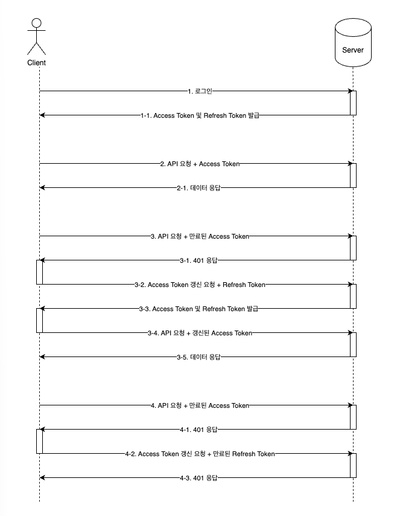
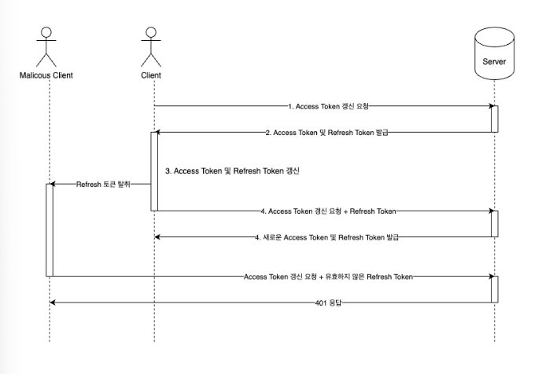
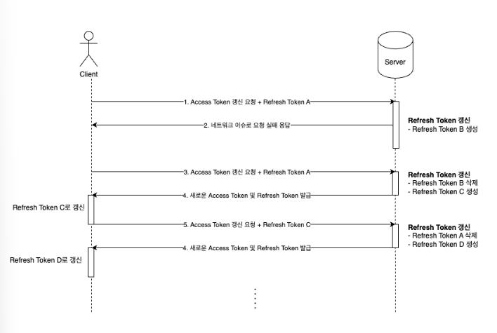

# 단지 권한 기능을 추가해달라고 했을 뿐인데(feat. 인증 기능 개선)

- 읽은 날짜: 2026-01-02
- 회사/작성 주체: 스포카
- 원문: [단지 권한 기능을 추가해달라고 했을 뿐인데(feat. 인증 기능 개선)](https://spoqa.github.io/2025/04/18/improve-auth.html)

---

## 1. 들어가며

키친보드 매장 앱에 “권한 관리 기능을 추가해 달라”는 요구로 시작된 작업이지만, 실제로는 **인증 구조 전반을 손보는 프로젝트**로 이어졌다.
이 글에서는

- 왜 기존 JWT 방식으로는 권한 기능을 안전하게 지원하기 어려웠는지
- 이를 해결하기 위해 Access/Refresh Token, Refresh Token Rotation, Token Family, 라이브러리 교체, TokenManager 설계를 어떻게 했는지
- Spring Security에서 권한 검증을 어떻게 유연하게 바꿨는지
  를 순서대로 정리한다.

---

## 2. 기존 JWT 인증 방식의 한계

키친보드 매장 앱에서는 식자재 주문, 결제, 월 거래 내역 조회 등 기능을 제공한다.
권한 기능이 도입되면서 “매장 사장님은 볼 수 있지만 직원은 볼 수 없어야 하는 정보(월 거래 내역 등)”가 생겼다.
여기서 문제가 된 것은 기존 JWT 방식의 특성이다.

- JWT는 **stateless**하다. 서버가 세션을 들고 있지 않고, 토큰 자체에 사용자 정보와 권한을 담아서 클라이언트가 들고 다닌다.
- 한 번 발급된 Access Token은 **만료 전까지 서버 마음대로 회수하거나 내용(권한)을 바꿀 수 없다**.
  즉, 서버 DB에서 사용자의 권한을 바꿔도:
- 이미 발급된 Access Token 안에는 예전 권한이 들어 있고
- 그 토큰이 만료되기 전까지는 클라이언트가 **계속 예전 권한으로 요청을 보낼 수 있다**.
  이 때문에
- 권한 변경을 “즉시” 반영하기 어렵고
- Access Token을 탈취당했을 때도, 만료 전까지는 공격자가 정상 사용자처럼 행동할 수 있다.
  이 두 가지를 동시에 개선하는 방향으로 인증 방식을 다시 설계하게 되었다.

---

## 3. Access Token / Refresh Token 구조 도입

먼저 **Access Token + Refresh Token 구조**를 도입한다.

- **Access Token**
  - 만료 시간을 짧게 둔다.
  - 탈취되더라도 사용할 수 있는 시간이 짧도록 만든다.
- **Refresh Token** - 서버가 상태를 관리한다. - Access Token이 만료되었을 때 **새 Access Token을 발급받는 용도**로 사용한다. - 유효기간은 Access Token보다 길게 가져간다.
  
  인증 흐름은 다음과 같이 구성한다.

1. 사용자가 로그인 요청을 보낸다.
2. 서버는 Access Token, Refresh Token을 함께 발급한다.
3. 사용자는 Access Token으로 API를 호출하고, 서버는 정상 응답을 한다.
4. Access Token이 만료된 상태로 API를 호출하면 서버는 401을 응답한다.
5. 클라이언트는 Refresh Token으로 “토큰 갱신” API를 호출한다.
6. 서버는 Refresh Token을 검증한 뒤, 새 Access Token을 발급한다.
7. Refresh Token까지 만료되었다면 다시 로그인하도록 요구한다.
   이 구조를 통해

- Access Token의 만료 시간을 짧게 가져가 **탈취 위험을 줄이고**
- Refresh Token을 통해 **사용자가 자주 로그인하지 않아도 되게 할 수 있다**.

---

## 4. Refresh Token 탈취 위험과 Rotation

Access Token에만 탈취 위험이 있는 것은 아니다.
Refresh Token이 탈취되면 공격자는 새 Access Token을 무한히 발급받을 수 있다.
이를 막기 위해 **Refresh Token Rotation**을 적용한다.

- Refresh Token으로 Access Token을 갱신할 때마다
  - Access Token만 새로 발급하는 것이 아니라
  - **Refresh Token도 새로 발급한다.**
- 이전 Refresh Token은 더 이상 사용할 수 없게 만든다.
  → Refresh Token을 **1회용**에 가깝게 사용한다.
  
  이렇게 하면 공격자가 Refresh Token을 탈취하더라도
- 그 토큰이 이미 사용되어 Rotation이 진행됐다면
- 탈취한 Refresh Token으로는 갱신이 실패하게 된다.
  다만, 여기에서 클라이언트 네트워크 이슈라는 현실적인 문제가 발생한다.

---

## 5. 네트워크 이슈와 Token Family

모바일 환경에서

- 엘리베이터, 지하 등 네트워크가 불안정한 구간에서 요청이 중복 전송되거나
- 첫 번째 Refresh 요청이 성공했는지 여부를 클라이언트가 확신하지 못하는 상황이 생길 수 있다.
  Refresh Token Rotation을 엄격하게 적용하면
- 첫 번째 Refresh 요청에서 이미 Rotation이 끝났는데
- 네트워크 문제로 응답을 받지 못한 클라이언트가 같은 Refresh Token으로 다시 요청할 수 있다.
- 이때 기존 로직이라면 두 번째 요청부터는 모두 실패(401)가 된다.
  이를 해결하기 위해 **Token Family 방식**을 도입한다.
  
- Refresh Token을 매번 완전히 지우는 대신,
  - Refresh Token들을 하나의 “패밀리”로 관리한다.
- Token Family에 속한 “과거 토큰”을 일정 조건에서 인정해 주어, - 첫 번째 요청에서 새 토큰 발급이 되었든, - 네트워크 이슈로 다시 기존 토큰으로 요청하든, - **합리적인 범위 내에서 토큰 갱신을 허용**한다.
  이 방식으로
- 보안성(탈취 시 무한 사용 방지)과
- 현실적인 네트워크 이슈 대응을 동시에 만족하도록 구성한다.

---

## 6. 인증 토큰 하위 호환과 JJWT 버전 변경

권한 변경을 즉시 반영하기 위한 또 다른 방법은 **비밀키를 변경하는 것**이다.

- 기존 Access Token을 서명하던 비밀키를 새 키로 교체하면
  - 기존 키로 서명된 토큰은 더 이상 검증에 통과하지 못한다.
- 이 방식으로 “기존 토큰 일괄 만료” 효과를 얻을 수 있다.
  이 과정에서 팀은 서명 알고리즘도 **HS256 → PS256**으로 변경하기로 결정한다.
- PS256은 RSA-PSS 기반 비대칭키 서명 알고리즘으로, 보안성이 더 높다.
- 이를 사용하려면 JJWT 라이브러리 버전을 올려야 하는데, - 기존에 쓰던 `io.jsonwebtoken:jjwt:0.9.1`와 - 신규 버전(`jjwt-api`, `jjwt-impl`, `jjwt-jackson`)이 의존성 충돌을 일으킨다.
  이를 해결하기 위해 다음과 같은 전략을 선택한다.

1. JJWT를 fork하여 **Spoqa용 JJWT 저장소**를 만든다.
2. 기존 버전의 패키지명을 변경한다.
   → 중앙 저장소와 충돌하지 않도록 네임스페이스를 분리한다.
3. GitHub + JitPack을 이용해 패키지명 변경된 JJWT를 의존성으로 추가한다.
   이렇게 하면

- 기존 로직은 fork한 JJWT를 사용하고
- 신규 로직은 공식 JJWT 0.12.6을 사용할 수 있어
- 과거 Access Token과 새 Access Token을 동시에 처리할 수 있는 기반이 마련된다.

---

## 7. LegacyJwtProcessor + JwtProcessor로 하위 호환 유지

서명 알고리즘/비밀키가 변경되면, 기존 앱이 들고 있는 Access Token을 새 서버에서 바로 쓸 수 없게 된다.
앱 배포와 서버 배포 시점이 항상 같지 않기 때문에, **기존 버전 앱도 일정 기간 서비스가 가능해야 한다.**
이를 위해 다음과 같이 설계한다.

- **LegacyJwtProcessor**
  - 과거 JJWT 버전 및 HS256, 기존 키를 사용하는 JWT 파서/검증기
- **JwtProcessor** - 신규 JJWT 버전 및 PS256, 신규 키를 사용하는 JWT 파서/검증기
  그리고 `JwtAuthenticationProvider`에서

```kotlin
val principal =
    try {
        jwtProcessor.getPrincipal(token)
    } catch (e: AuthenticationException) {
        legacyJwtProcessor.getPrincipal(token)
    }


```

처럼

1. 먼저 신규 JwtProcessor로 검증을 시도하고
2. 실패하면 LegacyJwtProcessor로 다시 시도한다.
   이렇게 하면

- 서버가 먼저 배포되더라도
- 기존 앱이 들고 있는 Access Token도 일정 기간 정상적으로 동작한다.
- 새 앱은 신규 알고리즘과 키로 발급된 토큰을 사용한다.

---

## 8. 인증 처리 구조 개선

### 8.1 CompositeJwtProcessor

```kotlin
interface JwtProcessor {
    fun generateToken(principal: UserPrincipal): String
    fun getPrincipal(token: String): UserPrincipal
}

class CompositeJwtProcessor(
    private val newJwtProcessor: JwtProcessor,
    private val legacyJwtProcessor: JwtProcessor,
) : JwtProcessor {
    override fun generateToken(principal: UserPrincipal): String {
        // 보통 신규 프로세서에 위임
    }
    override fun getPrincipal(token: String): UserPrincipal {
        return try {
            newJwtProcessor.getPrincipal(token)
        } catch (e: AuthenticationException) {
            legacyJwtProcessor.getPrincipal(token)
        }
    }
}


```

이렇게 두면

- 클라이언트(예: `JwtAuthenticationProvider`)는 `JwtProcessor`만 의존한다.
- 내부적으로 신규/레거시 프로세서를 순차적으로 시도한다.
- 나중에 LegacyJwtProcessor를 제거하더라도 Composite 내부만 수정하면 된다.

### 8.2 TokenManager

다른 방향으로, **Jwt 처리 + Refresh Token 처리 + Rotation/Token Family를 모두 모으는 상위 서비스**를 두는 방법이다.

```kotlin
@Service
class TokenManager(
    private val jwtProcessor: JwtProcessor,
    private val legacyJwtProcessor: LegacyJwtProcessor,
    private val refreshTokenService: RefreshTokenService,
) {
    fun getPrincipal(token: String): UserPrincipal {
        return try {
            jwtProcessor.getPrincipal(token)
        } catch (e: AuthenticationException) {
            legacyJwtProcessor.getPrincipal(token)
        }
    }

    fun generateAccessToken(userPrincipal: UserPrincipal): String { /* ... */ }
    fun generateRefreshToken(entity: RefreshToken): String { /* ... */ }
    fun replaceRefreshToken(principal: RefreshTokenUserPrincipal): String { /* ... */ }
}


```

이 방식의 특징은 다음과 같다.

- JWT 관련 하위 호환 처리
- Access/Refresh Token 발급
- Token Rotation, Token Family 등 정책
  을 **TokenManager 한 곳으로 모아 응집도를 높인다**.
  팀은 다음과 같은 이유로 TokenManager 방식을 선택한다.
- LegacyJwtProcessor는 앱 배포 이후 제거될 예정인 임시 요소이다.
- 이 임시 요소를 위해 별도의 Composite 구조를 유지하는 것보다
- 토큰 관련 기능을 모두 TokenManager로 모으는 편이 더 실용적이고 관리하기 쉽다.

---

## 9. Spring Security로 인증/인가 구조 정리

### 9.1 Access Token 기반 인증

인증 측면에서는 `AccessTokenAuthenticationProvider`와 `AccessTokenAuthenticationToken`을 사용한다.

```kotlin
@Component
class AccessTokenAuthenticationProvider(
    private val tokenManager: TokenManager,
) : AuthenticationProvider {
    override fun authenticate(authentication: Authentication): Authentication? {
        if (!supports(authentication::class.java)) return null

        val principal = tokenManager.getPrincipal(authentication.principal.toString())
        return AccessTokenAuthenticationToken(principal)
    }

    override fun supports(authentication: Class<*>): Boolean {
        return authentication == AccessTokenPreAuthenticationToken::class.java
    }
}

class AccessTokenAuthenticationToken(
    private val principal: UserPrincipal,
) : AbstractAuthenticationToken(principal.authorities) {
    init {
        super.setAuthenticated(true)
    }

    override fun getPrincipal() = principal
    override fun getCredentials() = null
}


```

인증 흐름은 다음과 같다.

1. 필터에서 `Authorization: Bearer` 헤더에서 토큰을 꺼낸다.
2. `AccessTokenPreAuthenticationToken`으로 포장해 `AuthenticationManager`에 전달한다.
3. `AccessTokenAuthenticationProvider`에서
   - `tokenManager.getPrincipal(token)`으로 토큰을 검증하고
   - `UserPrincipal`을 생성한다.
4. 인증에 성공하면 `AccessTokenAuthenticationToken(UserPrincipal)`을 반환하고
5. Spring Security는 이 토큰을 `SecurityContext`에 저장한다.
6. 이후 컨트롤러에서 `@AuthenticationPrincipal` 등을 통해 `UserPrincipal`을 사용한다.

### 9.2 @Secured의 한계와 @PreAuthorize 도입

기존에는 `@Secured` 애너테이션으로 권한을 체크한다.

```kotlin
@DgsMutation
@Secured(STORE_ADMIN, STORE_MANAGER, VENDOR)
fun createOrderSheet(...) { ... }


```

이 방식은 단순한 Role 기반 권한 체크에 적합하다.
하지만 권한이 세분화되면서 문제가 발생한다.

- 예를 들어, “매장 사용자” 안에서
  - `STORE_ADMIN`
  - `STORE_MANAGER`
  - (나중에) `STORE_INTERN`
    등으로 세분화되면,
- 매장 사용자 모두가 접근 가능한 API마다
  - `@Secured(STORE_ADMIN, STORE_MANAGER)`
  - 나중에는 `@Secured(STORE_ADMIN, STORE_MANAGER, STORE_INTERN)`
    이런 식으로 일일이 수정해야 한다.
- Role이 늘어날수록, 수정 누락과 중복이 쉽게 발생한다.
  이를 해결하기 위해 `@PreAuthorize`와 SpEL을 사용해 **권한 체크 로직을 추상화**한다.

```kotlin
@PostMapping("/replace-store")
@PreAuthorize("@authorizationExpressionHelper.isManager()")
fun replaceStore(@RequestBody request: ReplaceStoreRequest): ReplaceStoreResponse {
    // ...
}

@Service
class AuthorizationExpressionHelper {
    fun isManager(): Boolean {
        return PrincipalProvider.userPrincipal.isManager
    }
}


```

이렇게 구성하면

- 컨트롤러에서는 단순히 “매장 관리자 권한이 필요한 API”라는 의미만 표현한다.
- 실제로 어떤 Role을 “관리자”로 볼지는 `AuthorizationExpressionHelper.isManager()` 안에서 정의한다.
- 새로운 권한이 추가되거나 정책이 바뀔 때
  - 컨트롤러 애너테이션을 모두 수정하지 않고
  - 헬퍼 메서드 안의 로직만 수정하면 된다.

---

## 10. 마무리

이 글에서 소개한 작업은 “권한 기능을 추가해 달라”는 요구에서 출발했지만, 결국 다음과 같은 결과를 가져왔다.

- Access/Refresh Token, Rotation, Token Family 도입으로 **보안성과 사용성을 모두 개선**했고
- JJWT 버전/알고리즘 변경과 TokenManager 설계로 **하위 호환과 기술 부채를 처리**했으며
- Spring Security의 인증/인가 구조를 정리해
  **Role 나열 방식에서 정책 기반 표현(@PreAuthorize + SpEL)으로 전환**했다.
  권한 기능을 구현하는 과정에서 인증 구조 전반을 다시 설계하고, 기존에 미뤄두었던 기술 부채를 해소할 수 있었다.
