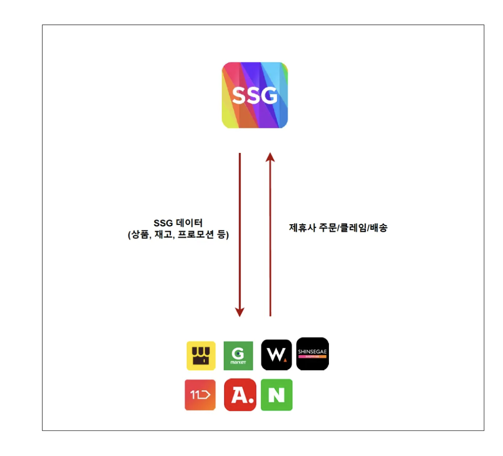
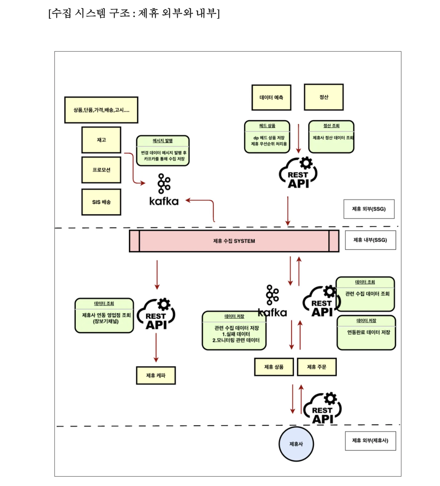
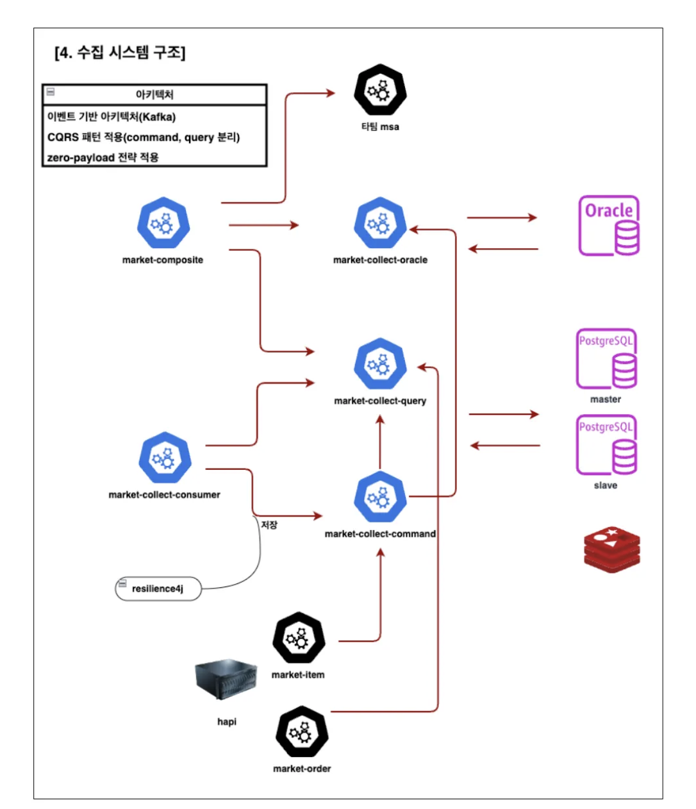
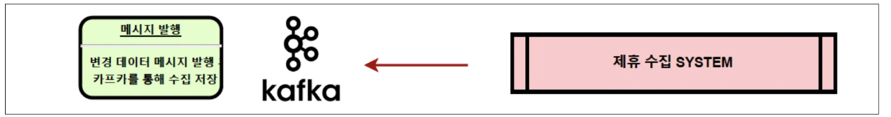
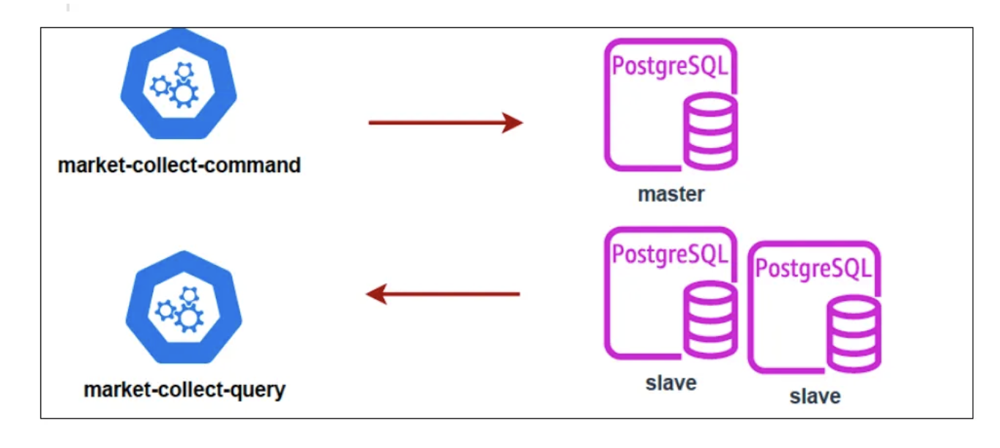
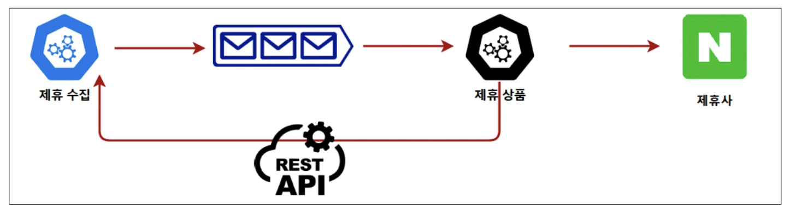
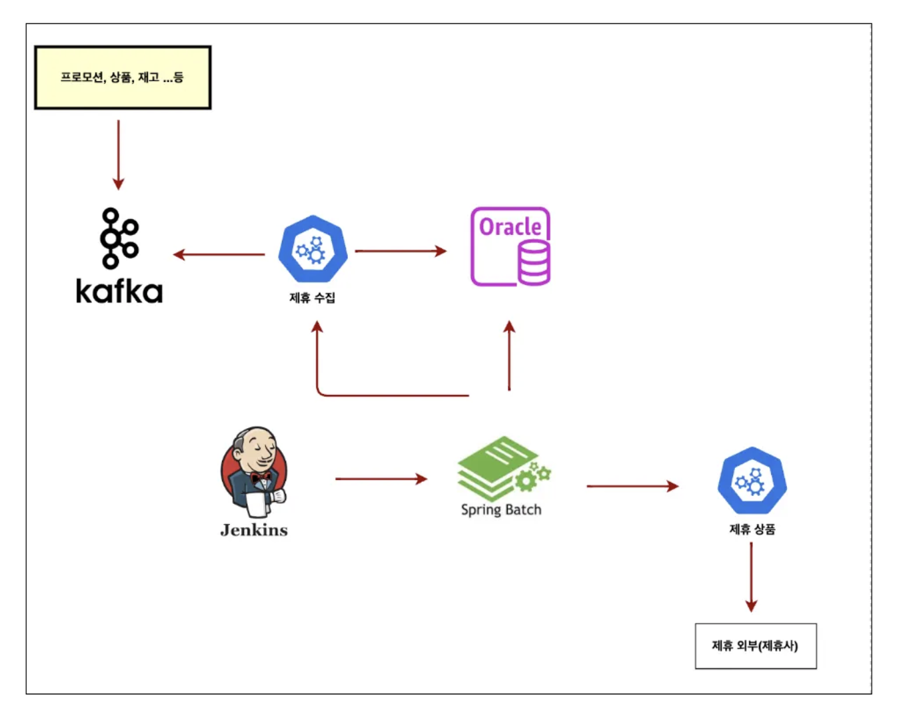
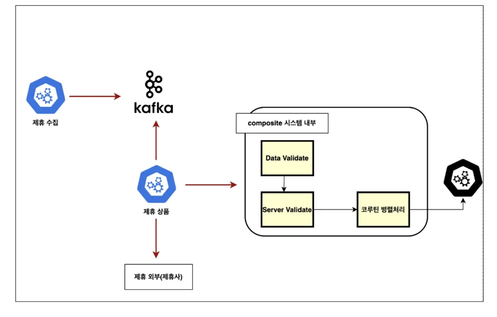
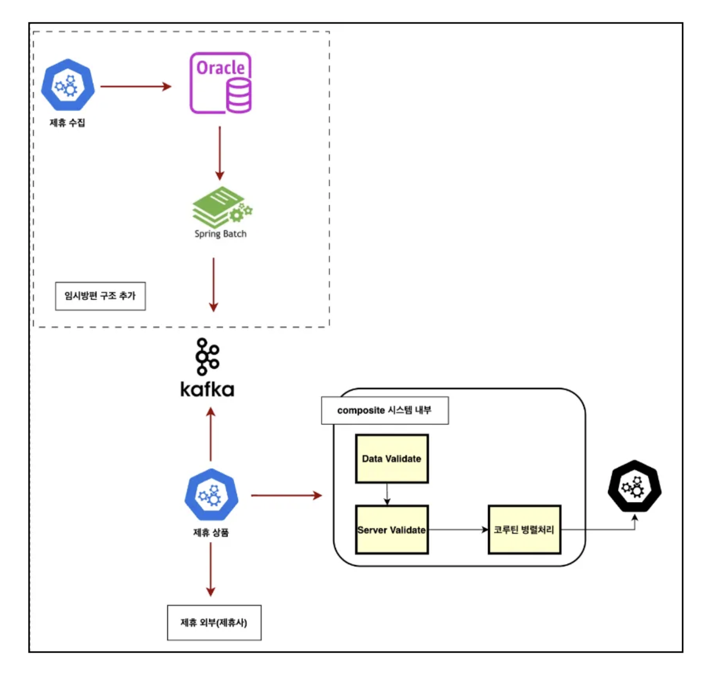
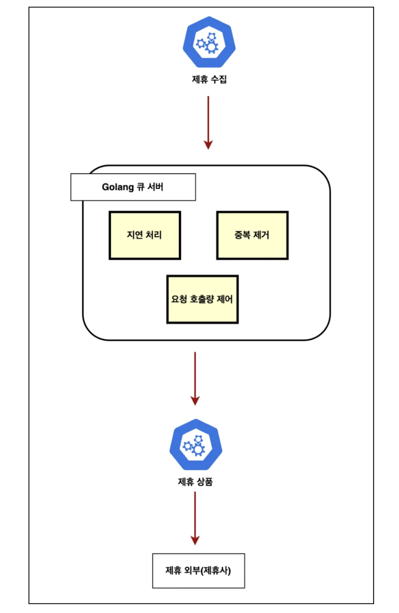

# 제휴 서비스 수집 시스템, 첫 설계부터 지금까지의 여정

- 읽은 날짜: 2026-05-13
- 회사/작성 주체: SSG.COM
- 원문: [제휴 서비스 수집 시스템, 첫 설계부터 지금까지의 여정](https://medium.com/ssgtech/%EC%A0%9C%ED%9C%B4-%EC%84%9C%EB%B9%84%EC%8A%A4-%EC%88%98%EC%A7%91-%EC%8B%9C%EC%8A%A4%ED%85%9C-%EC%B2%AB-%EC%84%A4%EA%B3%84%EB%B6%80%ED%84%B0-%EC%A7%80%EA%B8%88%EA%B9%8C%EC%A7%80%EC%9D%98-%EC%97%AC%EC%A0%95-deb0d80bb55e)

---


SSG 제휴 서비스 수집 시스템은 SSG 내부의 상품, 가격, 재고, 프로모션, 주문, 클레임, 배송 데이터를 외부 제휴사와 안정적으로 연동하기 위해 개선된 시스템이다.
예를 들어 SSG.COM의 상품이 네이버, 카카오, 11번가, G마켓, 옥션 같은 외부 플랫폼에서도 판매된다면, SSG 내부 데이터와 제휴사 데이터가 항상 비슷한 상태로 유지되어야 한다. 가격이 바뀌었는데 제휴사에는 예전 가격이 남아 있거나, 재고가 없는데 외부 플랫폼에서는 판매 가능 상태로 보이면 주문 오류나 고객 불만으로 이어질 수 있다.
따라서 이 시스템의 핵심은 단순히 데이터를 전달하는 것이 아니라, 변경된 데이터를 빠르게 감지하고, 제휴사별 요구사항에 맞게 가공하며, 안정적으로 연동하는 것이다.

---

## 1. 기존 Legacy 시스템의 구조

기존 시스템은 다음과 같은 방식으로 동작했다.

```text
Crontab
↓
Java Batch
↓
Oracle Procedure
↓
제휴사 데이터 전달
```

일정 시간마다 배치가 실행되고, 상품 테이블의 수정 시간을 기준으로 변경된 데이터를 조회한 뒤, Oracle Procedure에서 데이터를 집계하고 가공해서 제휴사에 전달하는 구조였다.
처음에는 이 방식도 충분히 사용할 수 있었다. 하지만 제휴사가 늘어나고, 상품 변경량이 많아지면서 여러 문제가 발생했다.

---

## 2. Legacy 시스템의 문제점

## 2-1. 대량 변경 시 성능 저하

기존 시스템은 수정 시간을 기준으로 변경 데이터를 조회했다.
예를 들어 10분마다 배치가 실행된다면, 최근 10분 동안 변경된 상품을 한 번에 조회한다.

```sql
SELECT *
FROM product
WHERE updated_at >= '2026-05-09 10:00:00'
  AND updated_at < '2026-05-09 10:10:00';
```

평소에는 문제가 없을 수 있지만, 대규모 할인 행사나 프로모션 변경으로 수십만 개의 상품이 한꺼번에 수정되면 문제가 생긴다.
배치 실행 시점에 대량의 데이터가 한 번에 조회되고 처리되면서 DB와 서버에 부하가 몰린다.

---

## 2-2. 불필요한 변경 데이터 처리

수정 시간이 바뀌었다고 해서 항상 제휴사에 필요한 데이터가 바뀐 것은 아니다.
예를 들어 상품의 내부 관리 메모만 바뀌었거나, 제휴사와 관계없는 컬럼이 수정되어도 `updated_at`은 변경될 수 있다.
그러면 시스템은 해당 상품을 변경 대상으로 인식하고 처리한다.
즉, 실제로 제휴사에 보낼 필요가 없는 데이터까지 조회하고 처리하는 문제가 생긴다.

---

## 2-3. Oracle Procedure에 로직이 강하게 결합됨

기존 시스템에서는 많은 비즈니스 로직이 Oracle Procedure 안에 들어가 있었다.
이런 구조에서는 로직을 수정하기 어렵다.
애플리케이션 코드처럼 Git으로 관리하고, 테스트하고, 배포하는 흐름이 상대적으로 어렵다. 또한 로직이 DB 내부에 숨어 있기 때문에 장애가 발생했을 때 원인을 추적하기도 어렵다.
결국 유지보수성이 떨어진다.

---

## 2-4. 배치 기반 구조의 한계

배치 시스템은 일정 주기마다 데이터를 한 번에 처리한다.
그래서 실시간성이 떨어진다.
데이터가 변경되어도 다음 배치 시간이 올 때까지 기다려야 한다.
또한 변경 데이터가 많을 경우 특정 시점에 서버 자원이 집중적으로 사용된다.

```text
데이터 변경 발생
↓
배치 시간까지 대기
↓
배치 실행
↓
대량 데이터 처리
↓
제휴사 전달
```

이 구조는 단순하지만, 대규모 트래픽과 실시간 연동이 필요한 환경에서는 한계가 있다.

## 3. 새로운 시스템의 목표


새로운 수집 시스템은 기존 배치 중심 구조의 한계를 해결하기 위해 설계되었다.
목표는 다음과 같다.

- 변경 데이터를 더 빠르게 감지한다.
- 실제 필요한 변경만 처리한다.
- 제휴사별 요구사항에 맞게 데이터를 가공한다.
- 대량 트래픽에서도 안정적으로 동작한다.
- 데이터 정합성을 유지한다.
- 유지보수와 확장이 쉬운 구조를 만든다.
  
  이를 위해 세 가지 핵심 아키텍처가 적용되었다.

```text
이벤트 기반 아키텍처
CQRS 패턴
Zero Payload 패턴
```

---

## 4. 이벤트 기반 아키텍처


이벤트 기반 아키텍처는 데이터가 변경되었을 때 즉시 이벤트를 발행하고, 해당 이벤트를 구독한 시스템이 처리하는 구조다.
기존 배치 방식은 “나중에 변경 데이터를 찾는 방식”이었다.
반면 이벤트 기반 구조는 “변경이 발생하면 바로 알려주는 방식”이다.

```text
SSG 내부 데이터 변경
↓
Kafka 이벤트 발행
↓
수집 시스템이 이벤트 구독
↓
변경 데이터 처리
↓
제휴사 연동
```

SSG 내부에서 상품 가격, 재고, 프로모션 등이 변경되면 Kafka를 통해 이벤트 메시지가 발행된다.
수집 시스템은 Kafka를 구독하고 있다가 해당 이벤트를 받아 처리한다.
이렇게 하면 배치 실행 시간을 기다리지 않고 변경 사항을 더 빠르게 반영할 수 있다.

---

## 4-1. 이벤트 기반 구조의 장점

이벤트 기반 구조의 가장 큰 장점은 변경이 발생했을 때만 처리한다는 점이다.
기존 배치 방식은 변경 사항이 없어도 정해진 시간이 되면 실행된다. 하지만 이벤트 기반 구조에서는 데이터 변경이 발생할 때만 이벤트가 만들어진다.
그래서 불필요한 작업을 줄일 수 있다.
또한 대량의 데이터를 한 번에 처리하는 것이 아니라, 이벤트 단위로 나누어 처리할 수 있다.

```text
배치 방식
변경 데이터를 모아서 한 번에 처리

이벤트 방식
변경이 발생할 때마다 나누어 처리
```

이로 인해 순간적인 서버 부하를 줄이고 더 빠르게 데이터를 반영할 수 있다.

## 4-2. 하지만 이벤트 기반이 항상 정답은 아니다

이벤트 기반 구조는 빠르다.
하지만 너무 빠른 것이 문제가 될 수도 있다.
SSG 내부 시스템은 Kafka 메시지를 빠르게 처리할 수 있지만, 외부 제휴사 API가 그 속도를 감당하지 못할 수 있다.
예를 들어 제휴사 API가 초당 100건까지만 허용하는데, Kafka Consumer가 초당 1,000건씩 API를 호출하면 Rate Limit에 걸릴 수 있다.
즉, 이벤트 기반 구조를 사용할 때는 속도 제어, 중복 처리, 실패 재처리까지 함께 설계해야 한다.

---

## 5. CQRS 패턴


CQRS는 Command Query Responsibility Segregation의 약자다.
쉽게 말하면 읽기와 쓰기를 분리하는 패턴이다.
제휴 수집 시스템은 쓰기보다 읽기 요청이 훨씬 많다.
상품 정보, 가격, 재고, 프로모션 데이터를 계속 조회해야 하기 때문이다.
블로그에서는 수집 Query 서비스의 RPS가 약 11K 수준이라고 언급한다.
RPS 11K는 초당 약 11,000건의 조회 요청이 발생한다는 의미다.
이 정도 조회 요청을 Master DB 하나에서 모두 처리하면 부하가 커질 수 있다.
그래서 쓰기와 읽기를 분리한다.

```text
쓰기 요청
↓
Master DB

읽기 요청
↓
Slave DB 1
Slave DB 2
```

쓰기 작업은 Master DB에서 처리한다.
읽기 작업은 Slave DB로 분산한다.

---

## 5-1. CQRS를 적용한 이유

Master DB는 데이터 변경을 처리하는 핵심 DB다.
그런데 읽기 요청까지 Master DB에 몰리면 쓰기 작업에도 영향을 줄 수 있다.
CQRS를 적용하면 Master DB는 쓰기에 집중하고, 조회 요청은 Slave DB가 나누어 처리할 수 있다.
이렇게 하면 전체 시스템의 성능과 안정성을 높일 수 있다.

---

## 5-2. CQRS의 주의점

CQRS를 적용하면 읽기 성능은 좋아질 수 있지만, 복제 지연 문제가 생길 수 있다.
Master DB에 데이터가 저장된 뒤 Slave DB로 복제되기까지 약간의 시간이 걸릴 수 있다.
이를 Replication Lag라고 한다.
그래서 방금 변경된 데이터가 Slave DB에서는 아직 보이지 않을 수 있다.
따라서 강한 정합성이 필요한 요청은 Master DB를 조회해야 할 수도 있고, 약간의 지연을 허용할 수 있는 조회만 Slave DB로 보내는 설계가 필요하다.

---

## 6. Zero Payload 패턴


Zero Payload 패턴은 이벤트 메시지에 실제 데이터를 모두 담지 않고, 최소한의 식별 정보만 담는 방식이다.
예를 들어 상품 가격, 재고, 프로모션 정보를 모두 Kafka 메시지에 담는 대신, 상품 ID와 제휴사 ID, 변경 타입 정도만 담는다.

```json
{
  "apiType": "05",
  "itemId": "TEST001",
  "salestrNo": "6005",
  "chnlId": "0000000000"
}
```

이 메시지는 실제 상품 데이터를 담고 있지 않다.
대신 “어떤 상품의 어떤 정보가 변경되었다”는 신호 역할을 한다.
실제 제휴사에 전달할 데이터는 이벤트 처리 시점에 ID를 기준으로 다시 조회한다.

---

## 6-1. 왜 데이터를 직접 담지 않을까?

상품 데이터는 복잡하다.
상품명, 가격, 재고, 프로모션, 옵션, 배송 정보, 판매 상태 등 많은 정보가 있다.
이 모든 데이터를 이벤트 메시지에 담으면 메시지가 무거워진다.
또 상품 데이터 구조가 바뀔 때마다 이벤트 메시지 구조도 함께 바꿔야 한다.
이러면 이벤트를 발행하는 시스템과 소비하는 시스템이 강하게 연결된다.
반면 Zero Payload 방식은 메시지 구조를 단순하게 유지한다.
상품 데이터 구조가 바뀌어도 이벤트에는 여전히 상품 ID만 담으면 된다.

---

## 6-2. 최신 데이터 기준으로 연동할 수 있다

Zero Payload의 큰 장점은 최신 데이터 기준으로 처리할 수 있다는 점이다.
예를 들어 같은 상품의 가격이 짧은 시간 안에 여러 번 바뀌었다고 하자.

```text
10:00 가격 10,000원
10:01 가격 9,500원
10:02 가격 9,000원
```

이벤트 메시지에 가격을 직접 담으면 각 시점의 가격이 메시지에 남는다.
처리 순서가 꼬이거나 지연되면 오래된 가격이 나중에 반영될 위험이 있다.
하지만 Zero Payload 방식에서는 이벤트에 상품 ID만 담긴다.
그래서 실제 연동 시점에 상품 ID로 최신 데이터를 조회하면 된다.
결과적으로 현재 DB 기준 최신 가격인 9,000원을 연동할 수 있다.

```text
이벤트 수신
↓
itemId 확인
↓
최신 상품 데이터 조회
↓
제휴사 연동
```

---

## 6-3. Zero Payload의 단점

Zero Payload도 단점이 있다.
이벤트를 처리할 때마다 최신 데이터를 다시 조회해야 한다.
즉, 조회 부하가 증가한다.
그래서 이 구조는 CQRS와 함께 사용하면 효과적이다.
이벤트 메시지는 가볍게 유지하고, 최신 데이터 조회는 Slave DB로 분산하는 방식이다.

```text
이벤트 기반 구조
→ 변경을 빠르게 감지

Zero Payload
→ 메시지를 가볍게 유지하고 최신 데이터 조회

CQRS
→ 늘어난 조회 부하를 Slave DB로 분산
```

이 세 가지 아키텍처는 서로 연결되어 있다.

## 7. 1차 고도화: Jenkins + Spring Batch + 이벤트 기반 구조


초기 개선 단계에서는 Jenkins와 Spring Batch 기반의 제휴 배치 플랫폼을 구축했다.
기존 Crontab, Java Batch, Oracle Procedure 중심 구조에서 벗어나 Spring Batch 기반으로 배치 플랫폼을 표준화했다.
또한 Kafka 이벤트를 활용해 변경 데이터를 수집하는 구조를 도입했다.

```text
SSG 데이터 변경
↓
Kafka 이벤트 발행
↓
수집 시스템이 이벤트 수집
↓
Spring Batch 기반 처리
↓
제휴사 연동
```

이 단계의 의미는 Legacy 시스템의 무거운 프로시저 의존도를 줄이고, 이벤트 기반 구조로 전환하기 위한 기반을 만든 것이다.
하지만 아직 완전한 실시간 구조는 아니었다.
Spring Batch가 여전히 사용되었기 때문에, 이벤트 기반과 배치 기반이 섞인 과도기적 구조라고 볼 수 있다.

---

## 8. 2-1차 고도화: Kafka 기반 실시간 연동과 Composite 시스템


1차 고도화 이후에도 문제가 남아 있었다.
짧은 주기로 배치를 실행하다 보니 자원 낭비가 발생했다.
또 상품 연동 과정에서 15개 이상의 API를 순차적으로 호출하면서 처리 속도가 느렸다.
변경 사항이 없어도 배치는 계속 실행되어야 했다.
이를 해결하기 위해 Spring Batch 중심 구조를 Kafka 기반 실시간 연동 구조로 개선했다.
또한 Composite 시스템을 구축했다.
Composite 시스템은 Kotlin으로 개발된 제휴 Gateway 역할의 시스템이다.
여러 API 호출을 중간에서 조합하고, Kotlin Coroutine을 사용해 병렬 처리한다.
기존 구조는 여러 API를 순차적으로 호출하는 방식이었다.

```text
API 1 호출
↓
API 2 호출
↓
API 3 호출
↓
...
↓
API 15 호출
```

Composite 시스템을 사용하면 다음과 같이 병렬 처리가 가능하다.

```text
Composite 시스템
├─ API 1 호출
├─ API 2 호출
├─ API 3 호출
├─ ...
└─ API 15 호출

결과 조합 후 제휴사 연동
```

API 호출은 대부분 네트워크 I/O 작업이다.
따라서 서로 독립적인 API라면 병렬로 호출하는 것이 훨씬 효율적이다.
Kotlin Coroutine은 이런 비동기 I/O 작업을 가볍게 처리할 수 있기 때문에 Composite 시스템에 적합하다.

---

## 9. 2-2차 고도화: 다시 배치 기반을 일부 섞은 이유


Kafka 기반 실시간 연동은 처리 속도를 크게 개선했다.
하지만 새로운 문제가 생겼다.
너무 빠른 처리가 외부 제휴사 API에 과도한 트래픽을 발생시킨 것이다.
제휴사 API는 대부분 호출량 제한, 즉 Rate Limit을 가지고 있다.
예를 들어 초당 100건, 분당 5,000건처럼 요청 제한이 있을 수 있다.
그런데 Kafka Consumer가 메시지를 빠르게 소비하면서 제휴사 API를 대량으로 호출하면 Rate Limit을 초과할 수 있다.
이 경우 API 호출 실패가 발생하거나, 제휴사 서버에 부담을 줄 수 있다.
또 다른 문제는 중복 메시지다.
같은 상품에 대해 짧은 시간 동안 여러 번 변경 이벤트가 발생할 수 있다.

```text
상품 A 변경
상품 A 변경
상품 A 변경
상품 A 변경
```

실제로는 최종 상태 한 번만 제휴사에 전달해도 충분한 경우가 많다.
하지만 Kafka는 이런 중복 메시지를 자동으로 제거해주지 않는다.
따라서 중복 제거와 속도 제어를 별도로 구현해야 한다.
그래서 2-2차 고도화에서는 Composite 시스템은 유지하되, 이벤트를 바로 제휴사에 보내지 않고 DB 테이블에 저장한 뒤 배치로 일정량씩 처리하는 구조를 적용했다.

```text
Kafka 이벤트 수신
↓
중간 DB 테이블 저장
↓
배치가 일정량씩 조회
↓
Composite 시스템 호출
↓
제휴사 API 호출
```

이 구조는 실시간성은 조금 낮아질 수 있다.
하지만 제휴사 API가 감당 가능한 속도로 요청량을 제어할 수 있다.
또한 중간 테이블에 쌓인 메시지를 기준으로 중복 데이터를 제거하거나, 최신 데이터만 남기는 전략을 적용할 수 있다.
여기서 중요한 점은 실시간 처리가 항상 정답은 아니라는 것이다.
대규모 연동 시스템에서는 빠른 처리보다 안정적인 처리, 외부 시스템과의 속도 균형, 실패 재처리, 중복 제거가 더 중요할 수 있다.

---

## 10. 3차 고도화: Golang 기반 자체 큐 서버

2차 고도화 이후에도 중복 메시지 제거와 속도 제어 문제는 남아 있었다.
Redis, Kafka, ActiveMQ, RabbitMQ 등 다양한 메시지 큐 기술을 검토했지만, 업무 요구사항에 완전히 맞는 큐를 찾기 어려웠다고 한다.
그래서 Golang 기반 자체 큐 서버를 구축하는 방향으로 설계가 진행되었다.
이 큐 서버의 핵심 요구사항은 다음과 같다.

- 이벤트를 효율적으로 처리할 수 있어야 한다.
- 과부하 방지를 위해 일정 시간 연동을 지연할 수 있어야 한다.
- 지연 시간 동안 같은 메시지가 여러 번 발생하면 중복 제거할 수 있어야 한다.
- 제휴사 API가 감당 가능한 속도로 요청을 보내야 한다.
  
  예를 들어 상품 A가 10초 동안 여러 번 변경되었다고 하자.

```text
10:00:00 상품 A 변경
10:00:02 상품 A 변경
10:00:05 상품 A 변경
10:00:08 상품 A 변경
```

이 변경을 모두 제휴사에 보내면 API 호출이 4번 발생한다.
하지만 실제로는 10초 뒤 최종 상태만 연동해도 충분할 수 있다.
자체 큐 서버는 이런 방식으로 동작할 수 있다.

```text
상품 A 변경 이벤트 수신
↓
바로 연동하지 않고 일정 시간 대기
↓
대기 시간 동안 같은 상품 A 이벤트가 또 들어오면 중복으로 판단
↓
최신 상태만 유지
↓
지연 시간 종료 후 상품 A 최신 데이터 1회 연동
```

이렇게 하면 중복 API 호출을 줄이고, 제휴사 서버에 가해지는 트래픽을 제어할 수 있다.
Golang은 가벼운 서버 구현과 동시성 처리에 강점이 있기 때문에, 대량 이벤트를 다루는 큐 서버 구현에 적합한 선택으로 볼 수 있다.

---

## 11. 느낀점

이 글에서 느낀점은 최신 기술을 쓰는 것 보다 상황에 맞는 기술을 쓰는게 중요하다라는 것을 느꼈습니다.
배치 시스템은 구현이 단순하고 속도 제어가 쉽다.
하지만 실시간성이 떨어지고, 대량 처리 시 부하가 몰릴 수 있다.
이벤트 기반 시스템은 실시간성과 확장성이 좋다.
하지만 중복 메시지 처리, 재처리, 순서 보장, 외부 API Rate Limit 같은 문제를 별도로 해결해야 한다.
CQRS는 읽기 부하를 분산하는 데 효과적이다.
하지만 복제 지연으로 인한 정합성 문제를 고려해야 한다.
Zero Payload는 메시지를 가볍게 만들고 데이터 모델 변경에 유연하다.
하지만 처리 시점마다 최신 데이터를 조회해야 하므로 조회 부하가 증가한다.
Composite 시스템은 여러 API 호출을 병렬화해 성능을 높일 수 있다.
하지만 부분 실패, 타임아웃, 재시도, 장애 격리 전략을 함께 설계해야 한다.
결국 대규모 시스템 설계에서는 빠른 처리만 중요한 것이 아니다.
실시간성, 정합성, 처리량, 안정성, 외부 시스템의 한계, 운영 편의성을 함께 고려해야 한다는 것을 느꼈습니다.

---
