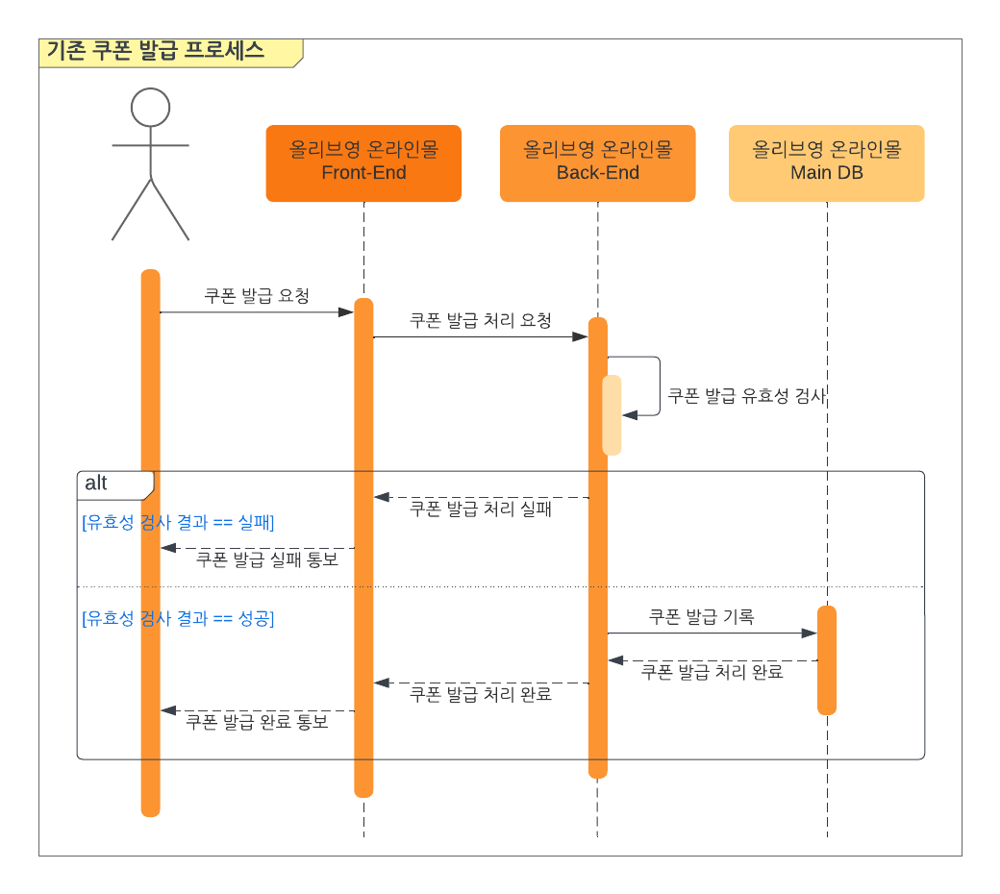
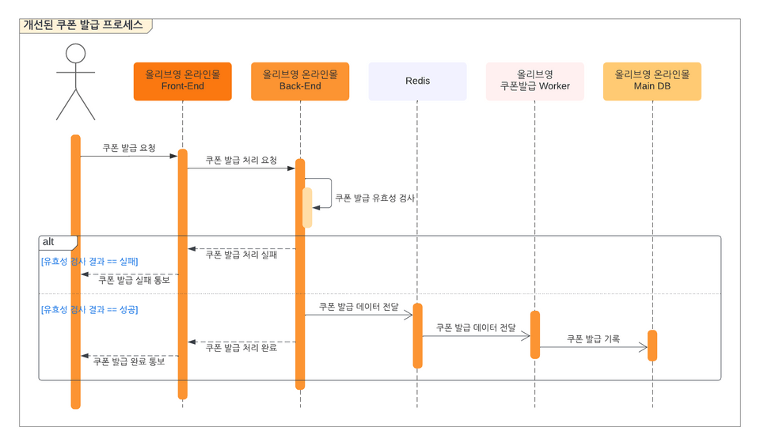
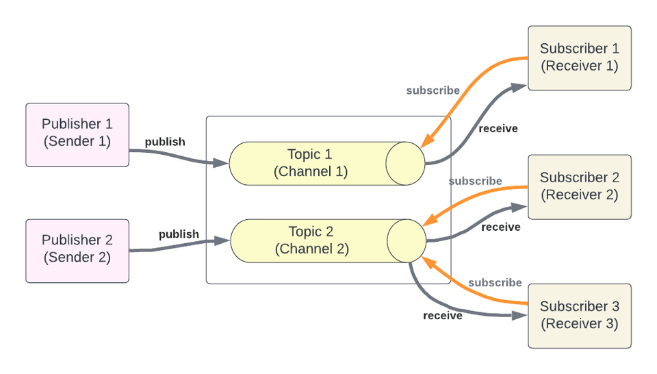
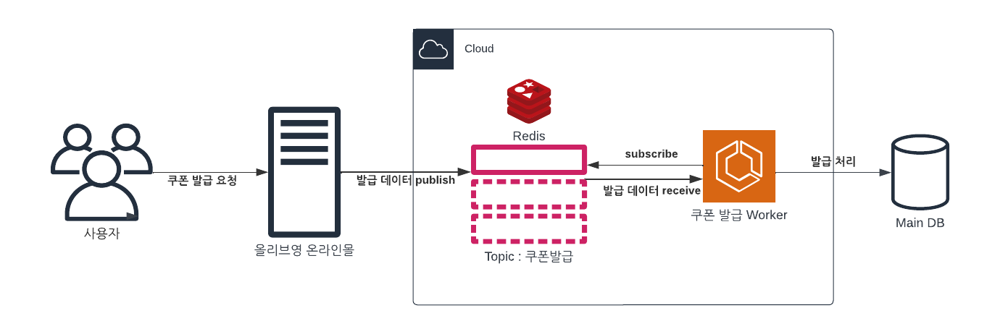
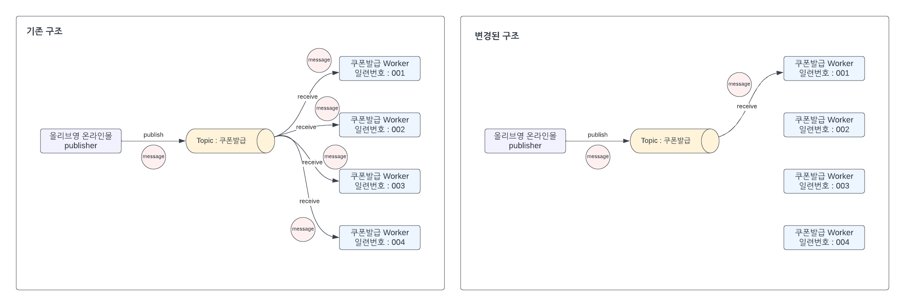
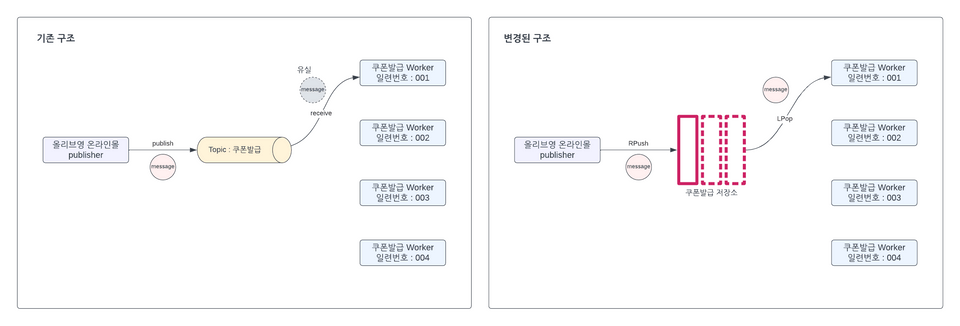
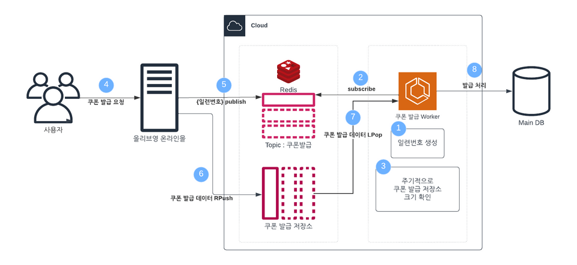

# Redis Pub/Sub을 활용한 쿠폰 발급 비동기 처리

- 읽은 날짜: 2025-12-19
- 회사/작성 주체: 올리브영
- 원문: [Redis Pub/Sub을 활용한 쿠폰 발급 비동기 처리](https://oliveyoung.tech/2023-08-07/async-process-of-coupon-issuance-using-redis/)

---

올영 세일 기간에는 0시와 12시에 선착순 쿠폰 다운로드 이벤트를 진행한다. 짧은 시간에 트래픽이 몰리면서 대기 시간이 길어졌고, 이를 개선하기 위해 Redis Pub/Sub을 활용한 비동기 발급 구조를 도입했다.

## 기존 쿠폰 발급 프로세스

기존에는 모든 과정을 동기식으로 처리했다. 트래픽이 몰리면 쿠폰 발급 과정에서 DB Connection 등의 자원을 많이 점유했고, 사용자는 본인의 처리 순서가 돌아올 때까지 오래 기다려야 했다.

## 프로세스를 어떻게 개선할까?

쿠폰 발급에 필요한 유효성 검사는 기존 로직에서 수행하고, 실제 발급 처리는 신규 시스템인 쿠폰 발급 Worker에 위임했다. 올리브영 온라인몰과 쿠폰 발급 Worker 사이의 데이터 전달에는 Redis Pub/Sub과 Redis List를 활용했다.

## Redis Pub/Sub이란?

Redis Pub/Sub은 특정 Channel을 구독한 구독자에게 메시지를 발행하는 방식이다. Publisher가 메시지를 발행하면 해당 Channel을 구독하고 있는 모든 Subscriber가 메시지를 받는다.

구조가 단순하고 빠르지만, 발행한 메시지를 보관하지 않고 Subscriber의 수신 여부도 확인하지 않는다. 따라서 메시지 저장이나 전달 보장이 필요하지 않은 알림과 신호 전달에 적합하다. 작업 데이터 자체를 안전하게 보관해야 한다면 별도의 저장 구조가 필요하다.

## Redis Pub/Sub을 쿠폰 발급에 적용

온라인몰이 `쿠폰발급` Channel에 데이터를 발행하면 이를 구독한 쿠폰 발급 Worker가 받아 Main DB에 저장하는 구조로 시작했다.

**첫 번째 이슈: 쿠폰 과발급**

운영 환경에서는 여러 Worker가 같은 Channel을 구독한다. Pub/Sub은 메시지를 모든 Subscriber에게 전달하므로, 한 건을 발행해도 모든 Worker가 발급 로직을 실행해 과발급이 발생했다.

이를 해결하기 위해 메시지를 발행할 때 여러 Worker 중 하나를 선택하고, 해당 Worker만 처리하도록 구조를 변경했다.

**두 번째 이슈: 쿠폰 미발급**

Pub/Sub 메시지는 보관되지 않기 때문에 Subscriber가 일시적으로 수신하지 못하면 쿠폰 발급 데이터가 유실될 수 있었다. 이를 막기 위해 실제 발급 데이터는 Redis List에 저장했다.

- 온라인몰이 여러 Worker 중 하나를 선택해 일련번호를 얻는다.
- 해당 일련번호에 대응하는 쿠폰 발급 List에 데이터를 `RPUSH`한다.
- Worker는 자신의 List를 확인하고 `LPOP`으로 데이터를 가져와 발급한다.

Pub/Sub은 처리할 Worker를 선택하는 신호 전달에 사용하고, 실제 발급 데이터는 List에 보관한 것이다.

## 최종으로 적용된 쿠폰 발급 로직

1. Worker가 구동되면 고유한 일련번호를 할당받고 `쿠폰발급` Channel을 구독한다.
2. Worker는 자신의 일련번호에 대응하는 Redis List를 주기적으로 확인한다.
3. 고객이 쿠폰 발급을 요청하면 온라인몰이 Worker 일련번호 하나를 선택한다.
4. 온라인몰은 선택한 일련번호를 Pub/Sub으로 알리고, 쿠폰 발급 데이터를 해당 Worker의 List에 `RPUSH`한다.
5. Worker는 List에서 데이터를 `LPOP`하여 Main DB에 저장하고 발급을 완료한다.

결국 Redis Pub/Sub은 여러 Worker 중 처리 대상을 정하는 데 사용하고, 실제 쿠폰 발급 데이터는 Worker별 Redis List에 저장한다.

## 결과

기존 대비 분당 최대 쿠폰 발급량이 2.2배로 늘었다. 사용자의 대기 시간도 줄어 모든 쿠폰이 1~2분 만에 소진되었고, 사용자 경험과 매출에도 긍정적인 영향을 주었다.

## 느낀점

Redis Pub/Sub의 동작 원리뿐만 아니라 메시지 유실 가능성과 쿠폰 과발급 문제를 함께 살펴볼 수 있었다. 프로젝트에 적용할 때도 단순히 비동기 처리를 도입하는 데 그치지 않고, 구독자가 없거나 처리 도중 장애가 발생했을 때 데이터를 어떻게 복구할지 먼저 설계해야겠다고 느꼈다.
