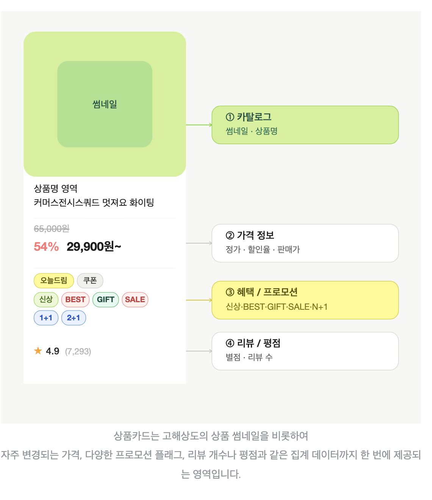
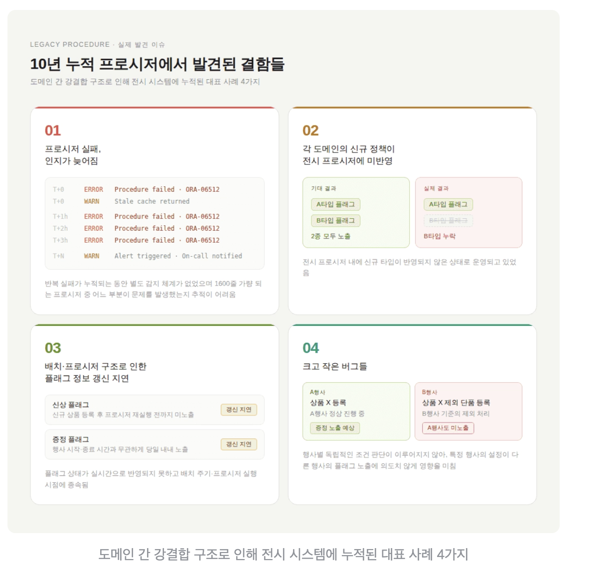
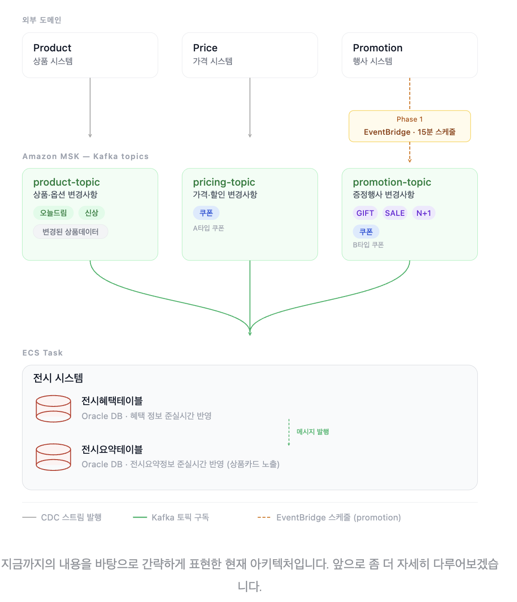
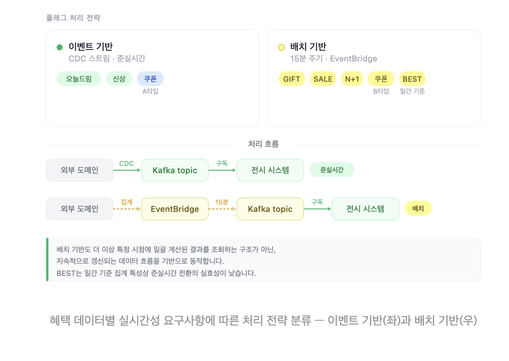
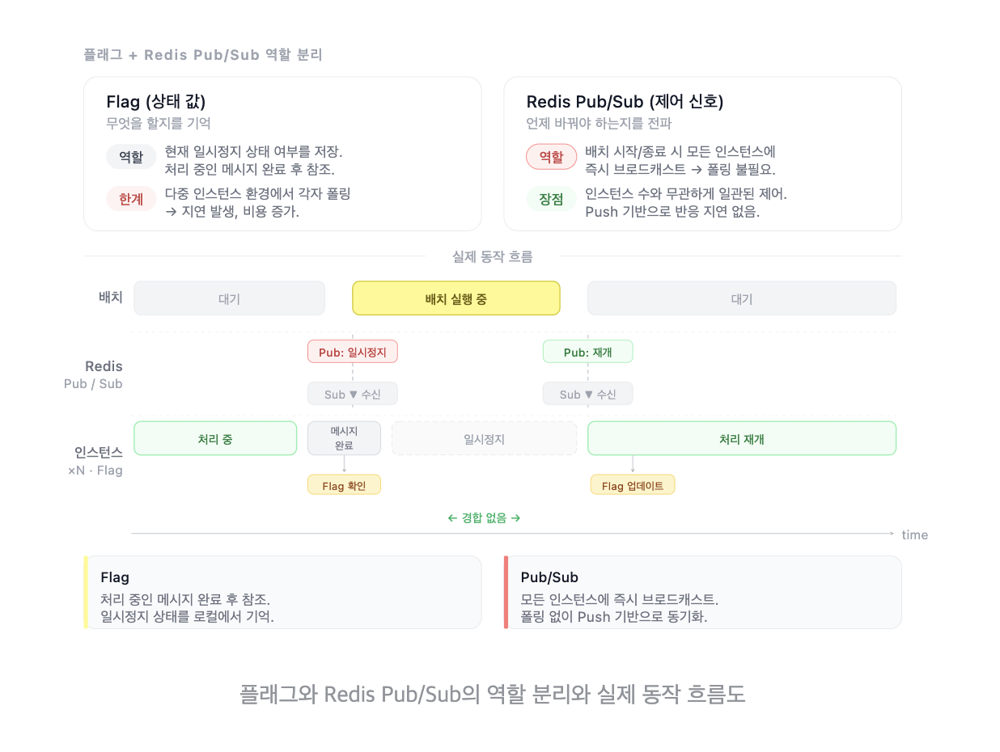
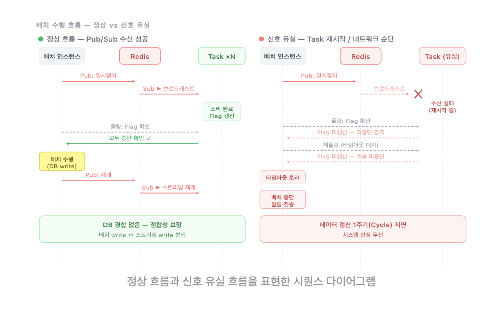
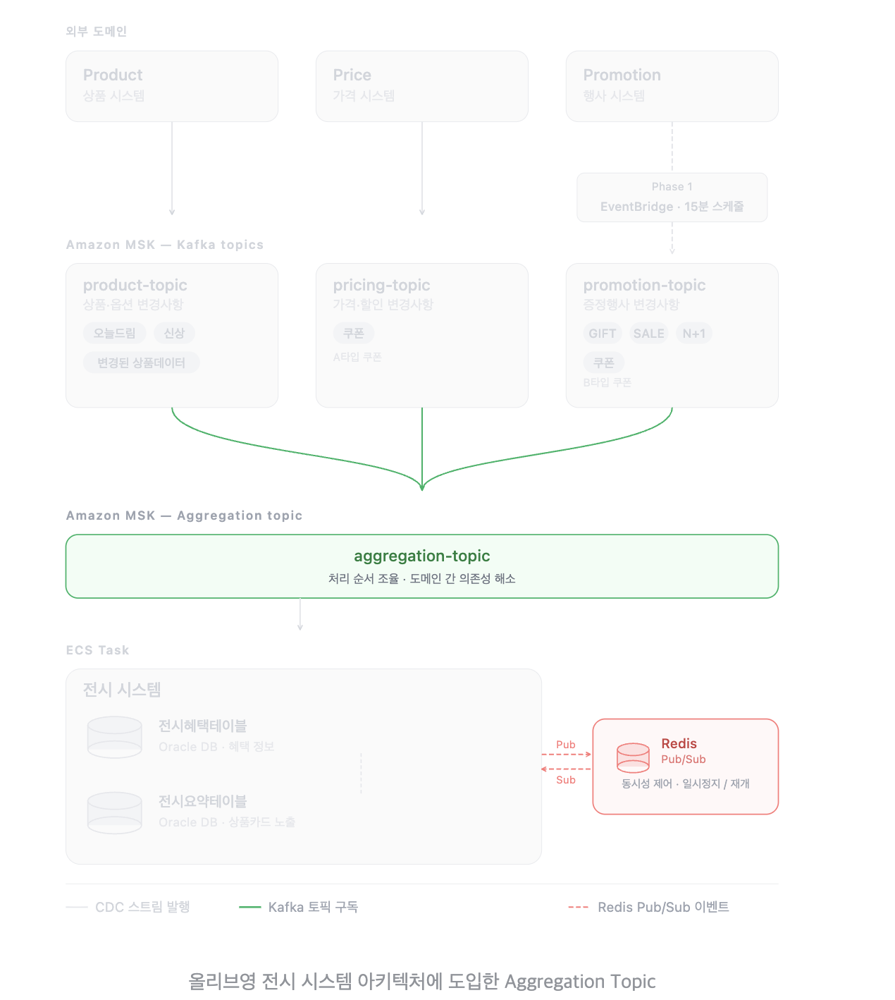
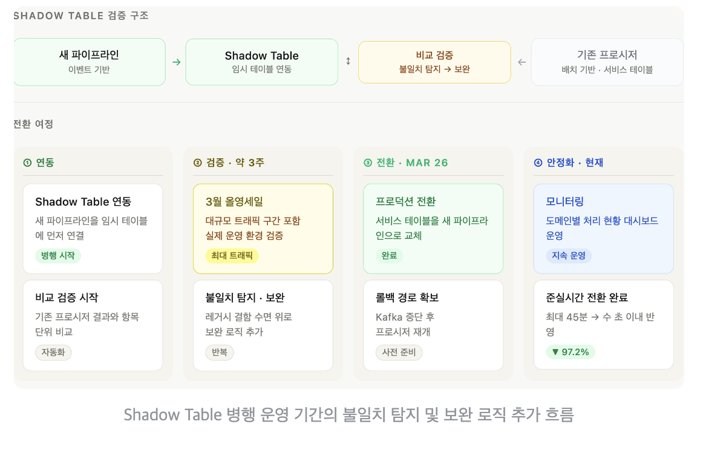
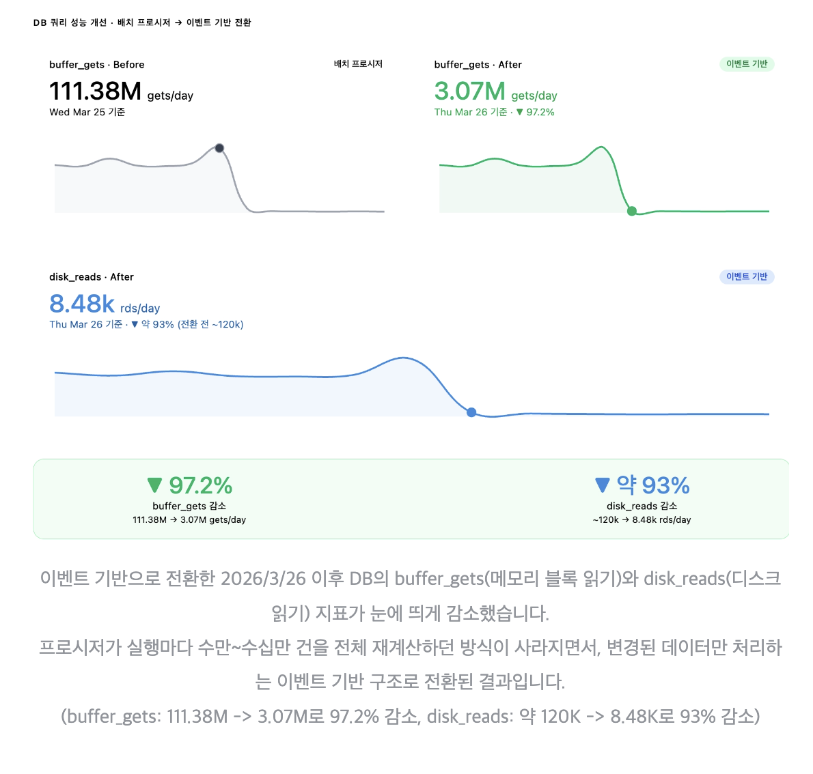

# 45분 배치에서 준실시간으로! 다수 도메인 데이터를 Kafka로 통합한 전환기

- 읽은 날짜: 2026-05-03
- 회사/작성 주체: 올리브영
- 원문: [45분 배치에서 준실시간으로! 다수 도메인 데이터를 Kafka로 통합한 전환기](https://oliveyoung.tech/2026-04-22/display-benefits-migration/)

---

# **올리브영 기술블로그 정리: 45분 배치에서 Kafka 기반 준실시간 전시 시스템으로 전환한 이야기**
이 글은 올리브영 온라인몰의 상품카드에 표시되는 혜택 정보를 기존 45분 배치 구조에서 Kafka 기반 준실시간 구조로 바꾼 사례다.
단순히 Kafka를 도입해서 빨라졌다는 이야기가 아니라, 10년 이상 운영된 레거시 프로시저를 어떻게 안전하게 걷어내고, 여러 도메인의 데이터를 어떻게 하나의 전시 화면에 정합성 있게 통합했는지가 핵심이다.
---
# **1. 이 글의 핵심 주제**
올리브영 온라인몰에는 홈 화면, 카테고리, 기획전 같은 여러 전시 영역이 있다.
사용자는 이런 화면에서 상품카드를 보고 상품을 클릭할지, 구매할지 판단한다.

상품카드에는 단순히 상품명과 이미지뿐만 아니라 가격, 리뷰, 평점, 쿠폰, 증정, 프로모션 같은 여러 정보가 함께 표시된다.
이 글에서 특히 다루는 것은 상품카드에 표시되는 3번 혜택 플래그다.
예를 들면 이런 정보들이다.
```text
쿠폰 적용 가능
선착순 증정
프로모션 진행 중
BEST 상품 여부
```
이런 혜택 정보는 고객의 구매 결정에 직접적인 영향을 준다.
문제는 기존 시스템에서는 이런 혜택 정보가 최대 45분까지 늦게 반영될 수 있었다는 점이다.
예를 들어 상품카드에는 “선착순 증정”이라고 표시되어 있는데, 실제 상세 페이지에 들어가면 이미 증정이 끝나 있을 수 있었다.
고객 입장에서는 화면에서 본 정보와 실제 적용 가능한 혜택이 다르기 때문에 신뢰가 떨어질 수 있다.
그래서 올리브영은 이 구조를 배치 기반에서 Kafka 기반 준실시간 구조로 전환했다.
---
# **2. 기존 구조: 45분 배치와 거대한 프로시저**
기존에는 상품, 쿠폰, 증정, 프로모션 데이터를 하나의 프로시저에서 모아서 계산했다.
흐름은 대략 이런 느낌이다.
```text
상품 데이터
쿠폰 데이터
증정 데이터
프로모션 데이터
        ↓
거대한 프로시저 실행
        ↓
상품별 혜택 플래그 계산
        ↓
전시 테이블 갱신
        ↓
상품카드에 노출
```
이 프로시저는 일정 주기로 실행되었다.
문제는 변경된 데이터만 계산하는 게 아니라, 실행될 때마다 전체 데이터를 다시 계산했다는 점이다.
데이터가 한 건만 바뀌어도 전체 상품 혜택 정보를 다시 계산하는 구조였기 때문에 DB 부하가 컸다.
또한 배치 주기가 있다 보니 변경사항이 바로 반영되지 않았다.
최대 45분까지 지연될 수 있었고, 커머스 서비스에서는 이 지연이 고객 경험에 직접적인 문제가 되었다.
---
# **3. 문제 1: 프로시저 안에 도메인 로직이 너무 많이 섞여 있었다**
올리브영에는 상품, 쿠폰, 증정, 프로모션처럼 각각 역할이 다른 도메인이 있다.
원래는 각 도메인이 자기 데이터를 책임지고 관리해야 한다.
상품 도메인은 상품 정보와 옵션을 관리하고, 쿠폰 도메인은 쿠폰 조건과 적용 대상을 관리하고, 증정 도메인은 증정 행사 조건을 관리하는 식이다.
그런데 기존 전시 시스템에서는 이 여러 도메인의 로직이 하나의 프로시저 안에 섞여 있었다.
```text
전시 프로시저
  - 상품 조건 계산
  - 쿠폰 조건 계산
  - 증정 조건 계산
  - 프로모션 조건 계산
  - 예외 케이스 처리
  - 오래된 정책 처리
```

이렇게 되면 전시 시스템이 너무 많은 책임을 가지게 된다.
전시 시스템은 원래 사용자 화면에 필요한 데이터를 조합해서 보여주는 역할을 해야 한다.
하지만 기존 구조에서는 전시 시스템이 각 도메인의 세부 정책까지 직접 계산하고 있었다.
이런 구조를 강결합 구조라고 볼 수 있다.
한 도메인의 조건을 조금 수정했는데 다른 혜택 계산에 영향을 줄 수도 있다.
결국 10년 이상 누적된 프로시저는 누가 봐도 쉽게 이해하기 어려운 레거시가 된 것이다.
또 프로시저는 테스트하기 어렵기 때문에 변경 검증 비용도 커진다.
---
# **4. 문제 2: 도메인마다 데이터 생명주기가 달랐다**
처음에는 단순히 “프로시저를 없애고 모두 이벤트 기반으로 바꾸면 되지 않을까?”라고 생각할 수 있다.
하지만 실제로는 그렇게 단순하지 않았다.
상품카드의 혜택 플래그는 여러 도메인의 데이터를 기반으로 만들어진다.
그런데 각 도메인 데이터는 변경 주기와 실시간성 요구사항이 다르다.
예를 들어 상품 옵션이나 품절 상태는 자주 바뀔 수 있다.
쿠폰 적용 여부도 빠르게 바뀔 수 있다.
증정 행사는 선착순 수량이 소진되면 바로 반영되어야 한다.
반면 어떤 프로모션 정보는 상대적으로 덜 자주 바뀔 수 있다.
또 어떤 도메인은 이미 Kafka 이벤트를 제공할 수 있었지만, 어떤 도메인은 아직 이벤트 기반 구조가 준비되어 있지 않았다.
즉, 모든 데이터를 한 번에 실시간 이벤트로 전환하기 어려웠다.
그래서 올리브영은 데이터 특성에 따라 처리 방식을 나누는 하이브리드 전략을 선택했다.
```text
이벤트 기반으로 처리 가능한 데이터
        ↓
Kafka 스트리밍 처리

아직 이벤트 기반이 어려운 데이터
        ↓
배치 기반 메시지 발행
```
중요한 점은 배치를 완전히 없앤 것이 아니라, 기존처럼 거대한 프로시저가 전체를 계산하던 구조에서 벗어나 각 도메인이 자기 데이터를 Kafka로 흘려보내는 구조로 바꾸기 시작했다는 것이다.

---
# **5. 문제 3: 레거시와 안전하게 공존해야 했다**
10년 이상 운영된 프로시저를 한 번에 제거하는 것은 위험하다.
기존 프로시저 안에는 문서화되지 않은 예외 케이스가 있을 수 있다.
예전 정책이 남아 있을 수도 있고, 특정 행사나 특정 상품에만 적용되는 조건이 숨어 있을 수도 있다.
그래서 새 Kafka 파이프라인을 만들었다고 바로 실제 서비스 테이블에 연결할 수는 없었다.
만약 새 파이프라인에 빠진 조건이 있으면 고객 화면에 잘못된 혜택 정보가 노출될 수 있기 때문이다.
따라서 안전한 전환 전략이 필요했다.
올리브영은 기존 프로시저와 새 파이프라인을 일정 기간 함께 운영하면서 결과를 비교하는 방식을 선택했다.
이때 사용한 것이 Shadow Table 전략이다.
---
# **6. 선택한 접근 1: 데이터 특성에 따른 하이브리드 처리**
올리브영은 모든 데이터를 똑같은 방식으로 처리하지 않았다.
실시간성이 높고 이벤트 기반 제공이 가능한 데이터는 Kafka 이벤트로 처리했다.
아직 이벤트 기반 제공이 어려운 데이터는 도메인팀과 협의해서 배치 기반으로 Kafka 메시지를 발행하도록 했다.
이 구조는 완성된 최종 구조라기보다는 전환을 위한 첫 단계에 가깝다.
기존에는 전시 시스템이 각 도메인 DB를 직접 조회하고 프로시저에서 모든 로직을 계산했다.
개선 후에는 각 도메인이 자신의 정책과 비즈니스 로직이 반영된 데이터를 Kafka로 전달하고, 전시 시스템은 이를 받아 조합하는 구조로 바뀌었다.
기존 구조는 이런 느낌이다.
```text
전시 시스템
        ↓
상품 DB 직접 조회
쿠폰 DB 직접 조회
증정 DB 직접 조회
프로모션 DB 직접 조회
        ↓
전시 프로시저에서 전체 계산
```
개선 구조는 이런 느낌이다.
```text
상품 도메인 → 상품 이벤트 발행
쿠폰 도메인 → 쿠폰 이벤트 발행
증정 도메인 → 증정 이벤트 발행
프로모션 도메인 → 프로모션 이벤트 발행
        ↓
Kafka
        ↓
전시 시스템이 이벤트를 받아 조합
```

이렇게 바꾸면 전시 시스템이 모든 도메인 로직을 직접 들고 있을 필요가 줄어든다.
각 도메인은 자기 책임을 유지하고, 전시 시스템은 화면에 필요한 정보를 조합하는 역할에 집중할 수 있다.
---
# **7. 선택한 접근 2: 배치와 스트리밍 간 동시성 제어**
하이브리드 구조를 적용하면서 새로운 문제가 생겼다.
일부 데이터는 스트리밍으로 들어오고, 일부 데이터는 배치로 들어온다.
그런데 최종적으로는 하나의 전시 테이블에 저장된다.
예를 들어 하나의 상품 Row 안에 쿠폰 여부, 증정 여부, 프로모션 여부가 함께 들어간다.
```text
상품 혜택 정보 Row
  - product_id
  - coupon_flag
  - gift_flag
  - promotion_flag
  - best_flag
```
이때 Kafka Consumer와 배치 작업이 같은 Row를 동시에 수정할 수 있다.
예를 들어 Kafka Consumer가 쿠폰 정보를 갱신하는 동시에, 배치 작업이 증정 정보를 갱신할 수 있다.
```text
Kafka Consumer
        ↓
coupon_flag 업데이트

Batch Job
        ↓
gift_flag 업데이트
```
이 둘이 동시에 실행되면 문제가 생길 수 있다.
DB 락이 발생할 수 있고, 업데이트 경합이 생길 수 있고, 한쪽 작업이 다른 쪽 작업 결과를 덮어쓸 수도 있다.
그래서 배치가 수행되는 동안에는 Kafka Consumer의 메시지 소비를 잠시 멈추는 제어가 필요했다.
처음 생각할 수 있는 방법은 플래그를 두는 것이다.
```text
batchRunning = true
```
Consumer는 메시지를 처리하기 전에 이 값을 확인한다.
```text
batchRunning이 true면 소비 중단
batchRunning이 false면 메시지 처리
```
하지만 다중 인스턴스 환경에서는 이 방식만으로 부족하다.
Consumer 인스턴스가 여러 개라면 모든 인스턴스가 계속 플래그를 확인해야 한다.
이것은 폴링 방식이기 때문에 인스턴스가 많아질수록 비용이 커지고, 확인 주기에 따라 반응 지연도 생긴다.
그래서 Redis Pub/Sub을 사용했다.
---
# **8. Redis Pub/Sub의 역할**
Redis Pub/Sub은 특정 채널에 메시지를 발행하면, 그 채널을 구독하고 있는 모든 인스턴스가 메시지를 받는 구조다.
배치가 시작되면 하나의 인스턴스가 pause 이벤트를 발행한다.
```text
Batch Instance
        ↓
Redis Pub/Sub에 pause 발행
        ↓
모든 Consumer 인스턴스가 수신
        ↓
Kafka 소비 중단
```
배치가 끝나면 resume 이벤트를 발행한다.
```text
Batch Instance
        ↓
Redis Pub/Sub에 resume 발행
        ↓
모든 Consumer 인스턴스가 수신
        ↓
Kafka 소비 재개
```
여기서 Redis Pub/Sub은 플래그를 완전히 대체하는 것이 아니다.
Pub/Sub은 “상태가 바뀌었으니 지금 반응해라”라고 알려주는 역할이다.
플래그는 “현재 시스템이 어떤 상태인지”를 기억하는 역할이다.
정리하면 이렇게 볼 수 있다.
```text
Redis Pub/Sub
→ pause/resume 신호를 빠르게 전달하는 역할

Redis 상태 플래그
→ 각 Consumer가 실제로 멈췄는지 기록하는 역할
```
이 역할 분리가 중요하다.

---
# **9. Pub/Sub 신호 유실 문제와 안전장치**
Redis Pub/Sub은 메시지를 저장하지 않는다.
즉, fire-and-forget 방식이다.
발행한 순간 구독 중인 인스턴스는 메시지를 받지만, 그 순간 재시작 중이거나 네트워크 문제가 있던 인스턴스는 신호를 놓칠 수 있다.
예를 들어 Consumer가 4개 있다고 해보자.
```text
Consumer-1 pause 수신
Consumer-2 pause 수신
Consumer-3 재시작 중이라 수신 실패
Consumer-4 pause 수신
```
이 경우 Consumer-3은 배치 중에도 계속 Kafka 메시지를 소비할 수 있다.
그러면 배치 작업과 Consumer 작업이 동시에 같은 DB Row를 갱신할 수 있다.
이 문제를 막기 위해 올리브영은 pause 신호를 보낸 뒤, 모든 Task가 실제로 중단 상태가 되었는지 확인하는 단계를 추가했다.
흐름은 이렇다.
```text
1. Batch가 pause 이벤트 발행

2. Consumer들이 pause 이벤트 수신

3. Consumer는 현재 처리 중인 메시지를 끝까지 처리

4. 처리가 끝난 뒤 Redis에 paused 상태 기록

5. Batch는 모든 Consumer가 paused 상태인지 확인

6. 모두 멈췄으면 배치 실행

7. 일부가 멈추지 않았으면 배치 중단 후 알림
```
여기서 중요한 점은 pause 이벤트를 “받았는지”가 기준이 아니라, 실제로 메시지 처리를 끝내고 “멈췄는지”가 기준이라는 것이다.
이렇게 해야 처리 중이던 메시지와 배치 작업이 동시에 DB를 건드리는 Race Condition을 막을 수 있다.
올리브영은 타임아웃 안에 모든 Task가 멈추지 않으면 배치를 강행하지 않았다.
배치를 건너뛰면 데이터 반영이 조금 늦어질 수 있다.
하지만 불확실한 상태에서 배치를 실행하면 데이터 정합성이 깨질 수 있다.
그래서 실시간성보다 안정성과 정합성을 우선한 것이다.

---
# **10. Aggregation Topic을 도입한 이유**
상품카드에는 여러 도메인의 데이터가 조합된다.
그런데 도메인 이벤트들은 서로 독립적으로 발행된다.
```text
상품 이벤트
쿠폰 이벤트
증정 이벤트
프로모션 이벤트
```
문제는 이 이벤트들의 처리 순서가 보장되지 않는다는 점이다.
예를 들어 신규 상품이 등록되고 그 상품에 쿠폰이 적용되는 상황을 생각해보면, 상품 Row가 먼저 있어야 쿠폰 정보를 연결할 수 있다.
논리적으로는 이런 순서가 필요하다.
```text
상품 생성
        ↓
쿠폰 연결
```
그런데 이벤트가 독립적으로 들어오면 쿠폰 이벤트가 상품 이벤트보다 먼저 처리될 수 있다.
```text
쿠폰 이벤트 먼저 처리
        ↓
상품 Row가 아직 없음
        ↓
쿠폰 정보를 저장할 대상이 없음
```
이 문제를 해결하기 위해 Aggregation Topic을 도입했다.
Aggregation Topic은 여러 도메인 이벤트를 바로 처리하지 않고, 하나의 토픽으로 모아서 처리 흐름을 조율하는 구조다.
```text
상품 Topic ──────┐
쿠폰 Topic ──────┼──> Aggregation Topic ──> 전시 Consumer
증정 Topic ──────┤
프로모션 Topic ──┘
```

이 구조에서 중요한 것은 파티셔닝 키다.
올리브영은 상품 ID를 파티셔닝 키로 사용했다.
```text
partition key = productId
```
Kafka는 같은 파티션 안에서는 메시지 순서를 보장한다.
따라서 같은 상품 ID를 가진 이벤트는 같은 파티션으로 들어가고, 상품 단위로 처리 순서를 제어할 수 있다.
```text
productId = 100 상품 이벤트
productId = 100 쿠폰 이벤트
productId = 100 증정 이벤트
        ↓
같은 Kafka partition
        ↓
상품 단위 순서 제어 가능
```
이 방식의 장점은 상품 단위의 순서 보장과 수평 확장을 동시에 가져갈 수 있다는 점이다.
모든 이벤트를 하나의 파티션으로 몰면 순서는 보장되지만 확장성이 떨어진다.
반대로 상품 ID 기준으로 나누면 서로 다른 상품은 병렬 처리하면서, 같은 상품에 대한 이벤트는 같은 흐름에서 처리할 수 있다.
---
# **11. 쿠폰이나 행사 이벤트가 먼저 오면 어떻게 처리했나**
상품 Row가 아직 없는 상태에서 쿠폰이나 행사 이벤트가 먼저 도착할 수 있다.
이 경우 올리브영은 해당 메시지를 건너뛰는 방식을 사용했다.
처음 보면 데이터 누락처럼 보일 수 있다.
하지만 보완 전략이 있다.
상품 정보를 처리할 때 쿠폰이나 행사 정보를 API로 실시간 조회해서 함께 적재한다.
즉, 쿠폰 이벤트가 먼저 와서 처리되지 못하더라도, 나중에 상품 이벤트를 처리할 때 현재 기준의 쿠폰/행사 정보를 다시 조회해서 넣을 수 있다.
흐름은 이렇다.
```text
쿠폰 이벤트 먼저 도착
        ↓
상품 Row 없음
        ↓
해당 메시지 건너뜀

이후 상품 이벤트 도착
        ↓
상품 Row 생성 또는 갱신
        ↓
쿠폰/행사 정보를 API로 현재 기준 조회
        ↓
혜택 정보 함께 적재
```
이 구조는 단순히 메시지를 무시하는 것이 아니라, 기준이 되는 상품 정보를 중심으로 최신 데이터를 다시 조합하는 방식이다.
그래서 일부 이벤트가 먼저 도착해도 최종 데이터 누락을 줄일 수 있다.
---
# **12. 멱등성 보장 전략**
이벤트 기반 시스템에서는 같은 메시지가 여러 번 처리될 수 있다.
예를 들어 Consumer가 메시지를 읽고 DB 업데이트까지 성공했는데, Kafka offset commit 전에 장애가 발생할 수 있다.
그러면 Consumer가 재시작된 뒤 같은 메시지를 다시 읽을 수 있다.
```text
Consumer가 메시지 읽음
        ↓
DB 업데이트 성공
        ↓
offset commit 전에 장애 발생
        ↓
재시작
        ↓
같은 메시지 재처리
```
이때 같은 메시지를 두 번 처리해도 최종 결과가 깨지지 않아야 한다.
이것이 멱등성이다.
올리브영은 멱등성을 위해 세 가지 전략을 사용했다.
첫째, 메시지를 배치로 가져온 뒤 중복을 제거했다.
둘째, 최신 발행 타임스탬프를 기준으로 오래된 이벤트를 필터링했다.
셋째, DB 저장은 UPSERT로 처리했다.
예를 들어 같은 상품에 대해 오래된 이벤트와 최신 이벤트가 함께 들어왔다고 해보자.
```text
10:00 couponFlag = false
10:05 couponFlag = true
```
만약 10:05 이벤트가 먼저 처리되고, 나중에 10:00 이벤트가 처리되면 오래된 데이터가 최신 데이터를 덮어쓸 수 있다.
그래서 타임스탬프를 기준으로 오래된 이벤트는 무시해야 한다.
```text
현재 DB 반영 시각 = 10:05
들어온 이벤트 시각 = 10:00
        ↓
오래된 이벤트이므로 무시
```
그리고 UPSERT를 사용하면 같은 데이터가 여러 번 들어와도 중복 Row가 계속 생기지 않는다.
```text
Row가 있으면 UPDATE
Row가 없으면 INSERT
```
이런 방식으로 중복 처리와 순서 역전으로 인한 정합성 문제를 줄였다.
---
# **13. Shadow Table로 정합성 검증**
새 Kafka 파이프라인을 만들었다고 바로 실제 서비스 테이블에 연결하면 위험하다.
그래서 올리브영은 Shadow Table 전략을 사용했다.
기존 프로시저는 기존 서비스 테이블을 계속 갱신하고, 새 Kafka 파이프라인은 별도의 Shadow Table을 갱신한다.
```text
기존 프로시저
        ↓
서비스 테이블

새 Kafka 파이프라인
        ↓
Shadow Table
```
이후 두 테이블의 결과를 비교한다.
```text
서비스 테이블 결과
Shadow Table 결과
        ↓
상품별 비교
필드별 비교
혜택 플래그 비교
        ↓
불일치 탐지
```
불일치가 발생하면 원인을 분석한다.
새 파이프라인의 로직이 부족한 경우도 있을 수 있고, 반대로 기존 프로시저에 오래된 정책이나 결함이 남아 있는 경우도 있을 수 있다.
블로그에서는 실제로 Shadow Table 쪽 데이터가 더 정확한 경우도 있었다고 한다.
보통 레거시 시스템은 오래 운영되었기 때문에 무조건 맞다고 생각하기 쉽다.
하지만 오래 운영된 시스템일수록 문서화되지 않은 예외, 지금은 쓰지 않는 정책, 과거 버그가 남아 있을 수 있다.
Shadow Table 검증은 새 시스템의 버그만 찾는 과정이 아니라, 기존 레거시의 숨은 문제를 드러내는 과정이기도 하다.
올리브영은 약 3주간 병행 운영했고, 올영세일 같은 대규모 트래픽 구간도 포함해서 안정성을 검증했다.
그리고 문제가 생겼을 때 기존 프로시저로 돌아갈 수 있는 롤백 시나리오도 준비해두었다.

---
# **14. 전환 결과**
전환 이후 가장 큰 변화는 혜택 플래그 반영 시간이 줄어든 것이다.
기존에는 최대 45분까지 지연될 수 있었지만, 전환 후에는 수 초 이내 반영되는 구조가 되었다.
```text
기존
→ 최대 45분 지연

개선 후
→ 수 초 이내 반영
```
또한 DB 부하도 크게 줄었다.
기존 프로시저는 실행할 때마다 수만\~수십만 건을 전체 재계산했다.
하지만 이벤트 기반 구조에서는 변경된 데이터만 처리한다.
그 결과 DB의 buffer_gets와 disk_reads 지표가 크게 감소했다.
블로그에 나온 수치를 보면 buffer_gets는 111.38M에서 3.07M으로 약 97.2% 감소했고, disk_reads는 약 120K에서 8.48K로 약 93% 감소했다.
이건 단순히 화면 반영 속도만 빨라진 것이 아니라, DB가 불필요하게 읽고 계산하던 작업 자체가 줄었다는 의미다.

---
# 15. 느낀점
이 글을 읽으면서 단순히 Kafka를 도입해서 시스템을 빠르게 만든 사례라기보다는, 오래된 레거시 시스템을 어떻게 안전하게 바꿔나갔는지가 더 인상 깊었다. 기존에는 45분마다 배치로 전체 데이터를 다시 계산했기 때문에 고객이 보는 혜택 정보가 실제와 다를 수 있었고, 이것이 단순한 성능 문제가 아니라 사용자 경험과 신뢰의 문제로 이어진다는 점이 와닿았다.
특히 인상 깊었던 부분은 모든 데이터를 무작정 실시간으로 바꾸지 않고, 도메인별 특성에 따라 CDC, Kafka 이벤트, 스케줄 기반 발행을 나누어 적용한 점이다. 실무에서는 기술을 한 번에 이상적인 구조로 바꾸기보다, 기존 시스템과 공존하면서 점진적으로 전환하는 방식이 중요하다는 것을 알 수 있었다.

