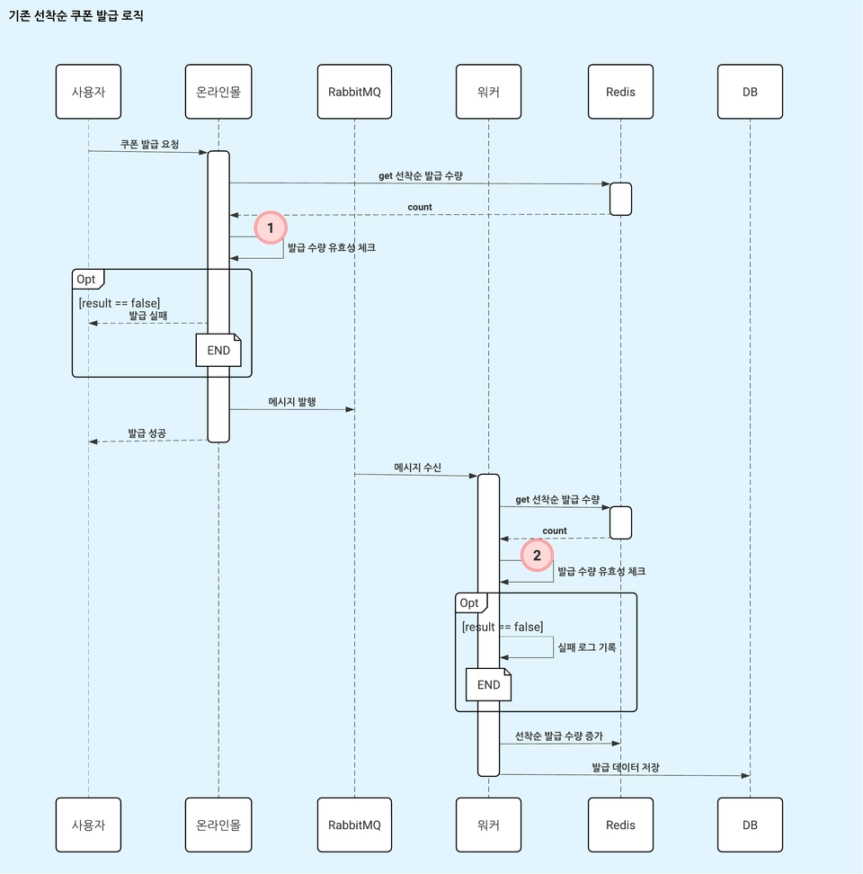
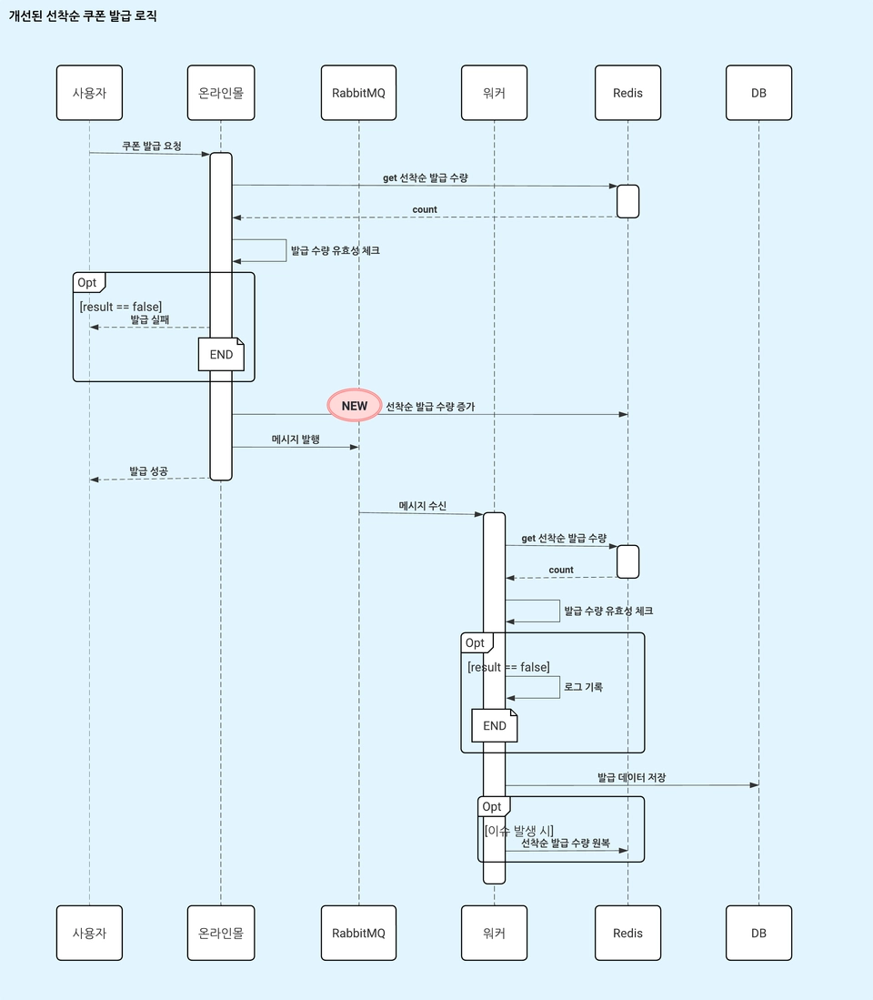
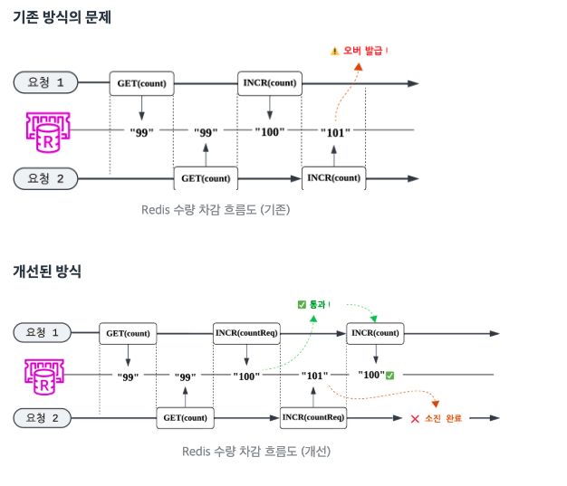

# 올영세일 선착순 쿠폰, 미발급 0%를 향한 여정

- 읽은 날짜: 2026-06-30
- 회사/작성 주체: 올리브영
- 원문: [올영세일 선착순 쿠폰, 미발급 0%를 향한 여정](https://oliveyoung.tech/2025-12-15/fcfs-coupon/)

---

## 1. 이 글의 핵심 주제
이 글은 올리브영이 **올영세일 선착순 쿠폰 발급 시스템에서 발생한 미발급 문제를 어떻게 해결했는지** 정리한 기술 블로그다.
핵심 문제는 단순히 트래픽이 많아서 서버가 느려졌다는 게 아니다.
가장 큰 문제는 이거였다.
**사용자에게는 쿠폰 발급 성공이라고 응답했는데, 실제로는 쿠폰이 발급되지 않는 상황**
즉, 사용자는 성공했다고 믿고 있는데 쿠폰함에는 쿠폰이 없는 상태다.
선착순 쿠폰은 사용자가 시간을 맞춰 기다렸다가 받는 이벤트이기 때문에 이런 문제는 단순한 오류가 아니라 **고객 신뢰도, CS 비용, 브랜드 이미지**까지 연결되는 문제다.
---
## 2. 기존 선착순 쿠폰 발급 구조

조금 더 풀면 다음과 같다.
1. 사용자가 쿠폰 발급 요청을 한다.
2. 온라인몰 서버가 Redis에서 현재 발급 수량을 조회한다.
3. 아직 제한 수량보다 적으면 발급 가능하다고 판단한다.
4. RabbitMQ에 쿠폰 발급 메시지를 발행한다.
5. 사용자에게 발급 성공 응답을 준다.
6. Worker가 메시지를 소비한다.
7. Worker가 다시 수량 유효성 검사를 한다.
8. redis에 선착순 발급 수량을 증가한다.
9. 문제가 없으면 DB에 쿠폰 발급 데이터를 저장한다.
여기서 중요한 점은 **사용자 요청 시점에 바로 DB 저장까지 끝내는 구조가 아니라는 것**이다.
실제 쿠폰 발급 처리는 RabbitMQ를 거쳐 Worker가 비동기로 처리한다.
---
## 3. 왜 비동기 구조를 썼을까?
선착순 쿠폰은 이벤트 오픈 순간에 요청이 한 번에 몰린다.
만약 모든 요청을 온라인몰 서버가 직접 DB에 저장하고, 쿠폰 수량을 확인하고, 발급 처리까지 끝낸 뒤 응답한다면 DB 부하가 매우 커진다.
그래서 온라인몰 서버는 사용자 요청을 빠르게 받고, 실제 발급 처리는 Worker에게 넘기는 구조를 사용했다.
### 동기 처리 방식
사용자 요청 → 서버가 직접 DB 처리 → DB 저장 완료 → 사용자 응답
장점은 결과가 확실하다는 것이다.
DB 저장이 끝난 뒤 응답하므로 사용자가 받은 응답과 실제 처리 결과가 일치하기 쉽다.
하지만 단점도 크다.
요청이 몰리면 DB 부하가 커지고 응답 속도가 느려진다.
### 비동기 처리 방식
사용자 요청 → 서버가 빠르게 요청 접수 → MQ에 메시지 발행 → 사용자에게 빠르게 응답 → Worker가 나중에 실제 처리
장점은 빠른 응답과 트래픽 흡수다.
대량 요청이 몰려도 온라인몰 서버가 모든 처리를 직접 하지 않기 때문에 안정적으로 버틸 수 있다.
하지만 단점은 **응답 시점과 실제 처리 완료 시점이 다르다**는 것이다.
이 말은 곧, 사용자에게 성공 응답을 줬더라도 나중에 Worker 처리에서 실패할 수 있다는 뜻이다.
---
## 4. 실제로 발생한 문제
2025년 6월 올영세일에서 선착순 쿠폰 행사를 운영하던 중, 미발급 문제가 발견됐다.
**성공 응답을 받은 사용자가 실제로는 쿠폰을 받지 못했다.**
```text
“쿠폰 발급 성공이라고 떴는데 왜 쿠폰함에 없지?”
```
이건 사용자 입장에서는 시스템을 신뢰하기 어려운 경험이다.
특히 선착순 쿠폰처럼 경쟁성 있는 이벤트에서는 더 민감하다.
---
## 5. 문제 원인 1: Time Gap
첫 번째 원인은 **Time Gap**, 즉 시간 간극이다.
온라인몰 서버가 Redis를 보고 수량이 남아 있다고 판단하는 시점과, Worker가 실제로 쿠폰을 발급하는 시점 사이에는 시간이 생긴다.
```text
T0: Redis GET (count=99) → 통과 ✅
T1: MQ 발행 (10ms)
T2: Worker 수신 (50ms)
T3: Redis GET (count=101) → 실패 ❌  <- T0와 T3 사이의 간극!
```
첫 번째 검증(T0)과 워커의 재검증(T3) 사이에는 MQ 지연 시간을 포함한 시간 간극이 발생한다.
이처럼 짧은 순간(예: 100ms)에 수백 건의 요청이 동시에 몰리면서 경합 상태(Race Condition)가 발생하여, T0 검증이 무의미해지는 결과가 발생했다.
---
## 6. 문제 원인 2: 이중 검증
기존 구조에서는 온라인몰 서버에서 한 번 검증하고, Worker에서 다시 한 번 검증했다.
```text
[Online Mall]        [Worker]
유효성 검사 1차  ---→  유효성 검사 2차
    (통과)            (실패 가능)
```
이중 검증 자체가 나쁜 것은 아니다.
오히려 비동기 시스템에서는 Worker에서 최종 검증을 한 번 더 하는 게 자연스럽다.
왜냐하면 메시지가 늦게 처리될 수도 있고, 중복으로 들어올 수도 있고, 앞단에서 통과된 요청이 뒤에서는 더 이상 유효하지 않을 수도 있기 때문이다.
하지만 이 구조에서는 문제가 있었다.
온라인몰 서버의 1차 검증 결과와 Worker의 2차 검증 결과가 달라질 수 있었다.
---
## 7. 문제 원인 3: Redis GET / INCR 원자성 부재
가장 핵심적인 원인은 Redis 사용 방식이었다.
```java
// 문제가 되는 코드 패턴
val currentCount = redisTemplate.opsForValue().get(key)  // GET
if (currentCount < maxCount) {
    redisTemplate.opsForValue().increment(key)  // INCR (별도 명령)
    // ⚠️ GET과 INCR 사이에 다른 요청이 끼어들 수 있음! (이 짧은 간극 사이에 경합 발생)
}
```
기존 로직은 대략 이런 구조였다.
현재 count 조회
→ count가 제한 수량보다 작으면
→ count 증가
겉으로 보면 자연스러운 로직이다.
하지만 동시 요청이 많은 상황에서는 위험하다.
Redis의 GET 명령 하나는 원자적이다.
Redis의 INCR 명령 하나도 원자적이다.
하지만 **GET 후 조건 검사 후 INCR**이라는 전체 로직은 원자적이지 않다.
각 요청 입장에서는 정상적으로 동작한 것처럼 보이지만, 전체 시스템 관점에서는 잘못된 결과가 나온다.
이런 문제가 바로 **Race Condition**이다.
---
## 8. 개선 시도 1: 발급 수량 선차감
- 문제점: 기존에는 워커가 수량을 증가(INCR) 처리했기 때문에, 1차 검증(GET)과 실제 수량 반영(INCR) 사이에 MQ 전송 시간까지 포함된 긴 시간 간극이 발생했다.
- 개선 방안: 이 시간 간극을 줄이기 위해 'Redis 발급 수량 증가' 처리를 워커가 아닌, 온라인몰 앞단에서 선차감하도록 로직을 변경했다.
- 실패 처리: 당연히 발급 실패 시 처리도 고려했다. 워커에서 실제 DB 처리 중 이슈가 발생하면 선차감했던 수량을 다시 원상복구(Rollback) 하도록 구현했다.

- 결과 및 한계: 이처럼 수량 선차감 로직을 적용한 후 부하 테스트를 진행한 결과, 미발급 건수가 줄기는 했지만 여전히 잔존하는 문제를 발견했다. 이는 Time Gap을 줄여도 원자성이 보장되지 않았기 때문이다. Redis GET과 INCR이 여전히 분리되어 수행되는 한, 경합 상태는 원천적으로 차단될 수 없었다.
---
## 9. 개선 시도 2: Lua Script 적용
두 번째 시도는 Redis Lua Script를 사용하는 방식이었다.
Lua Script를 사용하면 Redis 안에서 여러 명령을 하나의 작업처럼 실행할 수 있다.
즉, 다음 과정을 한 번에 묶을 수 있다.
현재 count 조회
→ 제한 수량과 비교
→ 가능하면 count 증가
→ 결과 반환
이렇게 하면 GET과 INCR 사이에 다른 요청이 끼어들 수 없다.
정확성 측면에서는 매우 좋은 방식이다.
실제로 Lua Script를 적용한 부하 테스트에서는 미발급과 과발급이 모두 0건으로 해결되었다.
하지만 문제가 있었다.
성능이 약 **21% 감소**했다.
Redis는 기본적으로 단일 스레드 기반으로 명령을 처리한다.
Lua Script가 실행되는 동안 다른 요청들은 대기해야 한다.
스크립트가 길거나 요청량이 많으면 Redis 자체가 병목이 될 수 있다.
그래서 정확성은 좋았지만, 기존 시스템의 높은 처리 성능을 크게 낮추는 부담이 있었다.
결국 Lua Script는 최종 선택에서 제외됐다.
---
## 10. Lua Script
Lua Script는 Redis 내부에서 실행할 수 있는 작은 스크립트다.
일반적으로 애플리케이션이 Redis에 GET, INCR 같은 명령을 각각 따로 보내면 명령 사이에 다른 요청이 들어올 수 있다.
하지만 Lua Script를 쓰면 Redis 내부에서 여러 명령을 한 번에 처리할 수 있다.
그래서 원자성을 확보할 수 있다.
다만 단점도 있다.
Redis는 명령을 빠르게 처리해야 하는데, Lua Script가 오래 실행되면 그동안 다른 요청들이 기다리게 된다.
그래서 Lua Script는 꼭 필요한 로직만 짧게 작성해야 한다.
정리하면 이렇다.
Lua Script의 장점은 정확성이다.
Lua Script의 단점은 성능 저하와 운영 복잡도다.
---
## 11. 개선 시도 3: 이중 카운터 전략
세 번째 시도는 Redis Key를 하나 더 추가하는 방식이었다.
기존에는 실제 발급 수량을 관리하는 count만 있었다.
개선 후에는 두 가지 카운터를 사용했다.
<table header-row="true">
<tr>
<td>Redis Key</td>
<td>역할</td>
</tr>
<tr>
<td>coupon:\{couponId\}:count</td>
<td>실제 발급 수량 관리</td>
</tr>
<tr>
<td>coupon:\{couponId\}:countReq</td>
<td>발급 요청 수량 관리</td>
</tr>
</table>
여기서 핵심은 **실제 발급 수량과 요청 수량을 분리해서 관리한다는 것**이다.
이 방식을 이중 카운터 전략이라고 볼 수 있다.
---
## 12. 이중 카운터 전략의 핵심 아이디어
기존 방식은 먼저 count를 조회하고, 가능하면 증가시키는 방식이었다.
조회 → 판단 → 증가
문제는 조회와 증가 사이에 다른 요청이 끼어들 수 있다는 점이었다.
개선 방식은 반대로 접근한다.
먼저 countReq를 증가시킨다.
그리고 증가된 결과값을 보고 통과 여부를 판단한다.
예를 들어 제한 수량이 100개라고 하자.
요청 A가 INCR(countReq)를 실행해서 99를 받으면 통과한다.
요청 B가 INCR(countReq)를 실행해서 100을 받으면 통과한다.
요청 C가 INCR(countReq)를 실행해서 101을 받으면 실패한다.
Redis의 INCR은 원자적이고, 증가된 값을 바로 반환한다.
그래서 각 요청은 고유한 순번을 받는 것처럼 처리된다.
선착순 쿠폰 관점에서는 이 countReq 값이 일종의 대기번호처럼 동작한다.
100번 이하만 통과시키고, 101번부터는 실패시키면 된다.
---
## 13. 기존 방식과 개선 방식 비교

### 기존 방식
요청 1이 GET(count)를 해서 99를 본다.
요청 2도 GET(count)를 해서 99를 본다.
둘 다 통과한다.
요청 1이 INCR 해서 100이 된다.
요청 2가 INCR 해서 101이 된다.
결과적으로 제한 수량을 초과할 수 있다.
### 개선 방식
요청 1이 INCR(countReq)를 해서 100을 받는다.
요청 2가 INCR(countReq)를 해서 101을 받는다.
요청 1은 통과한다.
요청 2는 실패한다.
이 방식에서는 동시 요청이 몰려도 각 요청이 서로 다른 숫자를 받기 때문에 초과 요청을 명확하게 차단할 수 있다.
---
## 14. 왜 이중 카운터가 효과적이었을까?
이중 카운터 전략이 효과적인 이유는 세 가지다.
첫째, 요청 카운터가 먼저 증가하기 때문에 초과 요청을 앞단에서 차단할 수 있다.
둘째, 실제 발급 카운터는 통과한 요청만 증가하므로 최종 발급 수량을 안정적으로 관리할 수 있다.
셋째, Lua Script 없이 Redis의 INCR 명령을 활용하기 때문에 성능 저하가 상대적으로 작다.
즉, 정확성과 성능 사이에서 현실적인 균형점을 찾은 방식이다.
---
## 15. 최종 선택: 선차감 + 이중 카운터
최종적으로 올리브영은 두 가지 방식을 조합했다.
첫 번째는 **발급 수량 선차감**이다.
두 번째는 **발급 요청 수량 체크용 Redis Key 추가**, 즉 이중 카운터 전략이다.
Lua Script는 정확성은 좋았지만 약 21%의 성능 저하가 있었다.
반면 이중 카운터 방식은 약 8% 정도의 성능 저하만 있었고, 실제 운영 트래픽을 감당할 수 있는 수준이라고 판단했다.
정리하면 다음과 같다.
<table header-row="true">
<tr>
<td>방식</td>
<td>정확성</td>
<td>성능</td>
<td>최종 선택</td>
</tr>
<tr>
<td>수량 선차감</td>
<td>개선됨</td>
<td>좋음</td>
<td>채택</td>
</tr>
<tr>
<td>Lua Script</td>
<td>매우 좋음</td>
<td>약 21% 저하</td>
<td>기각</td>
</tr>
<tr>
<td>이중 카운터</td>
<td>매우 좋음</td>
<td>약 8% 저하</td>
<td>채택</td>
</tr>
</table>
Lua Script를 기각한 이유는 성능 저하, Redis 병목 가능성, 운영 복잡도 때문이었다.
이중 카운터를 채택한 이유는 정확성을 확보하면서도 성능 저하를 최소화할 수 있었기 때문이다.
---
## 16. 개선 결과
부하 테스트 결과는 확실했다.
쿠폰 제한 수량이 10,000건일 때, 개선 전에는 성공 응답이 10,162건 나갔다.
하지만 실제 제한 수량은 10,000건이므로 162건은 성공 응답을 받았지만 실제로는 발급되지 않은 것이다.
개선 후에는 성공 응답이 정확히 10,000건만 나갔다.
<table header-row="true">
<tr>
<td>구분</td>
<td>개선 전</td>
<td>개선 후</td>
</tr>
<tr>
<td>제한 수량</td>
<td>10,000건</td>
<td>10,000건</td>
</tr>
<tr>
<td>발급 성공 응답</td>
<td>10,162건</td>
<td>10,000건</td>
</tr>
<tr>
<td>미발급 건수</td>
<td>162건</td>
<td>0건</td>
</tr>
<tr>
<td>미발급률</td>
<td>1.62%</td>
<td>0%</td>
</tr>
</table>
즉, 사용자가 성공 응답을 받았는데 실제 쿠폰이 없는 문제가 사라졌다.
운영 환경에서도 기능 플래그를 활용해서 검증했다.
9월 올영세일 3일차까지는 개선 기능을 끄고, 4일차부터 개선 기능을 켰다.
그 결과 개선 기능을 켠 뒤에는 미발급 건수가 0건으로 유지되었다.
또한 분당, 초당 최대 처리량도 기존 대비 큰 저하 없이 안정적으로 유지되었다고 한다.
---
## 17. 운영 시 고려한 점 1: Redis Key 관리
이중 카운터 전략을 쓰면 Redis Key를 명확하게 관리해야 한다.
예를 들어 다음처럼 역할을 구분해야 한다.
<table header-row="true">
<tr>
<td>Key</td>
<td>의미</td>
</tr>
<tr>
<td>coupon:\{couponId\}:count</td>
<td>실제 발급 수</td>
</tr>
<tr>
<td>coupon:\{couponId\}:countReq</td>
<td>발급 요청 수</td>
</tr>
</table>
이름을 명확히 구분하지 않으면 운영 중에 어떤 값이 어떤 의미인지 헷갈릴 수 있다.
또한 쿠폰 이벤트는 기간이 정해져 있기 때문에 TTL 설정도 중요하다.
쿠폰 종료 시각에 약간의 버퍼 시간을 더해서 Redis Key가 자동으로 삭제되도록 해야 한다.
그렇지 않으면 이벤트가 끝난 뒤에도 Redis에 불필요한 Key가 남아서 메모리 낭비가 생길 수 있다.
---
## 18. 운영 시 고려한 점 2: 모니터링
이중 카운터 전략을 사용하면 count와 countReq의 차이를 모니터링해야 한다.
countReq는 발급 요청 수이고, count는 실제 발급 수다.
정상 상황에서도 두 값이 항상 완전히 같지는 않을 수 있다.
하지만 차이가 비정상적으로 커지면 문제가 있을 수 있다.
예를 들어 countReq는 10,000인데 count가 9,500이라면 뭔가 이상하다.
이 경우 Worker 처리 실패, DB 저장 실패, MQ 지연, 롤백 실패 등을 의심해야 한다.
따라서 모니터링해야 할 지표는 다음과 같다.
1. count와 countReq의 차이
2. Redis 명령 처리 지연 시간
3. Redis 메모리 사용량
4. RabbitMQ 메시지 적체 여부
5. Worker 처리 실패율
6. DB 저장 실패율
7. 발급 성공 응답 수와 실제 DB 저장 수의 차이
특히 count와 countReq 차이가 특정 임계치를 넘으면 알람을 보내도록 해야 한다.
---
## 19. 운영 시 고려한 점 3: 장애 대응
Redis를 사용하면 빠르게 수량을 제어할 수 있지만, Redis 장애 상황도 고려해야 한다.
Redis가 장애 나면 수량 확인과 요청 제어가 어려워진다.
이때는 DB 기반 Fallback을 둘 수 있다.
Redis 정상 상황에서는 Redis 기반으로 빠르게 처리한다.
Redis 장애 상황에서는 DB 기반으로 처리한다.
하지만 DB 기반 Fallback은 성능이 낮을 수 있다.
선착순 이벤트처럼 요청이 몰리는 상황에서 갑자기 DB로 모든 요청이 몰리면 DB가 병목이 될 수 있다.
그래서 Fallback은 단순히 “DB로 처리하면 되지” 수준이 아니라, 트래픽 규모와 장애 상황을 고려해서 조심스럽게 설계해야 한다.
또한 count와 countReq, DB 저장 수량이 어긋났을 때 이를 보정하는 프로세스도 필요하다.
---
## 20. 느낀점
이 글을 읽고 비동기 시스템에서는 **빠른 응답보다 실제 결과와 응답이 일치하는 것이 더 중요하다**는 걸 느꼈다.
특히 Redis의 `GET`과 `INCR`은 각각 원자적이지만, 두 명령을 순서대로 실행하는 전체 로직은 원자적이지 않아 경쟁 조건이 발생할 수 있다는 점이 인상 깊었다. MQ 사용 여부와는 별개로, 여러 Redis 명령을 하나의 판정 로직으로 사용할 때는 Lua Script나 트랜잭션 같은 원자적 실행 방법을 검토해야 한다.
단순히 기술을 도입하는 것보다, **성공을 어느 시점에 판단할지와 정합성을 어떻게 지킬지**를 함께 고민해야 한다는 걸 배웠다.
