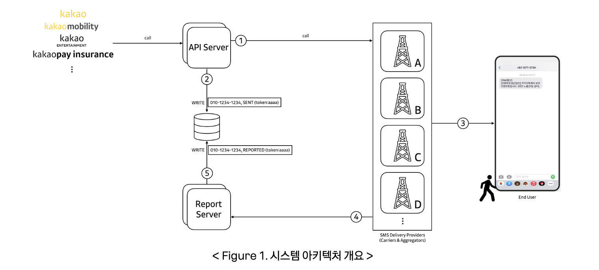
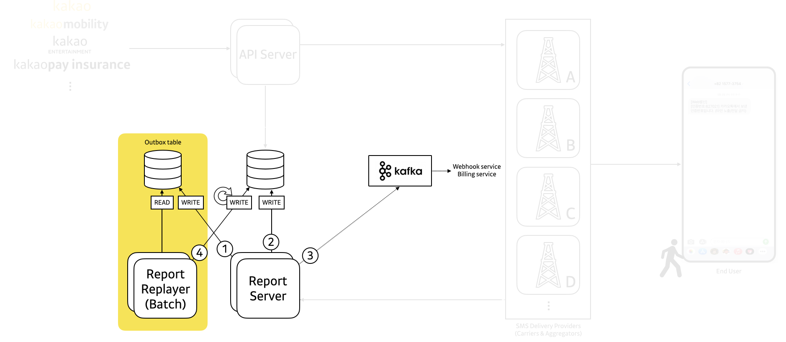
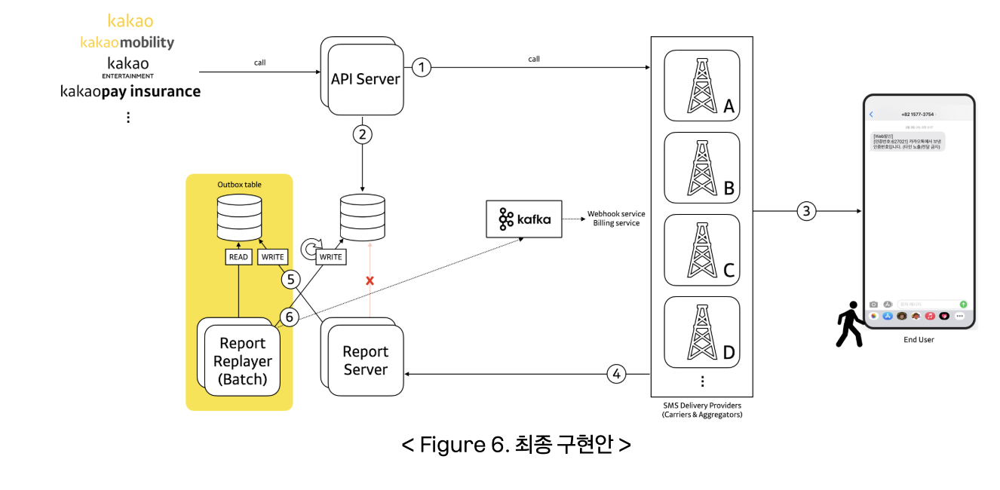

# 잃어버린 리포트를 찾아서: 카카오 메시징 시스템의 경쟁 조건 문제와 안티 패턴 제거 과정

- 읽은 날짜: 2026-04-29
- 회사/작성 주체: Kakao
- 원문: [잃어버린 리포트를 찾아서: 카카오 메시징 시스템의 경쟁 조건 문제와 안티 패턴 제거 과정](https://tech.kakao.com/posts/810)

---

이 글은 카카오 내부 SMS 전송 시스템인 **KIMS**에서 발생한 리포트 누락 문제를 다룬다.
핵심은 **메시지를 DB에 저장하기 전에 벤더사의 전송 결과 리포트가 먼저 도착하면서 생긴 Race Condition 문제**다.
단순히 코드 한 줄이 잘못된 문제가 아니라, 분산 시스템에서 **실행 순서가 뒤집힐 수 있다는 점을 고려하지 못해서 발생한 구조적인 문제**라고 볼 수 있다.
---
## **1. 시스템 흐름**
KIMS는 카카오 내부 서비스에서 SMS 전송을 담당하는 시스템이다.
정상적인 흐름은 다음과 같다.

```text
① API Server는 실시간 품질 지표를 기준으로, 여러 벤더사 중 가장 적합한 곳으로 메시지 전송 요청을 라우팅

② 벤더사 호출 이후, 메시지를 SENT 상태로 DB에 기록

③ 메시지는 실제 단말 사용자에게 전달

④ 이후 벤더사는 어떤 메시지가 언제, 어떤 결과로 전달되었는지에 대한 전송 결과 리포트를 우리에게 전송

⑤ 리포트를 수신하면, 메시지의 상태를 REPORTED 상태로 DB에 업데이트
```
여기서 상태의 의미는 다음과 같다.
```text
SENT
= 벤더사에 메시지 전송 요청이 성공한 상태

REPORTED
= 벤더사의 최종 전송 결과 리포트까지 DB에 반영된 상태
```
즉, `SENT`는 “문자를 아직 안 보냈다”가 아니다.
이미 벤더사에 전송 요청은 성공했지만, 최종 결과 리포트가 아직 반영되지 않은 상태에 가깝다.
---
## **2. 발생한 문제**
운영 중 일부 메시지가 `REPORTED`로 바뀌지 않고 `SENT` 상태에 계속 머무르는 문제가 발생했다.
처음에는 벤더사가 리포트를 보내지 않았거나, Report Server가 리포트를 받지 못했다고 생각할 수 있다.
하지만 로그를 확인해보니 리포트 수신 기록은 있었다.
실제 문제 상황은 다음과 같다.
```text
1. API Server가 벤더사 호출에 성공한다.
2. 아직 DB에 메시지를 저장하기 전이다.
3. 벤더사가 전송 결과 리포트를 매우 빠르게 보낸다.
4. Report Server가 리포트를 받는다.
5. Report Server가 DB에서 메시지를 조회한다.
6. 아직 메시지가 없어서 조회에 실패한다.
7. 리포트가 처리되지 않는다.
8. 이후 API Server가 메시지를 SENT 상태로 저장한다.
9. 결과적으로 메시지는 SENT 상태에 머문다.
```
리포트가 실제로 사라진 것은 아니다.
리포트가 너무 빨리 도착해서, 처리할 수 없는 타이밍에 들어온 것이다.
---
## **3. 핵심 원인: Race Condition**
이 문제의 핵심은 **Race Condition**이다.
Race Condition은 여러 작업이 동시에 실행될 때, **실행 순서에 따라 결과가 달라지는 문제**를 말한다.
이번 사례에서는 두 작업이 경쟁했다.
```text
API Server
→ 메시지를 DB에 SENT 상태로 저장하려는 작업

Report Server
→ 벤더 리포트를 받아 메시지를 REPORTED 상태로 바꾸려는 작업
```
원래 기대한 순서는 다음과 같다.
```text
API Server가 DB에 SENT 저장
        ↓
Report Server가 리포트 수신
        ↓
DB에서 메시지를 찾음
        ↓
REPORTED로 변경
```
하지만 실제로는 다음 순서가 발생했다.
```text
API Server가 벤더 호출 성공
        ↓
Report Server가 리포트 수신
        ↓
Report Server가 DB 조회
        ↓
아직 메시지가 없음
        ↓
리포트 처리 실패
        ↓
API Server가 뒤늦게 SENT 저장
```
이처럼 분산 시스템에서는 API Server, Report Server, 외부 벤더사, DB가 각각 독립적으로 동작하기 때문에 순서를 마음대로 보장하기 어렵다.
기존 시스템은 사실상 이런 가정을 하고 있었다.
```text
벤더 리포트는 DB 저장이 끝난 뒤에 도착할 것이다.
```
하지만 특정 벤더사가 리포트를 너무 빠르게 보내면서 이 가정이 깨졌다.
---
## **4. 왜 특정 벤더사와 유료 메시지에서 많이 발생했나?**
문제는 모든 벤더와 모든 메시지에서 동일하게 발생한 것이 아니었다.
특정 벤더사와 유료 메시지에서 주로 발생했다.
## **특정 벤더사에서 많이 발생한 이유**
일반적인 벤더사는 메시지 전송 요청 이후 리포트를 보내기까지 평균 1초 이상 걸렸다.
하지만 문제의 벤더사는 리포트를 매우 빠르게 보냈다.
```text
일반 벤더사
→ 리포트 도착까지 평균 1초 이상

문제 벤더사
→ 리포트 도착까지 평균 약 20ms

리포트 누락 사례
→ 약 8ms 만에 리포트 도착
```
8ms는 매우 짧은 시간이다.
그 사이에 API Server가 후처리를 하고 DB에 저장하고 Commit까지 끝내지 못할 수 있다.
그래서 Report Server가 먼저 DB를 조회했고, 아직 저장되지 않은 메시지를 찾지 못한 것이다.
## **유료 메시지에서 많이 발생한 이유**
유료 메시지는 무료 메시지보다 처리 과정이 더 길었다.
과금 이벤트 발행이라는 추가 후처리 로직이 있었기 때문이다.
기존 구조는 대략 다음과 같았다.
```text
@Transactional 시작
    벤더 호출
    메시지 상태 변경
    과금 이벤트 발행
    DB 저장
@Transactional 종료 및 Commit
```
트랜잭션 안에서 처리할 일이 많아질수록 Commit 시점은 늦어진다.
유료 메시지는 과금 이벤트 발행 로직까지 포함되어 있었기 때문에 DB에 메시지가 실제로 반영되는 시점이 더 늦어졌다.
그 결과 리포트가 DB 저장보다 먼저 도착할 가능성이 더 커졌다.
---
## **5. 해결 과정**
이 글의 해결 과정은 한 번에 끝난 것이 아니라, 문제를 줄이는 단계에서 시작해서 구조적으로 제거하는 방향으로 발전했다.
흐름은 다음과 같다.
```text
1. 트랜잭션을 줄여서 Commit을 빠르게 만든다.
2. 불필요한 @Transactional을 제거한다.
3. Outbox를 도입해서 리포트를 먼저 안전하게 저장한다.
4. Single Writer 구조로 쓰기 경로를 하나로 통일한다.
```
---
## **5-1. 첫 번째 조치: 트랜잭션 줄이기**
가장 먼저 한 일은 트랜잭션을 가볍게 만드는 것이었다.
기존에는 과금 이벤트 발행 같은 후처리 로직이 트랜잭션 내부에 있었다.
기존 구조는 다음과 같다.
```text
트랜잭션 시작
    메시지 상태 변경
    과금 이벤트 발행
    DB 저장
트랜잭션 커밋
```
이 구조의 문제는 과금 이벤트 발행까지 트랜잭션 안에서 처리되기 때문에 트랜잭션이 길어진다는 점이다.
트랜잭션이 길어지면 DB Commit이 늦어진다.
그러면 Report Server가 리포트를 먼저 받아 DB를 조회했을 때 메시지를 찾지 못할 가능성이 커진다.
그래서 과금 이벤트 발행을 트랜잭션 밖으로 분리했다.
개선 구조는 다음과 같다.
```text
트랜잭션 시작
    메시지 상태 변경
    DB 저장
트랜잭션 커밋
    커밋 이후 과금 이벤트 발행
```
Spring에서는 `@TransactionalEventListener`를 사용해서 트랜잭션 커밋 이후 이벤트를 처리할 수 있다.
```java
@TransactionalEventListener(phase = TransactionPhase.AFTER_COMMIT)
public void handle(Event event) {
    // 커밋 이후 과금 이벤트 발행
}
```
이렇게 하면 DB 상태 변경과 저장까지만 트랜잭션 안에서 처리하고, 과금 이벤트 발행은 커밋 이후 비동기로 실행할 수 있다.
실제로 리포트 누락은 줄어들었다. 하지만 이 방법은 문제를 완전히 없애지는 못했다.
> Commit을 빠르게 만들 수는 있지만,
DB 저장 시간을 0ms로 만들 수는 없다.
즉, 벤더사가 리포트를 극단적으로 빠르게 보내면 여전히 리포트가 먼저 도착할 수 있다.
---
## **5-2. 두 번째 조치: 불필요한 @Transactional 제거**
트랜잭션은 강력하지만 비용이 있다.
```text
DB 커넥션을 점유한다.
Commit 시점을 늦출 수 있다.
트랜잭션 안의 작업이 많으면 병목이 생긴다.
```
그래서 해당 처리 경로를 다시 분석했다.
이 경로에서 핵심 Write 작업은 사실상 하나였다.
```text
메시지를 SENT 상태로 저장하는 작업
```
여러 테이블을 동시에 변경해서 반드시 전부 성공하거나 전부 실패해야 하는 복잡한 구조가 아니었다.
또 트랜잭션 안에서 읽던 데이터도 벤더 품질 지표나 벤더 설정 같은 참고용 데이터였다.
```text
벤더별 성공률
벤더별 응답 속도
벤더별 라우팅 우선순위
```
이 데이터들은 메시지의 최종 상태처럼 강한 최신성이 필요한 데이터가 아니다.
1분 전 데이터여도 라우팅 판단에 큰 문제가 없을 수 있다.
반대로 `SENT`, `REPORTED` 같은 메시지 상태는 정확해야 한다.
하지만 벤더 품질 지표는 “어느 벤더로 보낼지” 정하는 참고 데이터이기 때문에 약간 오래된 값도 허용 가능하다.
그래서 이 경로에서 `@Transactional`이 주는 이점보다 비용이 더 크다고 판단했다.
결국 `@Transactional`을 제거했다.
이 조치의 효과는 다음과 같다.
```text
DB 커넥션 점유 시간이 크게 줄어든다.
Commit 지연이 줄어든다.
시스템 처리량이 좋아진다.
리포트 누락 가능성이 더 낮아진다.
```
하지만 이것도 완전한 해결책은 아니었다.
트랜잭션을 줄이고 제거해도 여전히 이런 상황은 가능하다.
```text
리포트가 1ms 만에 도착한다.
DB 저장은 3ms 걸린다.
Report Server가 먼저 조회한다.
메시지를 찾지 못한다.
```
즉, 문제 발생 확률은 낮아졌지만, Race Condition 자체가 사라진 것은 아니었다.
---
## **5-3. 세 번째 조치: Transactional Outbox Pattern 도입**
이제 필요한 것은 문제 발생 확률을 낮추는 것이 아니라, 리포트가 먼저 도착해도 안전한 구조를 만드는 것이었다.
그래서 도입한 것이 **Transactional Outbox Pattern**이다.
기존 구조에서는 리포트가 도착하면 Report Server가 바로 메시지를 조회하고 상태를 변경하려고 했다.
```text
리포트 도착
    ↓
DB에서 메시지 조회
    ↓
메시지가 있으면 REPORTED로 변경
    ↓
메시지가 없으면 처리 실패
```
이 구조의 문제는 리포트 도착 시점에 반드시 메시지가 DB에 있어야 한다는 것이다.
Outbox를 도입하면 흐름이 바뀐다.

```text
리포트 도착
    ↓
Report Server가 리포트를 Outbox에 저장
    ↓
Report Replayer가 나중에 Outbox 조회
    ↓
메시지 상태를 REPORTED로 변경
```
이렇게 하면 리포트가 먼저 도착해도 사라지지 않는다.
예를 들어 메시지가 아직 DB에 없는 상태에서 리포트가 도착해도 다음과 같이 처리할 수 있다.
```text
리포트가 먼저 도착한다.
    ↓
Outbox에 저장한다.
    ↓
지금 당장 메시지가 없으면 나중에 다시 처리한다.
    ↓
API Server가 메시지를 SENT 상태로 저장한다.
    ↓
Report Replayer가 Outbox를 다시 읽고 REPORTED로 변경한다.
```
즉, Outbox는 리포트를 안전하게 보관하는 임시 저장소 역할을 한다.
이 조치의 장점은 다음과 같다.
```text
리포트를 바로 처리하지 못해도 유실되지 않는다.
DB 저장과 리포트 도착 순서가 뒤집혀도 안전하다.
실패한 리포트를 나중에 재처리할 수 있다.
```
이 방식으로 DB 기준 리포트 누락은 해결되었다.
하지만 초기 Outbox 구조에는 새로운 문제가 있었다.
---
## **5-4. 초기 Outbox 구조의 문제: Writer가 두 개였다**
초기 Outbox 구조는 다음과 같았다.
```text
Report Server
    리포트를 수신한다.
    Outbox에 저장한다.
    기존 로직대로 메시지 상태를 REPORTED로 변경한다.
    과금 이벤트를 발행한다.

Report Replayer
    Outbox를 주기적으로 읽는다.
    처리되지 않은 리포트를 재처리한다.
    메시지 상태를 REPORTED로 변경한다.
```
겉으로 보면 Report Server가 실시간 처리를 하고, Report Replayer가 안전망 역할을 하는 구조처럼 보인다.
하지만 문제는 같은 데이터에 대해 쓰기를 수행하는 주체가 두 개가 되었다는 점이다.
```text
Report Server도 메시지 상태를 변경한다.
Report Replayer도 메시지 상태를 변경한다.
```
이렇게 되면 또 다른 Race Condition이 생긴다.
특히 과금 이벤트 중복 발행을 막기 위한 멱등성 가드와 충돌했다.
---
## **5-5. 멱등성 가드와 충돌한 이유**
벤더사는 같은 리포트를 여러 번 보낼 수 있다.
네트워크 장애나 재시도 때문에 중복 리포트가 들어올 수 있기 때문이다.
하지만 같은 리포트가 여러 번 들어왔다고 과금 이벤트를 여러 번 발행하면 안 된다.
그래서 시스템에는 멱등성 가드가 있었다.
대표적인 방식은 조건부 업데이트다.
```sql
UPDATE mt_messages
SET status = 'REPORTED'
WHERE token = 'aaaa'
  AND status = 'SENT'
```
이 SQL의 의미는 다음과 같다.
```text
현재 상태가 SENT일 때만 REPORTED로 바꾼다.
이미 REPORTED라면 아무것도 하지 않는다.
```
처음 리포트가 들어오면 다음처럼 동작한다.
```text
현재 상태: SENT
업데이트 성공
SENT → REPORTED
과금 이벤트 발행
```
중복 리포트가 들어오면 다음처럼 동작한다.
```text
현재 상태: REPORTED
업데이트 실패
과금 이벤트 발행 안 함
```
이 방식은 중복 과금을 막기 위해 필요하다.
하지만 초기 Outbox 구조에서는 Report Server와 Report Replayer가 동시에 같은 메시지를 처리할 수 있었다.
문제 상황은 다음과 같다.
```text
1. Report Server가 리포트를 받는다.
2. Report Server가 Outbox에 저장한다.
3. Report Server가 아직 상태 변경을 하기 전이다.
4. Report Replayer가 Outbox를 읽는다.
5. Report Replayer가 먼저 메시지 상태를 SENT → REPORTED로 바꾼다.
6. Report Server가 뒤늦게 상태 변경을 시도한다.
7. 이미 REPORTED라서 멱등성 가드에 의해 업데이트가 실패한다.
8. Report Server는 과금 이벤트를 발행하지 않는다.
```
결과적으로 이런 상태가 된다.
```text
DB 상태는 REPORTED
하지만 과금 이벤트는 발행되지 않음
```
즉, 리포트 누락을 해결하려고 Outbox를 도입했는데, 이번에는 과금 이벤트 누락이라는 새로운 문제가 생긴 것이다.
원인은 명확했다.
```text
같은 데이터에 대해 쓰기를 수행하는 주체가 두 개였다.
```
---
## **5-6. 네 번째 조치: Single Writer Principle 적용**
최종 해결책은 **Single Writer Principle**이었다.
Single Writer Principle은 같은 데이터에 대해 쓰기를 수행하는 주체를 하나만 두자는 원칙이다.
읽는 주체는 여러 개여도 괜찮다.
하지만 쓰는 주체가 여러 개면 실행 순서에 따라 결과가 달라지는 경쟁 조건이 생기기 쉽다.
그래서 최종 구조에서는 역할을 명확하게 분리했다.

```text
Report Server
    리포트를 수신한다.
    Outbox에 저장만 한다.
    메시지 상태는 변경하지 않는다.
    과금 이벤트도 발행하지 않는다.

Report Replayer
    Outbox를 읽는다.
    메시지 상태를 REPORTED로 변경한다.
    과금 이벤트를 발행한다.
    Outbox 처리 완료 상태를 기록한다.
```
즉, Report Server는 단순히 리포트를 안전하게 받아 저장하는 역할만 한다.
실제 비즈니스 처리는 Report Replayer가 전담한다.
최종 흐름은 다음과 같다.
```text
벤더 리포트 도착
    ↓
Report Server가 Outbox에 저장
    ↓
Report Replayer가 Outbox를 주기적으로 조회
    ↓
메시지 상태를 REPORTED로 변경
    ↓
과금 이벤트 발행
    ↓
처리 완료 기록
```
이 구조에서는 Report Server와 Report Replayer가 같은 메시지 상태를 두고 경쟁하지 않는다.
상태 변경과 과금 이벤트 발행이 하나의 경로에서만 일어나기 때문이다.
이렇게 해서 다음 문제들이 해결되었다.
```text
리포트가 먼저 도착해도 유실되지 않는다.
메시지 상태 변경 주체가 하나라서 경쟁 조건이 줄어든다.
과금 이벤트 발행도 하나의 경로에서 관리된다.
중복 리포트가 들어와도 멱등성 가드로 중복 과금을 막을 수 있다.
```
---
## **6. 최종 구조**
최종 구조는 다음과 같다.
```text
1. 벤더사가 리포트를 보낸다.
2. Report Server는 리포트를 받는다.
3. Report Server는 리포트를 판단하지 않고 Outbox에 저장만 한다.
4. Report Replayer가 Outbox를 읽는다.
5. 메시지 상태를 SENT에서 REPORTED로 변경한다.
6. 상태 변경에 성공하면 과금 이벤트를 발행한다.
7. Outbox 처리 완료 상태를 기록한다.
```
이 구조의 핵심은 두 가지다.
```text
리포트는 먼저 안전하게 저장한다.
실제 상태 변경과 과금 이벤트 발행은 하나의 Writer가 처리한다.
```
이렇게 하면 리포트 도착 순서에 덜 의존하게 된다.
예전에는 리포트가 도착하는 순간 DB에 메시지가 반드시 있어야 했다.
하지만 최종 구조에서는 리포트가 먼저 도착해도 괜찮다.
```text
리포트가 먼저 도착한다.
    ↓
Outbox에 저장된다.
    ↓
메시지가 아직 없으면 나중에 다시 처리한다.
    ↓
결국 REPORTED로 반영된다.
```
즉, 즉시 처리에 실패해도 리포트가 사라지지 않는 구조가 된 것이다.
---
## **7. 이 구조의 트레이드오프**
최종 구조도 장점만 있는 것은 아니다.
Outbox와 Replayer를 사용하면 리포트를 즉시 반영하지 않고 나중에 처리하게 된다.
즉, 약간의 지연이 생긴다.
```text
리포트 도착
    ↓
Outbox 저장
    ↓
Replayer 처리
    ↓
DB 상태 반영
```
그래서 실시간성은 조금 떨어질 수 있다.
하지만 과금과 정산이 관련된 시스템에서는 빠른 것보다 정확한 것이 더 중요하다.
```text
빠르지만 틀릴 수 있는 처리
보다
조금 늦더라도 반드시 맞는 처리
가 더 중요하다.
```
이런 방식을 **최종 일관성(Eventual Consistency)**이라고 한다.
당장은 상태 반영이 조금 늦어질 수 있지만, 시간이 지나면 결국 정확한 상태가 되는 방식이다.
이번 사례에서는 리포트가 몇 초 늦게 반영되는 것은 허용할 수 있지만, 리포트나 과금 이벤트가 누락되는 것은 허용하기 어려웠다.
그래서 즉시성을 조금 포기하고 정확성과 안정성을 선택한 것이다.
---
## **8. 최종 핵심 정리**
이 기술블로그의 핵심은 **분산 시스템에서 실행 순서를 믿으면 안 된다**는 것이다.
기존 시스템은 벤더 리포트가 DB 저장 이후에 도착할 것이라고 가정했다.
하지만 특정 벤더사가 너무 빠르게 리포트를 보내면서 이 가정이 깨졌고, Race Condition이 발생했다.
처음에는 트랜잭션을 줄이고 제거해서 문제 발생 확률을 낮췄다.
하지만 이것은 근본적인 해결책이 아니었다.
근본 해결은 리포트가 먼저 도착해도 안전한 구조를 만드는 것이었다.
이를 위해 Outbox를 도입해서 리포트를 먼저 안전하게 저장하고, Single Writer 구조를 적용해 하나의 처리 경로에서 상태 변경과 과금 이벤트 발행을 담당하도록 했다.
정리하면 다음과 같다.
```text
트랜잭션 줄이기
→ Commit 지연 감소

@Transactional 제거
→ DB 커넥션 점유 시간 감소

Outbox 도입
→ 리포트 유실 방지

Single Writer 적용
→ 쓰기 경쟁 제거
```
결론적으로 이 사례는 다음을 보여준다.
```text
트랜잭션은 만능 해결책이 아니다.
분산 시스템에서는 실행 순서가 언제든 뒤집힐 수 있다.
동시성 문제는 확률을 줄이는 것보다 경쟁 자체를 없애는 구조가 중요하다.
Outbox는 유실을 막고, Single Writer는 쓰기 경쟁을 제거하는 데 효과적이다.
빠른 처리보다 정확한 처리가 중요한 도메인에서는 최종 일관성이 더 적합할 수 있다.
```
---
## 10. 느낀점
이 글을 읽고 분산 시스템에서는 내가 예상한 순서대로 항상 동작하지 않을 수 있다는 점이 가장 인상 깊었다.
특히 메시지가 DB에 저장되기 전에 리포트가 먼저 도착해서 문제가 생긴 부분을 보면서, 단순한 코드 문제가 아니라 시스템 구조 자체가 중요하다는 것을 느꼈다.
또 `@Transactional`도 무조건 많이 쓰는 것이 좋은 게 아니라, 필요한 범위에서 짧게 사용해야 한다는 점을 알게 되었다.
마지막으로 Outbox Pattern과 Single Writer 구조를 통해 문제를 임시로 막는 것이 아니라, 경쟁 조건이 생기지 않도록 구조를 바꾼 점이 인상 깊었다.
