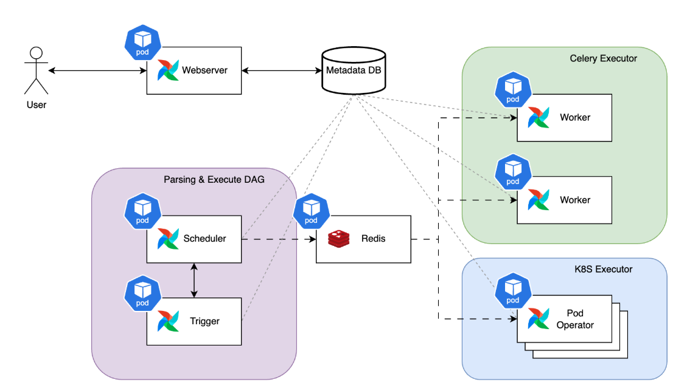
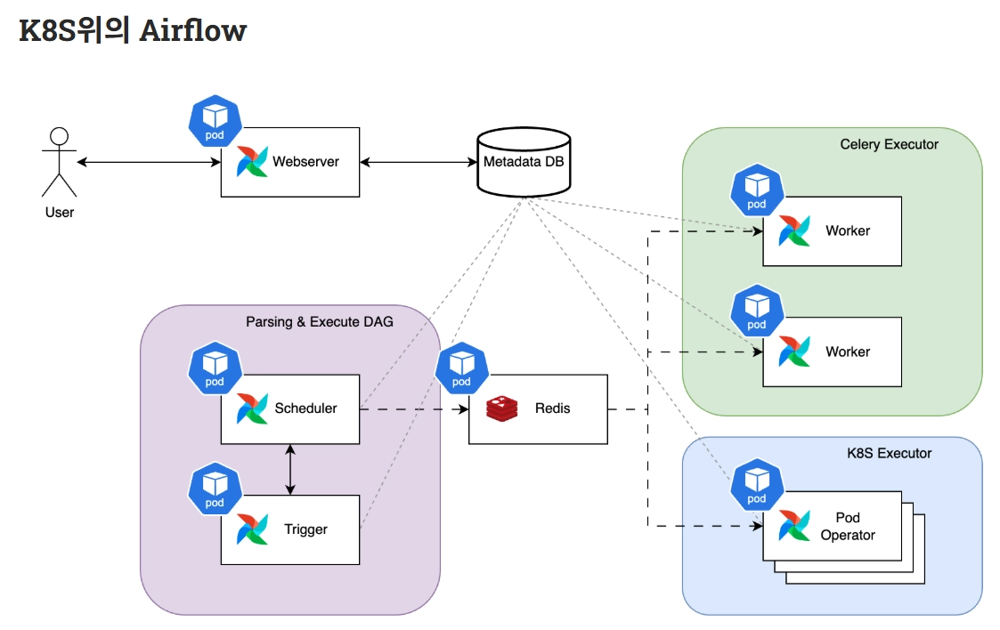
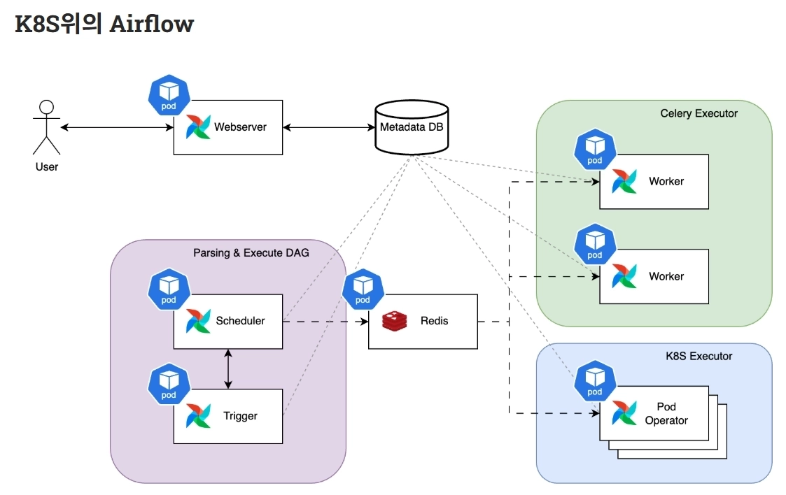

# 서버리스에서 쿠버네티스로 - Airflow 운영 경험기

- 읽은 날짜: 2026-03-25
- 회사/작성 주체: 컬리
- 원문: [서버리스에서 쿠버네티스로 - Airflow 운영 경험기](https://helloworld.kurly.com/blog/airflow-1/)

---

컬리에서는 수많은 데이터 파이프라인과 MLOps, BI 등 다양한 분야에서 워크플로 관리 플랫폼인 Airflow를 사용하고 있다.
최근 그중 데이터 파이프라인에 사용하던 Airflow를 관리형 서비스에서 Kubernetes(K8S) 환경으로 이관을 진행하고 안정적인 운영을 위한 여러 작업을 진행했다.
## Airflow의 운영 환경을 전환하게된 배경
컬리의 데이터 플랫폼은 K8S 환경과 여러 관리형 서비스들을 사용하여 구축되어 있으며 지속해서 기술 성숙도를 높이기 위해 노력했다.
그런 노력중 하나로 오픈소스 기반의 관리형 서비스를 직접 관리하는 K8S 환경으로 전환하기 위해 도전하고 있으며 이번엔 데이터 파이프라인에 사용중인 Airflow의 운영 환경을 전환했다.
- 이를 통해 성능 및 비용 최적화를 달성하고 있으며 직접 부딪히며 기술의 수준을 끌어올리고 있다고 한다.
## K8S위의 Airflow

### 1. Airflow가 무엇인가?
Airflow
- 여러 작업을 정해진 순서대로 실행하게 해주는 워크플로우 플랫폼
중요한 건 Airflow가 직접 비즈니스 로직 자체를 만드는 도구라기보다, 작업의 순서, 실행 시점, 상태 관리, 재시도, 모니터링을 맡는 오케스트레이션 도구이다.
Airflow이 관리하는 것과 관심사들
- 어떤 작업이 먼저 실행돼야 하는가
- 지금 실행 가능한 작업이 뭔지
- 실패했는지 성공했는지
- 다음 작업으로 넘어가도 되는지
- 어디서 실행할지
### 2. DAG가 무엇인가?
DAG(Directed Acyclic Graph)
- Airflow에서 워크플로우를 표현하는 방식
- 즉, 작업들을 어떤 순서와 의존관계로 실행할지 적어 놓은 실행 계획서
중요한 점
1. DAG 안에는 여러 개의 Task가 있다.
2. Task 사이에는 의존 관계가 있다.
즉, DAG는 작업 모음이 아니라 순서가 있는 작업 흐름이다.
### 3. Task가 무엇인가?
Task
- Airflow에서 실제 실행되는 가장 작은 단위
- 즉, DAG가 전체 설계도라면 Task는 그 설계도 안에 들어 있는 개별 작업이다.
Airflow는 이 Task를 하나씩 상태 관리한다.
- 예를 들어, 아직 대기 중인지, 실행 중인지, 성공했는지, 실패힜는지 같은 상태를 관리한다.
- 이 상태들은 metadata database를 중심으로 관리한다.
### 4. Parsing & Execute DAG (그림의 보라색 영역)

이 박스는 DAG를 읽고, 해석하고, 실행 가능한 task를 판단하는 제어 영역을 의미한다.
Scheduler는 그 결과와 상태를 보고 실행 가능한 task를 잡는다.
즉, 이 박스는 실제 무거운 작업을 하는 곳이라기보다 생각하고 지시하는 영역이다.
#### Scheduler
- Airflow의 핵심 관리자
- scheduler는 모든 DAG와 task를 모니터링하고, 의존관계가 충족되면 task instance를 트리거한다.
- 그리고 executor를 사용해 준비된 task를 실행한다.
즉 Scheduler는 이런 역할을 한다.
1. DAG를 본다.
2. 지금 어떤 task가 실행 가능한지 판단한다.
3. 실행 가능한 task를 executor 쪽으로 넘긴다.
4. 상태를 계속 확인한다.
#### Trigger
오래 기다리는 작업을 대신 대기해주는 역할
필요한 이유
- 어떤 task는 실제 계산을 하는 시간이 긴 게 아니라 계속 기다리는 시간이 길 수 있다.
- 이걸 worker가 계속 붙잡고 있으면 worker 자원이 낭비된다.
- 그래서 그 대기만 Triggerer가 맡고, 조건이 만족되면 다시 실행 흐름으로 돌려보낸다.
### 5. Redis는 왜 가운데 있나?

Scheduler 쪽과 Worker 쪽 사이에 Redis가 있다.
Redis는 여기서 메시지 브로커 큐 역할을 한다.
왜 Redis가 필요하냐
- Scheduler가 실행해야 할 Task를 찾았다고 하면 실제로 누가 그 Task를 수행해야 하는데, 그걸 Worker에게 전달할 통로가 필요하다.
- 그 통로가 Redis 같은 브로커다.
실행 흐름
1. Scheduler가 실행할 Task 결정
2. 그 작업 정보를 Redis 큐에 넣음
3. Celery Worker가 큐를 보고 자기 할 일을 가져감
4. 실행 후 결과 상태를 DB에 반영
### 6. Executor
Scheduler와 worker 사이에 있는 실행 방식이다.
즉 Scheduler가 “이 task 실행해”라고 판단하면, Executor가 “그걸 어떤 방식으로 실행할까?”를 정한다.
여기서 대표적인 방식이
- Celery Executor(초록색 영역)
- Kubernetes Executor(파란색 영역)
이 두가지다.
### 7. Cerlery Executor(그림에서 초록색 영역)

CeleryExecutor는 상시 떠 있는 worker들에게 일을 분배하는 방식
#### Worker
Worker는 실제 task를 수행하는 실행 주체다.
Scheduler에 의해 무엇을 실행할지 판단이 끝난 task를 실제로 돌리는 실행 주체다.
#### 실행 흐름
1. Scheduler가 실행할 task를 정함
2. 그 task를 Redis 같은 broker로 보냄
3. Cerlery worker들이 큐에서 task를 가져감
4. worker가 실행함
즉, Celery Executor는 큐 기반 분산 실행 구조이다.
#### 장점
- Worker 수를 늘려서 병렬 처리 가능
- 여러 작업을 분산 실행 가능
- 전통적인 분산 Task Queue 구조라 익숙한 편
Celery Executor 환경에서는 여러 Worker Pod가 큐에서 작업을 가져가 병렬 수행한다
### 8. K8S Executor (그림에서 파란색 영역)

작업 실행 방식 중 하나다.
Celery Executor와 차이는
항상 떠 있는 Worker가 Task를 가져가는 방식이 아니라, Task마다 Kubernetes Pod를 띄워 실행할 수 있다는 점이다.
#### 장점
- task 별로 격리 잘 됨
- 리소스 관리 유연
- 작업 단위로 독립된 Pod 실행 가능
- Kubernetes 환경과 잘 맞음
#### 단점
- Pod 생성/삭제 오버헤드 있음
- 설정 복잡도 있음
즉 K8S Executor는 쿠버네티스의 Pod 생성 능력을 Task 실행에 직접 활용하는 방식이다.
### 9. Metadata DB

가장 중요한 중심 컴포넌트다.
이 DB는 Airflow의 중앙 상태 저장소다.
저장되는 정보들 예시
- DAG 정보
- DAG run 정보
- task instance 상태
- 실행 시간
- 성공/실패 여부
- 재시도 횟수
즉, 지금 어떤 DAG가 돌고 있고, 어떤 Task가 끝났고, 어떤 Task가 실패했는지를 Metadata DB에 전부 적는다.
중요한 이유
- Airflow는 여러 컴포넌트가 분산돼 있어도 다 같이 metadata DB를 기준으로 상태를 맞춘다.
- 그래서 이 DB가 사실상 Airflow의 단일 진실 원천 역할을 한다.
### 10. Webserver

Airflow의 웹 UI를 제공하는 컴포넌트다.
사용자는 여기 접속해서
- DAG 목록
- 각 DAG의 실행 이력
- Task 성공/실패 상태
- 실행 시간
같은 걸 본다.
Webserver가 Metadata DB와 연결되는 이유
- 웹서버는 상태를 직접 들고 있지 않아 화면에 보여줄 정보는 대부분 Metadata DB에서 읽어온다.
- 예를 들어 사용자가 UI에서 DAG 상태를 보면, 그건 Webserver가 Metadata DB를 조회해서 그려주는 것이다.
즉 Webserver는 상태 저장소가 아니라 상태 조회/관리용 창구에 가깝다.
### 11. 전체 흐름

1. 사용자가 Webserver에서 DAG 상태를 보거나 실행한다. Webserver는 필요한 상태를 Metadata DB에서 읽는다.
2. Scheduler가 DAG와 Task 상태를 확인한다. 그리고 지금 실행 가능한 Task를 고른다.
3. Scheduler는 선택된 Task를 Executor에 넘긴다. 여기서 어떤 방식으로 실행할지가 정해진다.
4. CeleryExecutor라면 Worker가 큐에서 Task를 가져가 실행하고, KubernetesExecutor라면 새 Pod가 떠서 Task를 실행한다.
5. 실행 결과와 상태는 다시 Metadata DB에 기록된다. Webserver는 이 정보를 읽어서 화면에 보여준다.
6. 오래 기다리는 Task라면 Triggerer가 대기 구간을 맡아서 worker 자원 낭비를 줄인다.
## 운영 이슈
구조를 이해하는 것과 실제로 운영하는 것은 조금 다른 문제였다.
Kubernetes 위에서 Airflow를 운영해보니, 단순히 DAG를 실행하는 수준을 넘어서 스케줄러의 부하, 워커의 자원 사용량, 그리고 작업 지연이 어떻게 전체 파이프라인 안정성에 영향을 주는지 직접 확인할 수 있었다.
특히 운영 과정에서는 세 가지 문제가 인상적이었다.
스케줄러 CPU 과부하, 워커의 OOM, 그리고 로그조차 남지 않은 채 작업이 지연되는 현상이었다.
### CPU 과부하 문제 해결하기

먼저 스케줄러 CPU 과부하 문제였다.
GitSync로 관리하던 DAG가 늘어나자 스케줄러가 DAG 파일을 더 자주 파싱해야 했고, 그만큼 CPU 사용량도 크게 증가했다.
이 문제는 단순히 DAG가 많아졌다에서 끝나는 게 아니라, 스케줄러가 DAG 변경을 계속 감지하고 메타데이터를 반영하는 역할까지 함께 수행하기 때문에 생긴 부담이었다.
그래서 DAG 변경을 확인하는 주기인 `min_file_process_interval` 값을 조정해 파일 I/O 빈도를 줄였고, 결과적으로 CPU 사용량도 안정적으로 낮출 수 있었다.
즉, 스케줄러는 작업 실행만 관리하는 것이 아니라 DAG를 계속 읽고 해석하는 과정에서도 상당한 자원을 사용한다는 점을 확인할 수 있었다.
### **Airflow 워커의 OOM 문제 해결하기**
다음은 워커의 OOM 문제였다.
Celery 워커는 태스크를 실행할 때 필요한 자원을 요청하는데, Kubernetes 환경에서는 여러 파드가 노드 자원을 함께 사용하다 보니 순간적인 메모리 경합이 발생할 수 있다.
CPU는 어느 정도 조절이 가능하지만, 메모리는 그렇지 않아서 한 번 부족해지면 파드가 축출되거나 노드 자체가 영향을 받는 상황으로 이어질 수 있었다.
이를 줄이기 위해 워커에 request와 limit을 설정해 자원 사용 범위를 더 명확히 했고, 추가로 Taint와 Tolerations를 활용해 자원 사용 특성이 비슷한 애플리케이션끼리 노드를 분리했다.
그 결과 Airflow 워커가 자원 경쟁 때문에 흔들리는 상황을 훨씬 줄일 수 있었다.
### **워커의 사라진 실행 로그 찾기**

가장 흥미로웠던 문제는 로그가 사라진 것처럼 보였던 작업 지연 현상이었다.
처음에는 웹 UI에서 404가 보였기 때문에 로그 저장이나 조회 문제처럼 보였다.
하지만 실제 워커 파드 안을 확인해보니 로그가 삭제된 것이 아니라, 애초에 정상적인 실행 로그가 생성되지 않은 경우가 있었다.
자세히 보니 정상 실행은 `queued` 상태로 넘어간 뒤 워커에서 처리되지만, 문제가 된 실행은 `scheduled` 상태에 오래 머물러 있었다.
즉, 스케줄러에서 실행 대상으로는 잡혔지만 Celery Executor와 워커 쪽으로 실제 할당되기 전에 지연이 누적된 것이다.
당시에는 외부 작업 지연과 동시에 워커가 처리할 수 있는 태스크 수 한계에 가까워져 있었고, 결국 일부 실행은 워커에 도달하기도 전에 타임아웃처럼 밀려버렸다.
이 문제는 워커 수를 늘리는 scale-out 방식으로 완화할 수 있었고, 이후 작업 지연 현상도 눈에 띄게 줄었다.
## 마무리
결국 Kubernetes 위의 Airflow 운영은 “DAG를 잘 실행시키는 문제”가 아니라, 스케줄러가 얼마나 안정적으로 판단하고, 워커가 얼마나 예측 가능하게 자원을 사용하며, 작업이 어디에서 병목되는지를 계속 관찰하고 조정하는 문제에 더 가까웠다.
## 느낀점
처음에는 Kubernetes 용어들이 익숙하지 않아서 많이 어렵게 느껴졌다.
비슷한 역할처럼 보이는 개념도 많아서 헷갈렸지만, 하나씩 정리하면서 전체 흐름을 이해하려고 하니 조금씩 구조가 보이기 시작했다.
이번 내용을 공부하면서 개발은 단순히 기능 구현만이 아니라, 실행 환경과 자원 관리, 장애 대응까지 함께 봐야 한다는 점을 느꼈다.
아직 부족한 부분은 많지만, 새로운 개념을 직접 이해해가는 과정 자체가 좋은 경험이었다.

