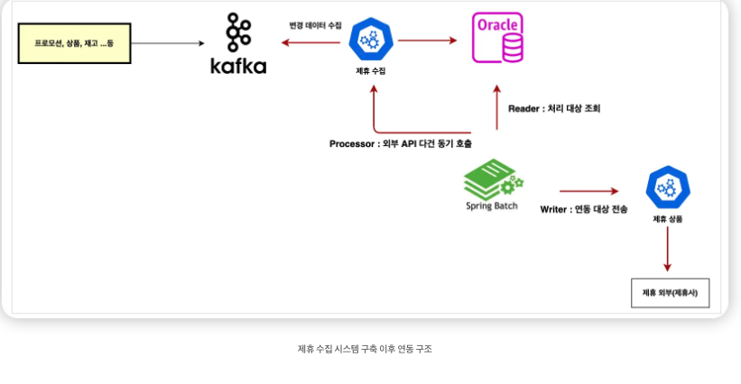
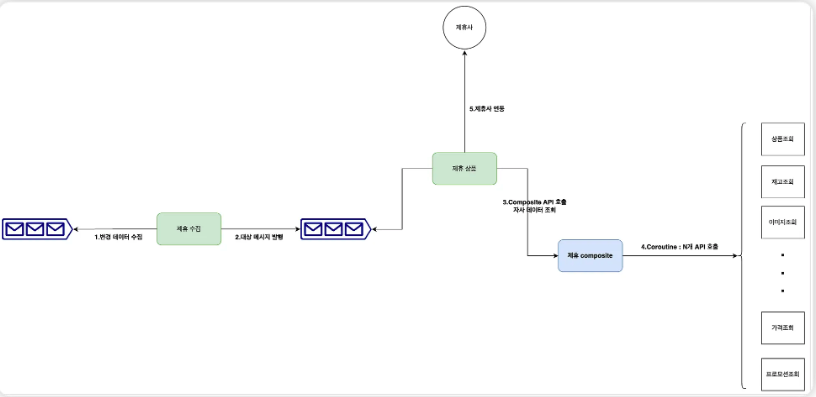
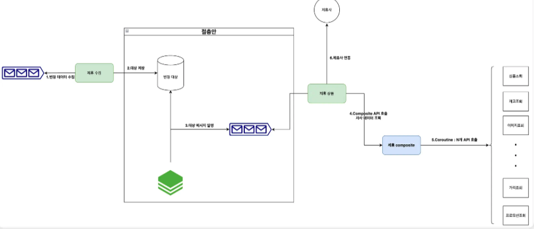
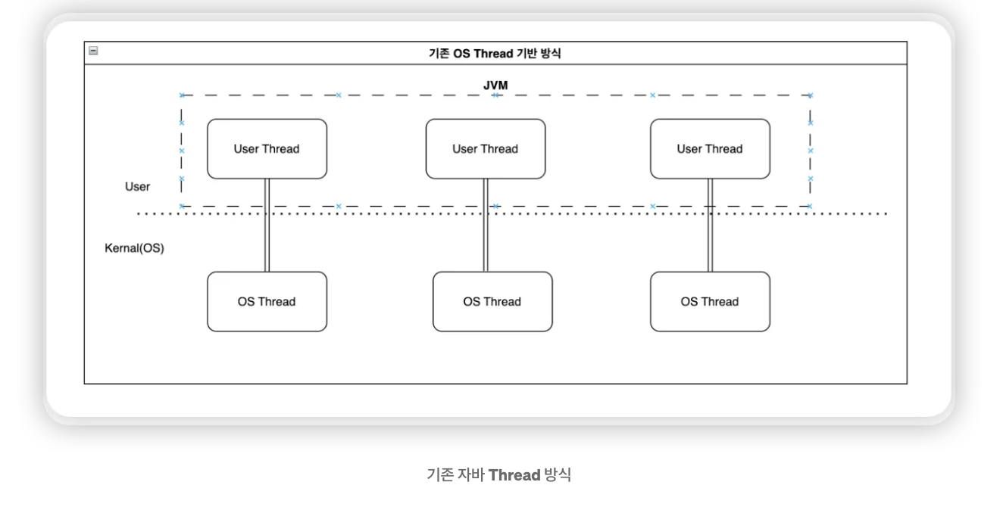
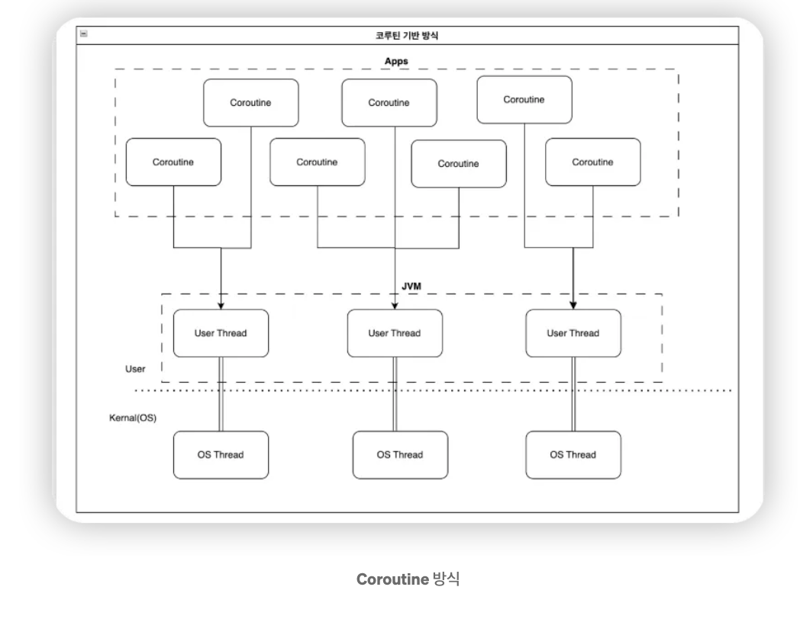
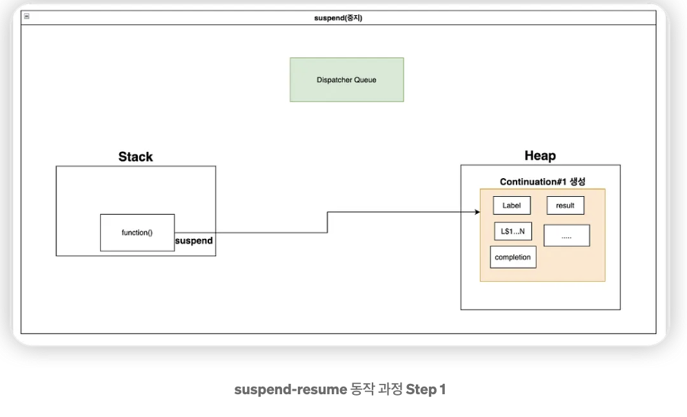
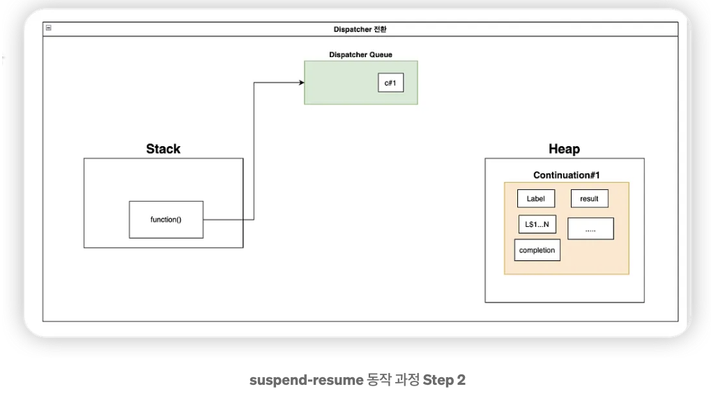
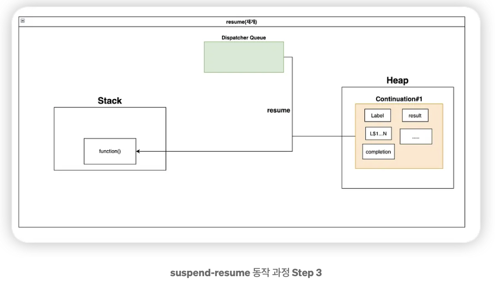

# Kotlin Coroutine으로 구현한 비동기 제휴 연동 시스템 구축기

- 읽은 날짜: 2026-05-20
- 회사/작성 주체: SSG.COM
- 원문: [Kotlin Coroutine으로 구현한 비동기 제휴 연동 시스템 구축기](https://medium.com/ssgtech/kotlin-coroutine%EC%9C%BC%EB%A1%9C-%EA%B5%AC%ED%98%84%ED%95%9C-%EB%B9%84%EB%8F%99%EA%B8%B0-%EC%A0%9C%ED%9C%B4-%EC%97%B0%EB%8F%99-%EC%8B%9C%EC%8A%A4%ED%85%9C-%EA%B5%AC%EC%B6%95%EA%B8%B0-395d26344377)

---

# **SSG 기술블로그 흐름 중심 정리: Kotlin Coroutine 기반 비동기 제휴 연동 시스템**
이 글은 코루틴 개념만 설명하는 글이 아니라, 실제 제휴 연동 시스템에서 병목이 생겼고 그 병목을 줄이기 위해 시스템 구조를 어떻게 바꿨는지 정리한 글이다.
핵심 흐름은 다음과 같다.
```text
기존 Spring Batch 동기 처리 구조
  ↓
Processor에서 15개 이상 API를 순차 호출
  ↓
처리 시간 증가, 스레드 자원 낭비
  ↓
Kafka 이벤트 기반 + Kotlin Coroutine 구조 구상
  ↓
하지만 중복 데이터, 속도 제어, 제휴사 호출 제한 문제 발생
  ↓
Batch + Kafka + Coroutine 절충 구조로 전환
  ↓
가장 큰 병목이던 API 다건 호출을 Coroutine으로 개선
  ↓
Latency, Thread Count, CPU, Heap, GC 지표 개선
```
---
# **1. 기존 시스템의 문제**
기존 제휴 연동 시스템은 Spring Batch 기반으로 동작했다.
구조는 대략 다음과 같다.

```text
Spring Batch
  ↓
Reader
  - 처리 대상 조회
  ↓
Processor
  - 외부 API 다건 호출
  - DTO 조립
  ↓
Writer
  - 저장 또는 제휴사 전송
```
문제는 Processor 단계에 있었다.
상품 하나를 제휴사에 연동하려면 상품 기본 정보, 재고, 옵션, 가격, 이미지, validation 정보 등 여러 API를 호출해야 했다. 블로그에서는 15개 이상의 API를 호출한다고 설명한다.
기존 방식은 이 API들을 순차적으로 호출했다.
```kotlin
//Processor 로직 
{
  ....

        // 1.상품 기본 정보 조회
        ItemBaseDto itemBaseDto = getItemBase(itemId);
  
        // 2.재고 조회
        List<InventoryDto> inventory = getInventory(chnl, itemId, salestrNo, itemBaseDto);
   
        // 3.옵션 조회
        List<OptionDto> optionDtos = getOption(itemId);

        // 4.가격 조회
        List<PriceDto> priceDtos = getPrice(chnl, itemId, salestrNo, itemBaseDto.getItemSellTypeCd());

  .....

        // 14.이미지 조회
        List<ImageDto> imageDtos = getImage(itemId);

        // 15.validation 체크를 위한 정보 조회
        ValidationDto validationDto = getValidation(chnl, itemId, siteNo, salestrNo);

     ....
    }
```
이 구조에서는 API 하나가 느려지면 전체 처리가 같이 느려진다.
즉, 기존 구조의 병목은 API 호출 개수와 순차 처리 방식에서 발생했다.
---
# **2. 문제의 본질은 I/O 대기 시간**
이 시스템이 느린 이유는 CPU 계산이 오래 걸려서가 아니다.
대부분의 시간은 외부 API 응답을 기다리는 시간이다.
```text
API 요청 전송
  ↓
외부 시스템 응답 대기
  ↓
응답 수신
  ↓
다음 API 호출
```
이런 작업은 I/O bound 작업이다.
I/O bound 작업에서는 CPU가 계속 계산하는 것이 아니라, 네트워크나 외부 시스템 응답을 기다리는 시간이 많다.
기존 동기 방식에서는 API 응답을 기다리는 동안 스레드가 해당 작업에 묶인다.
```text
Thread-1
  ↓
API 호출
  ↓
응답 올 때까지 대기
  ↓
그동안 다른 작업 처리 불가
```
스레드 입장에서는 실제로 CPU를 계속 쓰는 것도 아닌데, 작업 하나에 점유되어 있는 상태가 된다.
이게 Blocking 구조의 문제다.
---
# **3. 처음 구상한 구조: Kafka 이벤트 기반 + Coroutine**
처음에는 Spring Batch를 완전히 제거하고, Kafka 이벤트 기반 구조로 전환하는 것을 목표로 했다.
구상한 구조는 다음과 같다.

```text
제휴 수집 서비스
  ↓
변경 데이터 수집
  ↓
Kafka 토픽에 처리 대상 메시지 발행
  ↓
제휴 상품 연동 서비스가 이벤트 수신
  ↓
Composite 서비스 API 호출
  ↓
Composite 서비스 내부에서 Kotlin Coroutine으로 15개 API 동시 호출
  ↓
DTO 조립
  ↓
제휴사 연동
```
이 구조에서 핵심은 Kafka와 Composite 서비스다.
Kafka는 처리 대상을 메시지로 전달하는 역할을 한다.
```text
수집 서비스
  - 변경 데이터 감지
  - Kafka 메시지 발행

연동 서비스
  - Kafka 메시지 소비
  - 제휴사 연동 처리
```
Composite 서비스는 여러 API 호출 결과를 하나로 조립하는 역할을 한다.
```text
제휴 상품 연동 서비스
  ↓
Composite API 하나 호출
  ↓
Composite 서비스가 내부적으로 여러 API 호출
  ↓
최종 DTO 조립 후 반환
```
즉, 제휴 상품 연동 서비스가 15개 API를 직접 호출하지 않고, Composite 서비스에 한 번만 요청한다. 복잡한 API 조립 로직은 Composite 서비스가 담당한다.
---
# **4. 실제 구현은 완전 실시간이 아니라 절충 구조**

처음 목표는 완전한 이벤트 기반 실시간 처리였지만, 실제로는 바로 그렇게 가지 못했다.
이유는 다음과 같다.
```text
중복 데이터 문제
속도 제어 문제
제휴사 API 호출 제한 문제
```
예를 들어 상품 변경 이벤트가 갑자기 많이 발생하면 다음과 같은 문제가 생길 수 있다.
```text
상품 변경 이벤트 대량 발생
  ↓
Kafka 메시지 대량 발행
  ↓
Consumer가 빠르게 처리
  ↓
Composite API 대량 호출
  ↓
내부 API 호출 증가
  ↓
제휴사 API 호출 증가
  ↓
제휴사 호출 제한 초과 가능
```
이벤트 기반 구조는 빠르게 처리할 수 있다는 장점이 있지만, 반대로 제어를 잘못하면 외부 API나 내부 시스템에 부하를 크게 줄 수 있다.
그래서 실제 구현은 Spring Batch를 완전히 제거하지 않고, 역할을 줄이는 방식으로 갔다.
최종 구조는 다음과 같다.
```text
제휴 수집 서비스
  ↓
변경 데이터 수집 후 처리 대상 테이블에 저장
  ↓
Spring Batch
  ↓
Kafka로 처리 대상 메시지 발행
  ↓
제휴 상품 연동 서비스
  ↓
Composite 서비스 API 호출
  ↓
Coroutine으로 내부 API 동시 호출
  ↓
DTO 조립
  ↓
제휴사 연동
```
기존에는 Batch가 조회, 처리, 외부 API 호출, DTO 조립까지 많은 역할을 했다.
개선 후에는 Batch의 역할을 처리 대상 메시지를 Kafka로 발행하는 것으로 줄였다.
```text
기존 Batch 역할
  - 대상 조회
  - API 호출
  - DTO 조립
  - 저장 또는 전송

개선 후 Batch 역할
  - 처리 대상 조회
  - Kafka 메시지 발행
```
가장 큰 병목이었던 15개 API 호출은 Coroutine 기반 Composite 서비스로 옮겼다.
이 부분이 실무적으로 중요하다. 이상적인 구조를 바로 적용하기보다, 기존 시스템과 운영 리스크를 고려해서 점진적으로 바꾼 구조다.
---
# **5. 왜 Kotlin Coroutine을 사용했는가**
기존 Java Thread 기반 방식은 OS Thread와 1:1에 가깝게 매핑된다.

```text
Java Thread
  ↔
OS Thread
```
스레드는 실제 운영체제가 관리하는 실행 단위이기 때문에 비용이 있다.
```text
스레드 생성 비용
스택 메모리 비용
OS 스케줄링 비용
Context Switching 비용
Blocking 시 자원 점유 문제
```
특히 외부 API 호출처럼 응답을 기다리는 작업에서는 비효율이 커진다.
예를 들어 스레드 3개로 API 6개를 호출한다고 하자. 각 API는 1초 걸린다.
Java Thread 기반 동기 처리에서는 대략 이렇게 동작한다.
```text
0초
Thread-1 → API-1 호출
Thread-2 → API-2 호출
Thread-3 → API-3 호출

1초
API-1, API-2, API-3 완료
Thread-1 → API-4 호출
Thread-2 → API-5 호출
Thread-3 → API-6 호출

2초
API-4, API-5, API-6 완료
```
스레드가 3개뿐이기 때문에 동시에 처리할 수 있는 Blocking 작업도 3개로 제한된다.
그래서 6개의 API를 처리하려면 2번 나눠서 처리해야 한다.
```text
6개 API ÷ 3개 스레드 = 2번 처리
총 시간 약 2초
```
반면 Coroutine은 I/O 대기 중에 코루틴만 멈추고, 스레드는 다른 코루틴을 실행할 수 있다.
```text
Coroutine-1 → API 요청
  ↓
응답 대기 중 suspend
  ↓
Thread는 다른 Coroutine 실행
  ↓
응답 도착
  ↓
Coroutine-1 resume
```

---
# **6. suspend와 resume**
Coroutine은 중간에 멈췄다가 다시 이어서 실행될 수 있다.
```text
Coroutine 시작
  ↓
API 요청
  ↓
응답 기다리는 동안 suspend
  ↓
Thread는 다른 Coroutine 실행
  ↓
응답 도착
  ↓
resume
  ↓
중단된 지점부터 다시 실행
```
`suspend`는 스레드를 멈춘다는 뜻이 아니다.
코루틴의 실행을 잠시 중단하고, 나중에 다시 실행할 수 있도록 상태를 저장한다는 뜻이다.
예를 들어 `Thread.sleep()`과 `delay()`는 다르다.
```text
Thread.sleep(1000)
  ↓
현재 Thread 자체가 1초 동안 멈춤
```
```text
delay(1000)
  ↓
현재 Coroutine이 1초 동안 suspend
  ↓
Thread는 다른 Coroutine 실행 가능
```
그래서 Coroutine은 I/O 대기 시간이 많은 작업에서 유리하다.
API 응답을 기다리는 동안 스레드를 계속 붙잡지 않기 때문이다.
---
# **7. suspend 함수의 내부 동작: Continuation**
`suspend` 함수는 컴파일될 때 일반 함수와 다르게 변환된다.
Kotlin 컴파일러는 suspend 함수를 상태 머신 형태로 바꾸고, Continuation 객체를 사용한다.
Continuation은 쉽게 말하면 나중에 이어서 실행하기 위해 필요한 정보를 담은 객체다.
여기에는 다음과 같은 정보가 들어간다.
```text
현재 어디까지 실행했는지
지역 변수 값이 무엇인지
다음에 어디서부터 실행해야 하는지
결과를 어디로 전달해야 하는지
예외가 발생하면 어떻게 처리해야 하는지
```
일반 함수의 실행 정보는 JVM Stack에 저장된다.
하지만 코루틴은 중간에 suspend되었다가 나중에 다시 실행되어야 하므로, 실행 상태를 Stack에만 둘 수 없다.
그래서 중단 시점의 상태를 Continuation 객체로 만들어 Heap에 저장한다.
```text
Coroutine 실행 중
  ↓
suspend 지점 도달
  ↓
현재 실행 상태를 Continuation에 저장
  ↓
Continuation은 Heap에 저장
  ↓
Thread는 다른 작업 실행
  ↓
작업 완료 후 Continuation resume
  ↓
중단된 위치부터 다시 실행
```
이 구조 덕분에 코루틴은 스레드를 오래 점유하지 않고도 비동기 작업을 이어서 처리할 수 있다.
---
# suspend - resume 동작 과정
### 1. suspend 함수를 만나면, 현재 실행 중인 상태를 저장하기 위해 Continuation 객체가 생성되어 Heap에 저장된다.
이 객체는 중단 시점의 변수, 실행 위치(label)등의 다양한 정보를 담고 있다.

### 2. 상태 저장이 완료되면, 실행 제어권은 Dispatcher의 큐로 전환되고, Dispatcher는 나중에 resume 할 수 있도록 Continuation 객체를 참조하는 값을 큐에 등록한다.

### 3. 작업이 완료되면, Dispatcher는 등록된 값을 꺼내고, resume를 호출하면서 코루틴은 중단 지점부터 실행을 재개하게 된다.

---
# **8. async, await, combine 흐름**
글에서 핵심적으로 사용한 패턴은 다음과 같다.
```kotlin
coroutineScope {
    val a = async { api1() }
    val b = async { api2() }
    val c = async { api3() }

    combine(a.await(), b.await(), c.await())
}
```
이 코드는 api1, api2, api3을 동시에 시작하고, 세 결과가 모두 준비되면 combine으로 하나의 결과를 만드는 코드다.
---
## **coroutineScope**
`coroutineScope`는 여러 코루틴을 하나의 작업 단위로 묶는 공간이다.
```text
부모 coroutineScope
  ├─ async { api1() }
  ├─ async { api2() }
  └─ async { api3() }
```
이 안에서 만든 코루틴들은 부모-자식 관계를 가진다.
특징은 다음과 같다.
```text
자식 코루틴들이 끝나기 전까지 부모 scope는 끝나지 않는다.
부모가 취소되면 자식도 취소된다.
자식 중 하나가 실패하면 전체 scope가 취소될 수 있다.
```
이런 구조를 구조적 동시성이라고 한다.
비동기 작업을 아무 곳에서나 따로 실행하는 것이 아니라, 부모 scope 안에서 생명주기를 관리하는 방식이다.
---
## **async**
`async`는 결과를 반환하는 코루틴을 만드는 함수다.
```kotlin
val a = async { api1() }
```
여기서 `a`에는 `api1()`의 결과가 바로 들어가는 것이 아니다.
`a`에는 `Deferred<T>`라는 비동기 결과 객체가 들어간다.
예를 들어 `api1()`이 `ItemDto`를 반환한다면 다음처럼 이해할 수 있다.
```kotlin
val a: Deferred<ItemDto> = async { api1() }
```
`Deferred<T>`는 나중에 T 타입 결과를 받을 수 있는 객체다.
기본 설정에서 `async`는 호출되는 순간 작업을 실행 예약한다.
```kotlin
val a = async { api1() } // api1 시작
val b = async { api2() } // api2 시작
val c = async { api3() } // api3 시작
```
그래서 세 API가 순차적으로 실행되는 것이 아니라 거의 동시에 실행된다.
---
## **await**
`await()`는 `Deferred<T>`에서 실제 결과를 꺼내는 함수다.
```kotlin
val resultA = a.await()
```
결과가 이미 준비되어 있으면 바로 반환한다.
결과가 아직 준비되지 않았으면 현재 코루틴을 suspend하고 기다린다.
```text
a.await()
  ↓
결과가 있으면 바로 반환
  ↓
결과가 없으면 현재 Coroutine suspend
  ↓
Thread는 다른 Coroutine 실행 가능
```
중요한 점은 `await()`가 스레드를 막는 것이 아니라 코루틴만 멈춘다는 것이다.
그래서 여러 API를 동시에 시작해두고, 마지막에 결과만 기다릴 수 있다.
---
## **combine**
`combine()`은 여러 API 결과를 하나의 최종 결과로 조립하는 함수다.
예를 들어 다음과 같은 API들이 있다고 하자.
```text
api1() → 상품 기본 정보
api2() → 재고 정보
api3() → 가격 정보
```
그러면 combine은 이 결과들을 모아서 최종 DTO를 만든다.
```text
상품 기본 정보
  +
재고 정보
  +
가격 정보
  ↓
PartnerProductDto
```
즉, 전체 흐름은 다음과 같다.
```text
async로 여러 API 호출 시작
  ↓
await로 각 API 결과 수집
  ↓
combine으로 하나의 응답 DTO 조립
```
Composite 서비스에서 이 패턴이 중요하게 사용된다.
---
# **9. async 내부 동작 흐름**
```text
1. 현재 coroutineContext와 전달받은 context를 합친다.
2. CoroutineStart 설정을 확인한다.
3. DeferredCoroutine 또는 LazyDeferredCoroutine을 만든다.
4. 코루틴을 스케줄링한다.
5. Deferred<T>를 반환한다.
```
이걸 쉽게 풀면 다음과 같다.
```text
async는 새 코루틴 작업을 만들고
어떤 환경에서 실행할지 정하고
바로 시작할지 나중에 시작할지 확인하고
Dispatcher에게 실행을 맡긴 뒤
나중에 결과를 받을 수 있는 Deferred를 반환한다.
```
---
## **coroutineContext를 합친다는 의미**
`coroutineContext`는 코루틴 실행에 필요한 설정 묶음이다.
들어갈 수 있는 정보는 다음과 같다.
```text
어떤 Dispatcher에서 실행할지
부모 Job이 무엇인지
코루틴 이름이 무엇인지
예외 처리는 어떻게 할지
로그 추적 정보는 무엇인지
```
예를 들어 다음 코드가 있다.
```kotlin
coroutineScope {
    val a = async(Dispatchers.IO) {
        api1()
    }
}
```
이 경우 async는 부모 scope의 context를 물려받고, 여기에 `Dispatchers.IO`를 추가한다.
```text
부모 coroutineScope의 context
+
async에 전달한 Dispatchers.IO
```
즉, 부모-자식 관계는 유지하면서 실행은 IO 작업에 적합한 Dispatcher에서 하도록 설정하는 것이다.
---
## **CoroutineStart 확인**
`CoroutineStart`는 코루틴을 언제 시작할지 정하는 설정이다.
기본값은 `DEFAULT`다.
```kotlin
async {
    api1()
}
```
이 코드는 기본적으로 다음과 같다.
```kotlin
async(start = CoroutineStart.DEFAULT) {
    api1()
}
```
`DEFAULT`는 async를 호출하면 바로 실행 예약한다는 의미다.
반면 `LAZY`는 바로 실행하지 않는다.
```kotlin
val a = async(start = CoroutineStart.LAZY) {
    api1()
}
```
이 경우 `api1()`은 `await()`나 `start()`를 호출할 때 시작된다.
```text
DEFAULT
  → async 호출 시 바로 실행 예약

LAZY
  → async 호출만으로는 실행하지 않음
  → await 또는 start 호출 시 실행
```
---
## **DeferredCoroutine 생성**
`DeferredCoroutine`은 결과를 가지는 코루틴 작업 객체다.
`async { api1() }`를 호출하면 내부적으로 다음 정보를 관리하는 객체가 만들어진다.
```text
실행할 코드
실행 상태
결과값
예외
취소 상태
await 요청
```
`start = LAZY`라면 바로 실행하지 않아야 하므로 `LazyDeferredCoroutine`이 사용된다.
정리하면 다음과 같다.
```text
DeferredCoroutine
  → 만들면 바로 실행 가능한 결과 코루틴

LazyDeferredCoroutine
  → 만들지만 아직 실행하지 않는 결과 코루틴
```
---
## **스케줄링**
코루틴은 결국 실제 스레드 위에서 실행된다.
따라서 코루틴 객체를 만들었다고 혼자 실행되는 것이 아니라 Dispatcher에게 실행을 맡긴다.
스케줄링은 다음과 같다.
```text
코루틴 작업을 Dispatcher의 작업 큐에 올림
  ↓
Dispatcher가 사용 가능한 스레드에 배정
  ↓
해당 스레드가 코루틴 실행
```
예를 들어 `Dispatchers.IO`를 사용하면 IO 작업용 스레드 풀에서 실행된다.
```kotlin
async(Dispatchers.IO) {
    api1()
}
```
이 코드는 api1 작업을 IO Dispatcher 큐에 올리고, 사용 가능한 worker thread가 실행하도록 만든다.
---
## **Deferred 반환**
마지막으로 async는 `Deferred<T>`를 반환한다.
```kotlin
val a = async { api1() }
```
여기서 `a`는 실제 결과가 아니라 나중에 결과를 받을 수 있는 객체다.
```text
a = Deferred<T>
```
실제 결과를 얻으려면 await를 호출한다.
```kotlin
val result = a.await()
```
그래서 async와 await는 보통 같이 사용된다.
---
# **10. Dispatcher**
Dispatcher는 코루틴을 어떤 스레드에서 실행할지 결정하는 역할을 한다.
```text
Coroutine
  ↓
Dispatcher가 실행할 스레드 결정
  ↓
Thread에서 실제 코드 실행
```
대표적으로 `Dispatchers.Default`와 `Dispatchers.IO`가 있다.
---
## **Dispatchers.Default**
`Dispatchers.Default`는 CPU bound 작업에 적합하다.
예를 들면 다음과 같다.
```text
복잡한 계산
대량 데이터 파싱
압축
암호화
이미지 처리
```
CPU 작업은 스레드를 많이 만든다고 무조건 빨라지지 않는다.
CPU 코어 수보다 훨씬 많은 스레드를 만들면 오히려 Context Switching 비용이 증가할 수 있다.
그래서 Default Dispatcher는 CPU 코어 수를 기준으로 스레드 수를 조절한다.
---
## **Dispatchers.IO**
`Dispatchers.IO`는 I/O bound 작업에 적합하다.
예를 들면 다음과 같다.
```text
외부 API 호출
DB 접근
파일 읽기/쓰기
네트워크 요청
```
이런 작업은 CPU를 계속 쓰는 것이 아니라 기다리는 시간이 많다.
그래서 Default보다 더 많은 스레드를 사용할 수 있도록 설계되어 있다.
블로그에서는 다음 코드가 나온다.
```kotlin
Dispatchers.IO.limitedParallelism(3)
```
이건 IO Dispatcher를 사용하되, 동시에 실행할 작업 수를 3개로 제한한다는 의미다.
이 제한이 중요한 이유는 코루틴을 많이 만들 수 있다고 해서 외부 API를 무제한 호출해도 되는 것은 아니기 때문이다.
```text
코루틴은 많이 만들 수 있음
  ↓
하지만 외부 API, DB, 커넥션 풀에는 한계가 있음
  ↓
따라서 동시성 제한이 필요함
```
실무에서는 이 부분이 중요하다.
---
# **11. MDCContext**
```kotlin
withContext(Dispatchers.IO.limitedParallelism(3) + MDCContext()) {
    ...
}
```
MDC는 로그 추적 정보를 저장하는 공간이다.
서버에는 동시에 많은 요청이 들어오기 때문에 로그가 섞인다. 그래서 요청마다 traceId 같은 값을 붙여서 같은 요청의 로그를 추적한다.
```text
[traceId=abc-123] 상품 조회 시작
[traceId=abc-123] 재고 API 호출
[traceId=abc-123] 가격 API 호출
[traceId=abc-123] 상품 조회 완료
```
문제는 MDC가 보통 ThreadLocal 기반이라는 점이다.
ThreadLocal은 스레드마다 따로 값을 저장한다.
```text
Thread-1 MDC: traceId=abc-123
Thread-2 MDC: 비어 있음
Thread-3 MDC: 비어 있음
```
그런데 코루틴은 suspend 후 resume될 때 다른 스레드에서 이어서 실행될 수 있다.
```text
Coroutine-A가 Thread-1에서 실행
  ↓
suspend
  ↓
Thread-3에서 resume
```
이때 Thread-3의 MDC에는 traceId가 없을 수 있다.
그러면 로그 추적 정보가 끊긴다.
```text
[traceId=abc-123] 요청 시작
[traceId=] api1 호출
[traceId=] api2 호출
[traceId=abc-123] 요청 완료
```
`MDCContext()`는 이 문제를 해결한다.
현재 MDC 값을 코루틴 context에 담아두고, 코루틴이 다른 스레드에서 실행될 때도 MDC 값을 복원해준다.
```text
현재 MDC 값 저장
  ↓
CoroutineContext에 포함
  ↓
스레드가 바뀌어도 MDC 복원
  ↓
로그 traceId 유지
```
즉, MDCContext는 성능 개선용이 아니라 코루틴 환경에서 로그 추적 문맥을 유지하기 위한 도구다.
---
# **12. 도입 후 개선 결과**
코루틴 도입 후 블로그에서는 다음과 같은 개선이 있었다고 설명한다.
```text
처리 시간 감소
스레드 수 안정화
Heap 사용량 안정적 유지
GC Rate/Time 안정적 유지
CPU 사용량 안정화
```
가장 큰 개선은 처리 시간이다.
기존에는 15개 이상의 API를 순차 호출했기 때문에 API 시간이 누적되었다.
개선 후에는 가능한 API를 Coroutine으로 동시에 호출해서 전체 시간이 줄어들었다.
```text
기존 순차 호출
  → API 시간 × API 개수

Coroutine 병렬 호출
  → 가장 느린 API 시간 + DTO 조립 시간
```
스레드 수 측면에서도 개선이 있다.
기존 Blocking 방식에서는 요청이 많아질수록 많은 스레드가 필요하다.
Coroutine은 I/O 대기 중 스레드를 계속 점유하지 않기 때문에, 적은 수의 스레드로 더 많은 I/O 작업을 처리할 수 있다.
다만 코루틴도 공짜는 아니다.
Coroutine이 suspend될 때 Continuation 객체가 Heap에 저장되므로, 코루틴이 많아지면 Heap과 GC 부담이 생길 수 있다.
그래서 블로그에서도 Heap Usage와 GC Rate/Time을 같이 확인했다.
결과적으로 Heap과 GC 지표가 안정적이었기 때문에, 코루틴 도입이 운영 환경에서도 부담이 크지 않았다고 볼 수 있다.
---
# **느낀점**
이 글을 보면서 코루틴은 단순히 비동기 처리를 쉽게 해주는 문법이 아니라, **I/O 대기 시간이 많은 시스템에서 스레드 자원을 효율적으로 쓰기 위한 설계 도구**라는 점을 알 수 있었다.
특히 인상 깊었던 부분은 처음부터 완전한 이벤트 기반 구조로 바꾸지 않고, 중복 데이터나 제휴사 호출 제한 같은 현실적인 문제를 고려해서 **Batch + Kafka + Coroutine 절충 구조**를 선택했다는 점이다.
결국 중요한 것은 새로운 기술을 쓰는 것 자체가 아니라, 현재 시스템의 병목이 어디인지 찾고, 운영 환경에서 안정적으로 적용할 수 있는 방식으로 개선하는 것이라고 느꼈다.

