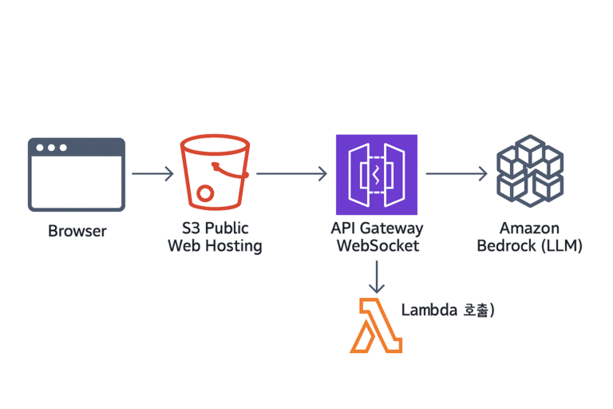

# 실시간 AI 스트리밍: WebSocket으로 완성하는 끊기지 않는 대화

- 읽은 날짜: 2025-09-18
- 회사/작성 주체: 교보DTS
- 원문: [실시간 AI 스트리밍: WebSocket으로 완성하는 끊기지 않는 대화](https://blog.kyobodts.co.kr/2025/09/02/실시간-ai-스트리밍-websocket으로-완성하는-끊기지-않는-대화/)

---

실시간 AI 경험에서 중요한 건 단순히 모델이 얼마나 빨리 답을 내놓느냐가 아니다.
→ “정답이 만들어지는 과정을 얼마나 자연스럽게 보여주느냐”
LLM(Large Language Model)은 문장을 한 번에 완성하지 않고 토큰 단위로 조금씩 생성한다.
브라우저는 이 조각들을 붙여 사용자에게 보여줌
→ 즉, 문장이 만들어지는 과정 자체가 곧 UX이다.
→ 첫 단어가 빠르게 나타나고, 이후 글이 매끄럽게 이어진다면 사용자는 몰입감을 느낀다.
결국 실시간 AI의 품질은 모델의 성능만으로 결정되지 않는다. 답이 얼마나 정확한지와 동시에, 그 답이 얼마나 끊김 없이 매끄럽게 전달되는지가 함께 작동해야 한다.
→ 이를 위해서 **안정적인 연결**, **적절한 속도**, **중복 제거 처리** 같은 기술적 장치가 필요하다.
이 글에서는 Bedrock에서 브라우저까지 토큰이 어떻게 전달되는지를 API Gateway와 Lambda함수를 거쳐 스트리밍 되는 구조를 중심으로 살펴본다. 

## 1. 브라우저(Browser)
- 사용자가 직접 상호작용하는 클라이언트
- 웹 애플리케이션의 사용자 인터페이스(UI)를 렌더링하고, 사용자의 입력을 받아 서버로 전송하며, 서버로부터 받은 응답을 화면에 표시하는 역할을 한다.
- 이 아키텍처에서는 사용자가 AI와 나눌 대화 내용을 입력하고 AI의 답변을 실시간으로 확인하는 창구이다.
## 2. S3 정적 웹 호스팅 (S3 Public Web Hosting)
Amazon S3 (Simple Storage Service)는 파일 스토리지 서비스이지만, 정적 웹사이트 호스팅 기능도 제공한다. HTML, CSS, JavaScript와 같은 정적 파일들을 S3 버킷에 업로드하고 공개적으로 액세스할 수 있도록 설정하면, 별도의 웹 서버 없이도 저렴하고 안정적으로 웹사이트를 운영할 수 있다.
- **역할:** 사용자가 접속할 웹페이지(채팅 화면 등)를 제공한다.
## 3. API Gateway WebSocket
실시간 양방향 통신을 가능하게 해주는 AWS의 관리형 서비스이다. 일반적인 HTTP 통신은 클라이언트의 요청이 있어야만 서버가 응답하는 단방향성이지만, WebSocket은 한 번 연결이 수립되면 서버와 클라이언트가 언제든지 서로에게 메시지를 보낼 수 있다.
- **역할:** 브라우저와 백엔드(Lambda) 간의 지속적인 연결을 유지하고, 실시간으로 메시지를 주고받는 다리 역할을 한다.
## 4. AWS Lambda
서버를 프로비저닝하거나 관리할 필요 없이 코드를 실행할 수 있게 해주는 서버리스 컴퓨팅 서비스이다. 특정 이벤트가 발생했을 때만 코드를 실행하고, 실행된 시간만큼만 비용을 지불하므로 효율적이다.
- **역할:** API Gateway로부터 전달받은 사용자 메시지를 처리하여 Amazon Bedrock에 전달하고, Bedrock으로부터 받은 AI의 응답을 다시 API Gateway를 통해 브라우저로 보내는 핵심 비즈니스 로직을 수행한다.
## 5. Amazon Bedrock
Amazon 및 타사 AI 스타트업의 파운데이션 모델(FM)을 API를 통해 사용할 수 있도록 지원하는 완전 관리형 서비스이다. 복잡한 인프라 설정 없이도 강력한 생성형 AI 모델을 애플리케이션에 쉽게 통합할 수 있다.
- **역할:** Lambda로부터 전달받은 사용자 질문(프롬프트)을 이해하고, 그에 대한 답변을 생성하여 다시 Lambda로 반환하는 AI의 두뇌 역할을 한다.
# 전체 동작 흐름
## 1단계: 초기 접속 및 WebSocket 연결
1. 웹페이지 로드: 사용자가 브라우즈를 열고 S3에 호스틍된 웹사이트 주소로 접속
2. 정적 콘텐츠 다운로드: S3는 웹사이트를 구성하는 HTML, CSS, JavaScript 파일들을 사용자 브라우저로 전송한다.
3. WebSocket 연결 요청 : 브라우저의 JavaScript 코드가 API Gateway WebSocket 엔드포인트로 연결을 요청한다.
4. 연결 수립 및 등록:
	1. API Gateway는 `$connect` 라우팅 키에 연결된 Lambda 함수를 호출한다.
	2. 이 Lambda 함수는 연결된 클라이언트의 고유 ID(connectionId)를 DynamoDB에 저장하여, 나중에 특정 사용자에게 메시지를 보낼 때 사용한다.
	3. 연결이 성공적으로 수립되면, 브라우저와 API Gateway 간에 지속적인 통신 채널이 열린다.
## 2단계: 사용자 메시지 전송 ( 브라우저 → Bedrock)
1. 메시지 입력 및 전송: 사용자가 브라우저의 채팅방에 질문을 입력하고 ‘전송’ 버튼을 누른다.
2. WebSocket 메시지 발신: 브라우저의 JavaScript는 입력된 메시지를 JSON 형식으로 만들어 WebSocket 연결을 통해 API Gateway로 전송한다.
3. Lambda 함수 트리거: 
	1. API Gateway는 미리 정의된 라우팅 키에 따라 해당 메시지를 처리할 Lambda 함수를 호출한다.
	2. 이때 사용자 메시지와 `connectionId` 가 Lambda 함수의 이벤트 데이터로 전달된다.
4. Bedrock API 호출:
	1. Lambda 함수는 전달받은 사용자 메시지를 Bedrock이 이해할 수 있는 형식의 프롬프트로 가공한다.
	2. 가공된 프롬프트를 담아 Amazon Bedrock API를 호출하여 AI 모델에게 답변 생성을 요청한다.
## 3단계: AI 응답 수신 및 전송 (Bedrock → 브라우저)
1. AI 응답 생성: Bedrock은 요청받은 프롬포트를 기반으로 AI 모델을 사용하여 답변을 생성한다.
2. Lambda로 응답 반환: 생성된 답변을 Lambda 함수로 반환한다. Bedrock은 스트리밍 응답도 지원하므로, 긴 답변을 실시간으로 조각내어 보낼 수도 있다.
3. 클라이언트로 메시지 전송:
	1. Lambda 함수는 Bedrock으로부터 받은 AI의 답변을 `connectionId`를 이용해 특정 사용자에게 보내야 한다는 것을 인지한다.
	2. API Gateway의 `PostToConnection` API를 호출하여, 해당 `connectionId`를 가진 클라이언트에게 AI의 답변 메시지를 WebSocket을 통해 전송한다.
4. 화면에 응답 표시: 브라우저는 WebSocket을 통해 수신한 AI의 답변 메시지를 받아 채팅창에 실시간으로 표시한다.

