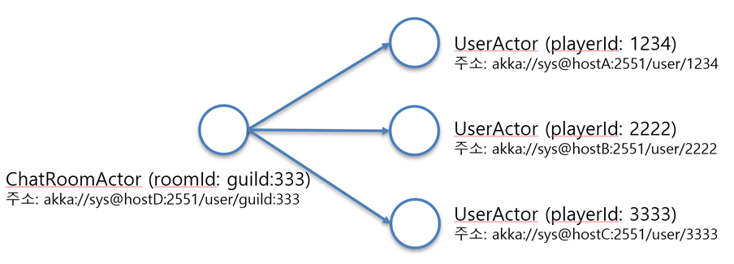
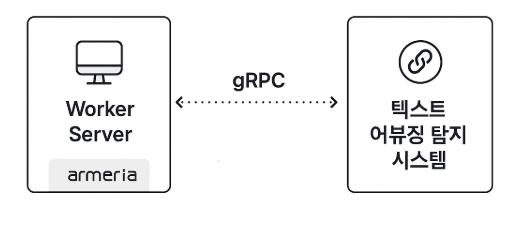

# Hive 채팅 시스템 구축기

- 읽은 날짜: 2025-11-01
- 회사/작성 주체: Com2uS Platform
- 원문: [Hive 채팅 시스템 구축기](https://on.com2us.com/tech/hive_chatting_system/)

---

# Socket 서버 구축
채팅 서비스는 기본적으로 ‘실시간으로 메시지를 수신한다’는 조건을 충족해야 한다.
이 조건을 만족시키기 위해서는 다음과 같은 요소들이 갖춰져야 한다.
- 커넥션 관리
- 프로토콜 설계
- 라우팅
## 1. 커넥션 관리
실시간 메시지 수신을 위해서는 클라이언트와 서버 간 네트워크 커넥션이 항상 열린 상태여야 한다. 
→ 양방향으로 데이터 송수신할 수 있는 상태를 의미한다.
하지만 네트워크 상태는 언제든 변할 수 있기 때문에, 커넥션 상태를 효율적으로 관리하는 것이 중요하다.
→ 커넥션이 비정상적으로 종료되었을 경우 이를 감지하여 사용자 접속 정보를 삭제해야 하며, 유휴 시간이 지나치게 긴 커넥션은 해제해 시스템 자원을 절약해야 한다.
### Netty
비동기 이벤트 기반 네트워크 프레임워크로 커넥션을 효과적으로 관리할 수 있도록 지원
```java
public interface ChannelInboundHandler extends ChannelHandler {
    void channelRegistered(ChannelHandlerContext ctx) throws Exception;
    void channelUnregistered(ChannelHandlerContext ctx) throws Exception;
    void channelActive(ChannelHandlerContext ctx) throws Exception;
    void channelInactive(ChannelHandlerContext ctx) throws Exception;
    void channelRead(ChannelHandlerContext ctx, Object msg) throws Exception;
    void channelReadComplete(ChannelHandlerContext ctx) throws Exception;
    void userEventTriggered(ChannelHandlerContext ctx, Object evt) throws Exception;
    void channelWritabilityChanged(ChannelHandlerContext ctx) throws Exception;
    @Override
    @SuppressWarnings("deprecation")
    void exceptionCaught(ChannelHandlerContext ctx, Throwable cause) throws Exception;
}

```
- Netty의 ChannelInboundHandler 인터페이스 네트워크 커넥션에 해당하는 Channel의 상태(예: registered, active 등)에 따라 필요한 처리를 구현할 수 있도록 지원
- 커넥션 관리뿐만 아니라 TCP, UDP, HTTP/2, WebSocket 등 다양한 프로토콜을 지원
	- ChannelPipeline 기반으로 네트워크 데이터를 처리할 수 있어 전송 흐름에 따라 필요한 기능을 유연하게 추가 가능
- Spring WebFlux, Apache Kafka, Armeria 등 다양한 오픈소스 프로젝트에서 활용될 만큼 높은 안정성
	- 개발 과정에서 발생할 수 있는 다양한 이슈를 효과적으로 대응하는데 적합
## 2. 프로토콜 설계
HTTP는 요청-응답 기반의 단방향 통신 모델로 비연결성(stateless)의 특징을 지닌다.
- 따라서 실시간성과 양방향 통신이 요구되는 채팅 서비스에는 적합하지 않다.
- 또한 임의의 시점에 서버에서 클라이언트로 메시지를 푸시할 수도 없다.
지속적으로 커넥션을 유지하기 위해서는 TCP 기반의 소켓 통신을 직접 사용해야만 한다. 
→ 웹소켓을 기반으로 채팅 프로토콜을 구성했다.
```java
/**
 * 새로운 클라이언트 연결(SocketChannel)이 생성될 때마다
 * 해당 채널의 파이프라인(ChannelPipeline)을 초기화(설정)하는 클래스입니다.
 * WebSocket 서버를 위한 핸들러들을 순서대로 등록합니다.
 */
public class ServerChannelInitializer extends ChannelInitializer<SocketChannel> {


    /**
     * 채널이 성공적으로 등록되었을 때 호출되며, 파이프라인을 설정합니다.
     * @param ch 새로 연결된 클라이언트의 SocketChannel
     * @throws Exception
     */
    @Override
    protected void initChannel(SocketChannel ch) throws Exception {
        // ChannelPipeline: 데이터가 흐르는 통로(파이프라인)입니다.
        // 핸들러들을 순서대로 추가하며, 데이터는 이 파이프라인을 따라 흐릅니다.
        ChannelPipeline pipeline = ch.pipeline();

        // --- (Inbound/Outbound) HTTP 프로토콜 처리 ---
        // 1. HttpServerCodec: Netty가 HTTP 요청/응답을 처리할 수 있도록
        //    ByteBuf <-> HttpRequest/HttpResponse 로 변환(코덱)합니다.
        //    (HTTP 요청 디코더 + HTTP 응답 인코더)
        pipeline.addLast(new HttpServerCodec());

        // 2. HttpObjectAggregator: HTTP 메시지 조각(Chunk)들을 하나로 합쳐줍니다.
        //    이 핸들러 덕분에 FullHttpRequest / FullHttpResponse 객체로 처리할 수 있게 됩니다.
        //    maxContentLength는 합쳐진 메시지의 최대 크기를 제한합니다.
        pipeline.addLast(new HttpObjectAggregator(maxContentLength));

        // 3. httpRequestHandler: (커스텀 Inbound 핸들러)
        //    WebSocket 핸드셰이크가 아닌, 일반 HTTP 요청(예: /health, /favicon.ico)을
        //    여기서 먼저 처리(필터링)하기 위한 커스텀 핸들러입니다.
        pipeline.addLast(httpRequestHandler);

        // --- WebSocket 프로토콜 처리 ---

        // 4. WebSocketServerCompressionHandler: WebSocket 메시지 압축을 지원합니다.
        //    (permessage-deflate 확장)
        pipeline.addLast(new WebSocketServerCompressionHandler());

        // 5. IdleStateHandler: 유휴 상태(Idle State) 이벤트를 처리합니다.
        //    (60, 0, 0) 설정은 60초(첫 번째 인자: readerIdleTime) 동안
        //    클라이언트로부터 아무런 데이터를 읽지 못하면(수신하지 못하면)
        //    'IdleStateEvent'를 발생시킵니다.
        //    이 이벤트는 이후 핸들러(websocketHandler)에서 감지하여 핑(Ping)을 보내거나 연결을 끊는 데 사용됩니다.
        pipeline.addLast(new IdleStateHandler(60, 0, 0));

        // 6. WebSocketServerProtocolHandler: WebSocket 프로토콜의 핵심 처리를 담당합니다.
        //    - 'wsPath'(예: "/ws")로 들어온 HTTP Upgrade 요청을 감지하여 WebSocket 핸드셰이크를 수행합니다.
        //    - 핸드셰이크가 완료되면, HTTP 관련 핸들러들을 동적으로 제거할 수 있습니다.
        //    - Ping/Pong/Close 같은 제어 프레임(Control Frame)을 자동으로 처리해 줍니다.
        //    - ByteBuf를 WebSocketFrame (TextWebSocketFrame, BinaryWebSocketFrame 등) 객체로 변환해 줍니다.
        pipeline.addLast(new WebSocketServerProtocolHandler(wsPath, null, true));

        // --- (Outbound) 커스텀 프로토콜 처리 (서버 -> 클라이언트) ---
        // (참고: Outbound 핸들러는 등록된 순서의 역순으로 실행됩니다)

        // 7. serverResponseEncoder: (커스텀 Outbound 핸들러)
        //    서버가 클라이언트로 보내는 커스텀 응답 객체(예: ServerResponse)를
        //    WebSocket 프레임(예: TextWebSocketFrame)으로 인코딩(변환)합니다.
        pipeline.addLast(serverResponseEncoder);

        // 8. serverPushPacketOutboundHandler: (커스텀 Outbound 핸들러)
        //    서버가 클라이언트에게 푸시(Push)하려는 커스텀 객체(예: ServerPushPacket)를
        //    처리하여 'serverResponseEncoder'가 이해할 수 있는 객체로 변환할 수 있습니다.
        pipeline.addLast(serverPushPacketOutboundHandler);

        // --- (Inbound) 커스텀 비즈니스 로직 처리 (클라이언트 -> 서버) ---

        // 9. websocketHandler: (커스텀 Inbound 핸들러)
        //    파이프라인의 최종 목적지입니다.
        //    'WebSocketServerProtocolHandler'가 변환해준 WebSocket 프레임(예: TextWebSocketFrame)을
        //    수신하여 실제 비즈니스 로직(채팅 메시지 처리, 요청 분석 등)을 수행합니다.
        //    또한, 'IdleStateEvent'를 감지하여 핑을 보내는 로직도 여기서 처리합니다.
        pipeline.addLast(websocketHandler);
    }
}
```
추가하는 순서대로 inbound, outbound 흐름에 적용되기 때문에 각 핸들러의 역할을 이해해야 한다.
예를 들어 IdleStateHandler를 WebSocketServerProtocolHandler보다 뒤에 등록한다면 웹소켓 표준 ping/pong을 이용한 유휴 커넥션 처리를 할 수 없다.
- WebSocketServerProtocolHandler에서 웹소켓 표준 ping/pong 처리를 하고 있기 때문이다.
이러한 초기화 과정은 WebSocket 기반의 실시간 통신 서버를 구축할 때 필수적인 절차이며, 마지막에 추가한 WebSocketRequestHandler를 통해 비즈니스 로직으로 흐름이 넘어가게 된다.
```java
/**
 * WebSocket 프레임(WebSocketFrame)을 처리하는 최종 Inbound 핸들러.
 * SimpleChannelInboundHandler<WebSocketFrame>를 상속하여 WebSocketFrame 타입의 메시지만 처리함.
 * (앞선 핸들러인 WebSocketServerProtocolHandler가 ByteBuf를 WebSocketFrame으로 변환해줬기 때문에 가능)
 */
public class WebSocketRequestHandler extends SimpleChannelInboundHandler<WebSocketFrame> {
 mapper;
    }

    /**
     * 클라이언트로부터 메시지(프레임)가 수신되었을 때 호출되는 메서드.
     *
     * @param ctx 채널 파이프라인의 컨텍스트
     * @param frame 수신된 WebSocket 프레임 (Text, Binary, Ping, Pong, Close 등)
     */
    @Override
    protected void channelRead0(ChannelHandlerContext ctx, WebSocketFrame frame) throws Exception {
        //  현재 연결된 채널(클라이언트와의 통신 통로)
        Channel channel = ctx.channel();

        //수신된 프레임이 텍스트(TextWebSocketFrame) 타입인지 확인.
        // (BinaryWebSocketFrame, CloseWebSocketFrame 등 다른 타입도 처리 가능)
        if (frame instanceof TextWebSocketFrame) {
            
            // TextWebSocketFrame으로 형 변환
            TextWebSocketFrame textFrame = (TextWebSocketFrame) frame;

            // 프레임에서 실제 텍스트 데이터(JSON 문자열)를 가져옴
            String jsonPayload = textFrame.text();
            
            // JSON 문자열을 ChatPacket 자바 객체로 역직렬화 (변환)
            ChatPacket chatPacket = mapper.readValue(jsonPayload, ChatPacket.class);

            // TODO: 변환된 chatPacket 객체를 가지고
            // 실제 비즈니스 로직(서비스 레이어)을 호출하는 부분.
            // (예: chatService.processMessage(channel, chatPacket);)
            
        } else {
            // 텍스트가 아닌 프레임(예: Binary, Close) 처리
            // (예: if (frame instanceof CloseWebSocketFrame) { ... })
        }
    }

    /**
     * 클라이언트와의 연결이 비활성화(종료)되었을 때 호출됨.
     * (예: 클라이언트가 브라우저를 닫았을 때)
     */
    @Override
    public void channelInactive(ChannelHandlerContext ctx) throws Exception {
        // (주석) TODO: 연결 해제 시 처리 로직
        // (예: 채팅방에서 사용자 제거, 리소스 정리 등)
        
        super.channelInactive(ctx);
    }

    /**
     * 파이프라인에서 사용자 정의 이벤트가 발생했을 때 호출됨.
     * (주로 IdleStateHandler와 함께 사용됨)
     */
    @Override
    public void userEventTriggered(ChannelHandlerContext ctx, Object evt) throws Exception {
        
        // (주석) 발생한 이벤트가 IdleStateEvent인지 확인.
        // (이 이벤트는 앞선 파이프라인의 IdleStateHandler가 발생시킨 것)
        if (evt instanceof IdleStateEvent) {
            IdleStateEvent e = (IdleStateEvent) evt;
            
            // (주석) IdleStateEvent의 상태(State) 확인
            switch (e.state()) {
                case READER_IDLE:
                    // (주석) 일정 시간 동안 클라이언트로부터 아무런 데이터를 읽지 못함 (수신 없음)
                    // (주석) TODO: 유휴 상태의 연결에 대한 처리 로직
                    // (예: "아직 살아있니?" 핑(Ping) 메시지를 보내거나, 응답 없으면 연결을 끊음)
                    System.out.println("READER_IDLE: " + ctx.channel().remoteAddress());
                    ctx.writeAndFlush("ping"); // (예시: 핑 전송)
                    // ctx.close(); // (예시: 연결 강제 종료)
                    break;
                case WRITER_IDLE:
                    // (주석) 일정 시간 동안 클라이언트로 데이터를 쓰지 않음 (송신 없음)
                    break;
                case ALL_IDLE:
                    // (주석) 읽기/쓰기 모두 유휴 상태
                    break;
            }
        }

        // (주석) 처리하지 않은 이벤트는 상위 핸들러로 전달
        super.userEventTriggered(ctx, evt);
    }

    /**
     * 채널 처리 중 예외(Exception)가 발생했을 때 호출됨.
     */
    @Override
    public void exceptionCaught(ChannelHandlerContext ctx, Throwable cause) throws Exception {
        // (주석) TODO: 예외 처리 로직 (로깅, 연결 종료 등)
        cause.printStackTrace();
        ctx.close(); // (주석) 예외 발생 시 보통 연결을 닫음
    }
}
```
WebSocketRequestHandler 클래스는 클라이언트로부터 수신한 메시지를 처리하는 핵심 핸들러다. 
WebSocketFrame을 수신한 뒤, 해당 프레임 내 텍스트 메시지를 비즈니스 요청 객체로 변환하여 처리하는 역할을 수행한다.<br>또한, 커넥션이 끊겼을 때 이를 정리하는 로직과, 커넥션의 Idle 상태를 감지하여 타임아웃 처리를 수행하는 기능도 포함되어 있다.
WebSocketRequestHandler가 상속받은 SimpleChannelInboundHandler는 앞서 설명한 ChannelInboundHandler를 상속한 추상 클래스이며, ChannelInboundHandler의 모든 기능을 보다 간편하게 사용할 수 있도록 도와주는 구현체다. 
이제 커맨드 구조를 살펴보겠다.
```java
public class ChatPacket {
	    private PacketType packetType;
     	private Object body;
}
```
TCP 패킷 구조 → PacketType에 따라 body 타입을 결정하도록 Object 타입으로 정의했다.
```java
public enum PacketType {
        CONNECT,
        RESPONSE_CONNECT,
        RECONNECT,
        ...
}
```
enum으로 정의한 PacketType의 모습이다. PacketType의 수가 늘어날수록 코드 내 분기 처리도 증가하게 되어 복잡도가 높아진다.
이에 따라 우리는 WebSocket을 실시간 메시지 송수신에만 활용하고, 그 외의 기능은 REST API를 통해 처리하는 방식으로 개발했다.
RESPONSE라는 접두어로 시작하는 패킷은 요청에 대한 응답임을 나타낸다. WebSocket은 비동기 통신 방식이기 때문에, 클라이언트는 요청을 보낸 후 결과를 즉시 확인할 수 없다. 따라서 요청과 응답을 구분하고 매칭하기 위해 응답 패킷에 RESPONSE 접두어를 붙여 요청의 결과임을 식별할 수 있도록 했다.
이처럼 LOW 레벨의 통신 프로토콜을 설계할 때는 메시지 포맷, 핸드셰이크 절차 등 다양한 요소들을 종합적으로 고려해야 한다.
## 3. 라우팅
채팅방에 참여한 사용자들에게 메시지를 전달하려면 어떻게 해야 할까?
예를 들어 A 사용자가 1번 서버, B 사용자가 3번 서버, C 사용자가 5번 서버에 접속한 상태에서 A 사용자가 채팅방에 메시지를 전송했다면, 채팅 서버는 각 사용자가 접속해 있는 서버를 찾아 해당 메시지를 전달해야 한다.
-  즉, 사용자의 커넥션이 유지되고 있는 서버를 식별하고, 그 위치에 맞춰 데이터를 전송할 수 있어야 한다.
많은 기술 블로그에서는 이 기능을 Redis Pub/Sub으로 구현하지만, Hive는 Akka를 활용하여 개발했다. 
Akka의 ActorSystem을 이용하면 특정 Actor가 어느 서버에 생성됐는지 알지 못해도 Actor 호출이 가능하다. 
- Hive는 사용자 정보를 표현하는 UserActor를 정의하고, 채팅 메시지를 전송할 때 ActorSystem이 라우팅을 전담하는 구조를 설계했다.

 ChatRoomActor는 채팅방에 참여한 사용자들에게 메시지를 전달하는 역할만을 수행한다. 
각 UserActor는 서로 다른 서버에 위치할 수 있지만, ActorSystem에 등록된 식별자를 통해 위치와 관계없이 호출할 수 있다.
```java
private Behavior<ActorEvent> createUserActor(LoginEvent event){
        		...
       ServiceKey<ActorEvent> serviceKey = 
ActorUtils.getUserActorKey(session.getGameIndex(), session.getPlayerId());
       context.getSystem().receptionist().tell(Receptionist.register(serviceKey, actorRef));

	     return Behaviors.same();
}

```
Akka의 Receptionist를 활용하면 ActorSystem에 ServiceKey(식별자)와 Actor를 등록할 수 있으며, 이후 해당 ServiceKey를 통해 등록된 Actor를 호출할 수 있다.
 이를 응용하면 사용자가 접속한 서버 정보를 별도로 데이터 저장소에서 조회할 필요가 없어 로직이 단순해진다.
또한 Akka는 분산 처리, 확장성, 비동기 처리에 강점을 지니고 있어, 트래픽이 증가하더라도 일관된 설계 구조를 유지할 수 있다.
‘실시간으로 메시지를 수신한다.’ 이 단순한 문장을 만족시키기 위해 Socket 서버는 다양한 요소들을 갖추고 있어야 한다. 이처럼 겉으로 드러나지 않는 조건들이 유기적으로 맞물려야만 사용자는 자연스럽고 끊김 없는 메시지 경험을 누릴 수 있다.
# Worker 서버 구축
채팅 메시지 외에도 비속어 필터링, 채팅 로그 저장 등 다양한 부가기능이 존재한다. 
이러한 기능들을 빠르게 처리하기 위해 백그라운드 기능을 전담하는 별도의 Worker 서버를 구축했다. 
그 중 비속어 필터링에 대해서 자세히 이야기해 보겠다.
## 비속어 필터링
실시간 채팅 서비스를 설계할 때 가장 먼저 고민하게 되는 요소 중 하나는 바로 ‘비속어 필터링’이다. 
기능을 검토한 결과, 비속어 필터링은 단순한 기능을 넘어 하나의 독립된 서비스 수준의 범위를 갖고 있다는 결론에 이르렀다.
 AI 개발팀의 ‘텍스트 어뷰징 탐지 시스템(이하 TADS)’을 연동하여 비속어 필터링을 적용하게 됐다.
### gRPC
RPC는 Google에서 개발한 고성능 원격 프로시저 호출(RPC) 프레임워크다. 
바이너리 포맷인 Protocol Buffers(Protobuf)를 사용하기 때문에 데이터 직렬화 속도가 빠르고, 메시지 크기가 작아 네트워크 비용 절감에 유리하다. 
또한 양방향 스트리밍을 지원하여 실시간 메시지 전송이나 대용량 데이터 처리에 최적화되어 있다.
이러한 gRPC의 특성은 HIVE가 지향하는 Async – Non Blocking 아키텍처와 잘 부합한다고 판단해, TADS와의 통신에도 gRPC를 적용했다.
이를 통해 지연 시간을 최소화하면서도 높은 응답성과 안정성을 확보할 수 있었다.

### Armeria
Armeria는 Line에서 개발한 고성능 비동기 마이크로서비스 프레임워크다. 
gRPC를 포함한 다양한 통신 방식을 지원하며, Spring과의 연동도 자연스럽게 처리할 수 있는 장점을 갖고 있다.
HIVE는 gRPC 기반의 실시간 통신을 보다 유연하고 안정적으로 처리하기 위해 Armeria를 도입했다.
 Armeria는 gRPC 통신을 담당하고, 전반적인 구성과 의존성 관리는 Spring에 위임함으로써 Spring 생태계를 그대로 활용하면서도 Armeria의 장점을 살린 안정적인 gRPC 통신 구조를 구축할 수 있다.
# 마치며
채팅 서비스는 이미 경쟁이 치열하고 기능적, 기술적으로 성숙된 시장이다. 
이러한 상황 속에서 ‘Hive 채팅’이 단순한 채팅 기능을 넘어서 ‘채팅’과 ‘메신저’의 경계에서 어떤 모습을 갖춰야 하는지 많은 고민을 할 수밖에 없었다.
우리는 이러한 고민을 추상적인 수준에만 그치는 게 아니라, 하나씩 구체화해 가며  ‘Hive 채팅’의 모습을 갖춰나가고 있다. 
어느 하나 쉬운 내용이 없지만 개발자로서의 호기심과 도전의식을 불러일으키고 있어 즐겁게 개발하고 있다.
 이러한 노력을 통해 많은 사용자들이 서로 연결되고 즐거운 소통의 순간이 만들어지기를 기대해 본다.

