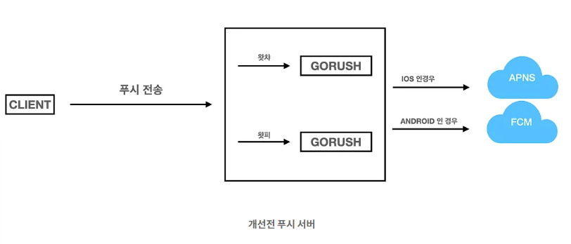
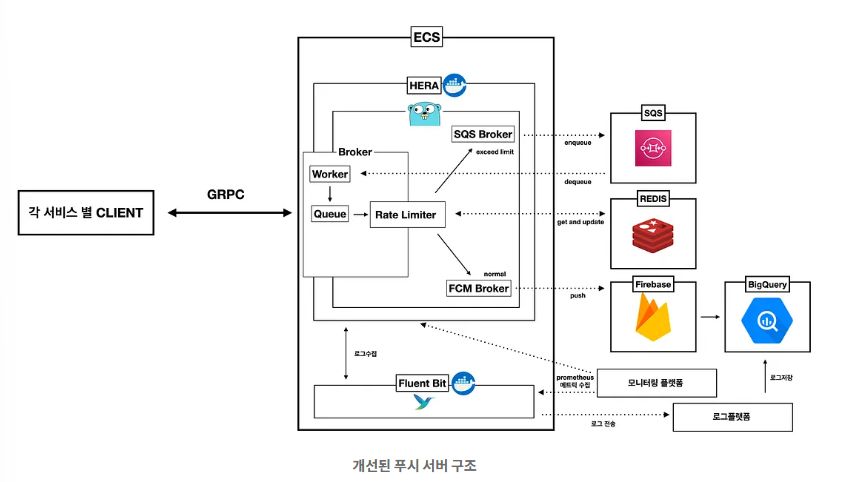
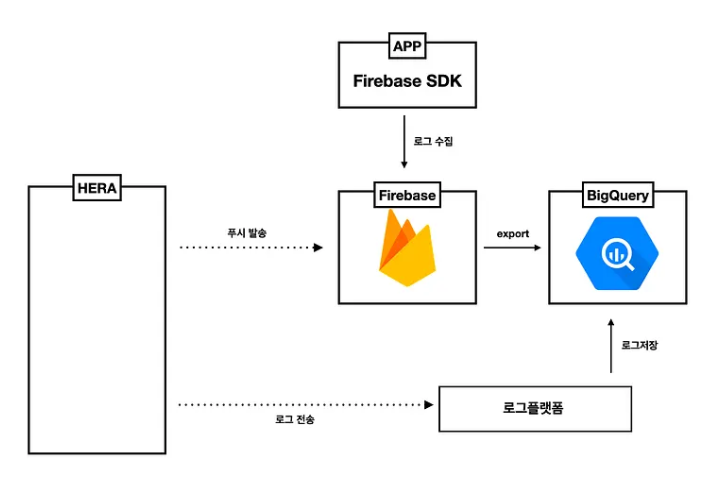
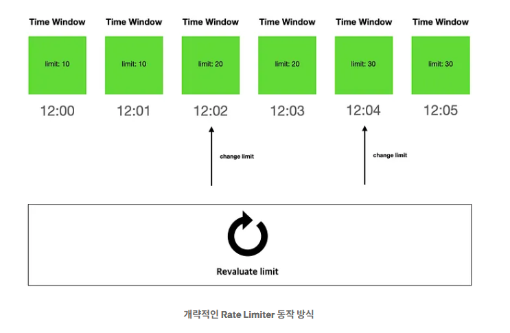
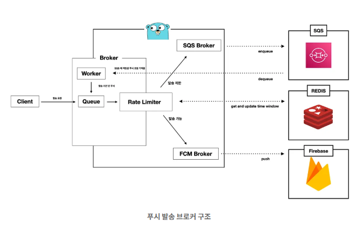
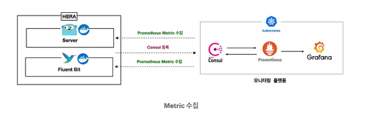

# WATCHA 푸시 서버 개선하기

- 읽은 날짜: 2025-11-09
- 회사/작성 주체: 왓챠
- 원문: [WATCHA 푸시 서버 개선하기](https://medium.com/watcha/watcha-%ED%91%B8%EC%8B%9C-%EC%84%9C%EB%B2%84-%EA%B0%9C%EC%84%A0%ED%95%98%EA%B8%B0-56070b73c287)

---

WATCHA는 푸시 서버를 개선한 사례를 이야기 했다고 합니다.

기존의 푸시 서버는 GORUSH를 이용하여 왓챠, 왓챠피디아 각각 서비스 별로 따로 프로세스를 띄워 구동되고 있었다.
- GORUSH란 직접 운영하는 푸시 게이트웨이 서버이다. Go로 만들어졌고, REST/gRPC API로 들어온 요청을 APNs(IOS), FCM(Android),로 전달해 주는 경량 서버이다. 
## 기존 푸시 서버에 요구된 개선사항
### 1. 푸시 발송에 관련된 로깅 및 분석
기존 푸시 서버는 따로 로그를 남기고 분석하고 있지 않았다. 
-  어떤 유저에게 푸시를 전송했는지, 푸시받은 유저 행동은 어떠한지… 등 푸시 관련된 유저에 대한 행동 분석이 어려운 상황이었다.
→ 적절한 로그수집과 유저 행동에 대한 trace가 필요했다.
### 2. 푸시 발송 제어
기존 푸시 서버는 푸시 요청 오는 즉시 푸시를 발송하는 형태
- 많은 푸시 요청이 푸시서버로 들어오는 경우 → 푸시가 특정시간에 몰려 유저들에게 전달 → 순간적으로 많은 트래픽이 다양한 서비스로 유입
	- 한번에 많은 푸시 발송전 미리 여유있게 서버를 증설
	- 푸시를 발송하는 각 서비스별 Client가 푸시 발송 지연 로직을 적용 
→ 푸시 서버가 발송 제어 로직 기반으로 푸시를 발송하여, 다른 서비스 서버들이 적절히 Warming Up(Scale Out) 되도록 하는 것이 필요했다.
### 3. WebPush와 같은 브라우저
모바일 뿐만 아니라 웹(브라우저) 환경에서 많은 이용을 하고 있음
→ 웹(브라우저) 환경에서 푸시 알림을 받을수 있도록 기능을 제공할 필요성이 있다.
### 4. 각 서비스별 CLIENT들이 손쉽게 푸시 발송을 요청
각 서비스별 Client에서 사용하는 개발 언어에 상관 없이 쉽게 푸시를 발송할 수 있고, 활용할 수 있는 구조가 필요했다.
### 5. 서버 구조 변경 및 서버 지표 제공
기존 푸시 서버는 각 서비스별이 각각 푸시 서버를 서비스 별로 따로 띄워야 하고 트래픽 분산 및 Scale Out이 되는 구조도 아니었다.
게다가 유의미한 서버 지표를 매트릭으로 제공 할수 있는 기능도 제공하고 있지 않아서 운영 및 관리가 힘들 상황이었고, 개선이 필요했다.
# 개선된 푸시 서버

## \[개선\] 1. 푸시 발송에 관련된 로깅 및 분석
IOS는 APNS, Android는 FCM을 이용하고 있는 구조에서 모든 디바이스가 FCM을 이용하는 형태로 변경했다.
모든 푸시 발송이 FCM(Firebase Cloud Messaging)을 이용하게 되면 Firebase BigQuery Export 기능을 이용해서 푸시 발송 관련 로그들도 쉽게 BigQuery로 전송이 가능하다.
게다가 기존 App들도 Firebase SDK를 이용하고 있어, App에서도 푸시 관련 이벤트 뿐만 아니라 다양한 이벤트들도 수집이 가능하여 푸시 발송과 유저 행동에 대한 연관 분석이 가능하다.

좀 더 세밀한 분석을 위해서는 푸시 발송 성공유무, 발송된 푸시 종류, 타입 및 개별 유저에 대한 푸시를 식별하기 위한 MessageID 등 추가 정보가 필요했다.
→ 추가적으로 푸시 서버에 발송시 필요 정보를 로그수집을 통하여 BigQuery 저장하여 분석이 가능하도록 하였다.
## \[개선\] 2. 푸시 발송 제어
부하 분산을 위해 Client에서 발송제어(delay)를 하게 되면, Client 별 따로 발송 제어 로직을 가지게 되어 관리 이슈가 생기고, 서비스 측면에서 발송제어가 어렵다.
(개별 Client 별 제어만 가능)
그래서 각 Client는 발송제어 없이 무조건 요청하고, 실제 발송을 담당하는 푸시서버에서 푸시 발송 Rate Limiter를 구현해 적용하여 발송제어를 하도록 했다.

Rate Limiter 구현은 간단히 구현 할 수 있는 Time Window 방식을 이용했다.
Time Window은 분당 생성되며, 각 Time Window마다 발송제어 Limit가 존재한다.
여러 푸시서버에서 Time Window을 공유하고(Redis를 이용), 각 푸시서버에서 푸시발송시 현재 발송하는 시점에 해당 하는 Time Window를 가져와 현재 발송 Limit에 도달했는지 확인 한 후 발송 또는 지연을 하게 된다.
그리고 TCP Congestion Control Policy와 같이 Slow Start방식을 이용해, 특정 기간동안 발송 내역을 참고하여 발송 Limit를 주기적으로 재조절 하는 로직을 적용하여 Limit를 적절히 늘리거나 줄여서 발송 제어를 하게 된다.
Limit에 도달하여 발송 제한되어 Pending된 푸시 요청은 AWS SQS에 저장되어 추후 자동으로 발송되게 된다.

전반적인 푸시 발송 구조는 위 그림처럼 Broker들이 처리하도록 구현했다.
각 푸시 요청은 메인 Broker의 Queue에 들어가게 되고, Rate Limiter의해서 발송 가능 상태면 FCM Broker로, 발송 지연 상태이면 SQS Broker로 가게 된다.
FCM Broker로 전송된 메시지는 FCM을 통한 푸시 발송이 이뤄지고, SQS Broker로 전송된 메시지는 SQS에 enqueue되고, 추후 발송이 이뤄지게 된다.
### \[개선\] 3. WebPush와 같은 브라우저 푸시 및 커스텀 가능한 푸시 제공
푸시서버는 FCM이 지원하는 WebPush 뿐만 아니라 커스텀 형태로 푸시메시지 전송 가능하도록 FCM이 지원하는 API 및 구조를 그대로 포팅해서 구현되어 있다.
### \[개선\] 4. 각 서비스별 CLIENT 들이 손쉽게 푸시 발송을 요청
푸시서버는 GRPC 기반으로 만들어져 있어서, 각 Client가 이용하는 언어따라 쉽게 사용할 수 있도록 라이브러리 형태로 제공하고 있어서, 손쉽게 원하는 push가 전송가능하도록 되어 있다.
### \[개선\] 5. 서버 구조 변경 및 서버 지표 제공
각 서비스 별 푸시 서버를 따로 띄우지 않고, 통합된 푸시 서버로 구현하여 서비스 상관 없이 해당 서비스에 대한 푸시를 발송이 가능하다.
확장성 및 관리 측면 효울적으로 하기 위해서, AWS Elastic Beanstalk With ECS 기반의 Multi Container를 이용해서 운영하고 있다.
그리고 실시간으로 현재 Rate Limiter limit 값, Pending 된 푸시 메시지 수, 푸시 발송수(성공, 실패), 각종 서버 상태 등을 모니터링 하기 위해서 Prometheus Metric Exporter를 구현하고 모니터링 플랫폼을 통해 수집하고 있다.

## 결론
로그 수집을 통한 분석이 용이하게 하며, 각 서비스별로 발송 제어를 하여 각 서비스들이 큰 부담을 주지 않도록 개선하며, 확장성 및 관리 편리하도록 구조 변경 및 모니터링을 지원하고, 각 Client들이 쉽게 사용할 수 있도록 개선해 보았다.
## 느낀점
단순히 서버 푸시 → 푸시 서버 → 화면 알람 구조가 아닌 처리율 제한, 로깅 및 분석, 장애 대응 등 디테일한 부분에서의 설계가 중요하다는 것을 느꼈다. 항상 시스템을 설계할 때 많은 것을 고려하며 설계해야 함을 다시 느끼게 되었다.

