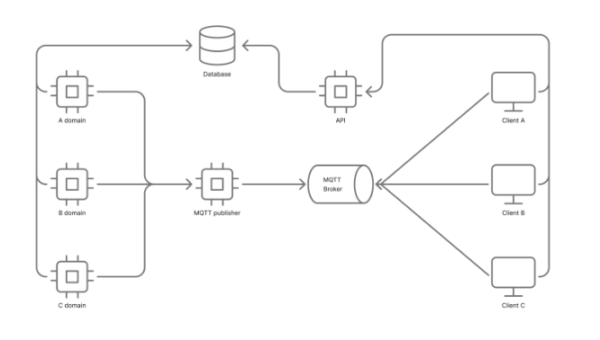
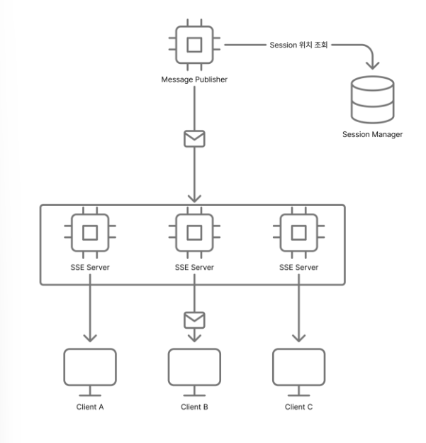
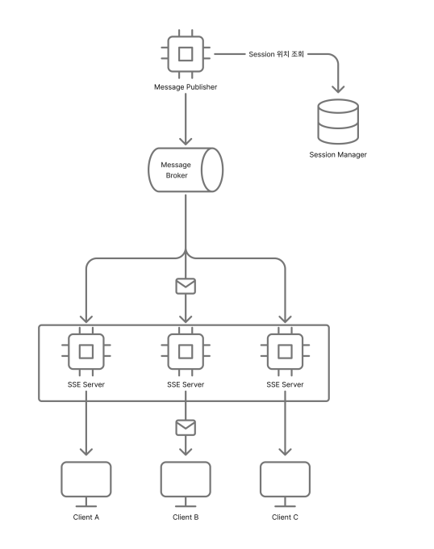
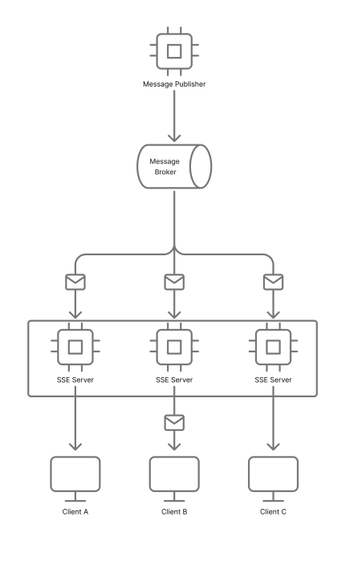
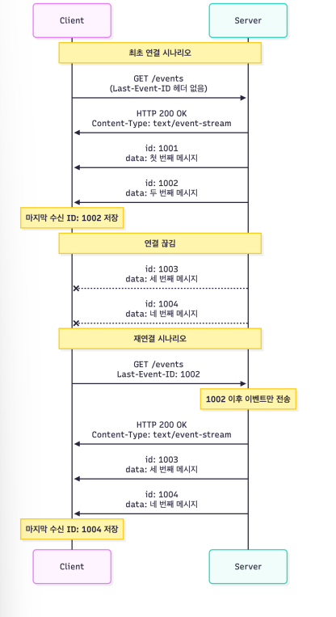
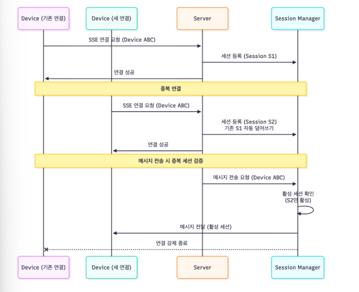
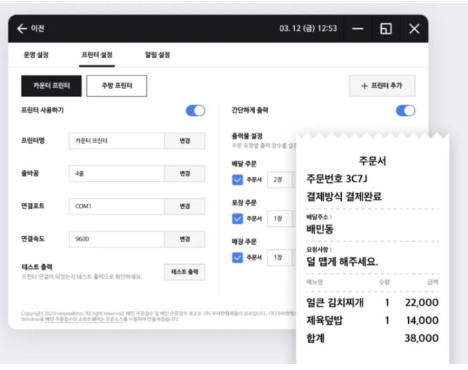

# Server-Sent Events로 실시간 알림 전달하기

- 읽은 날짜: 2025-11-13
- 회사/작성 주체: 우아한형제들
- 원문: [Server-Sent Events로 실시간 알림 전달하기](https://techblog.woowahan.com/23199/)

---

그동안 알림 시스템은 큰 문제 없이 잘 동작해 왔다. 하지만 서비스가 커지고 사용자가 늘어나면서, 더 빠르고 안정적인 알림 전송이 중요해졌다.
# 기존의 알림 전송 방식
---
기존의 알림은 MQTT(Message Queuing for Telemetry Transport)를 통하여 전달하였다.
MQTT는 경량 메시지 프로토콜의 한 종류이다.
<details>
<summary>MQTT란?</summary>
	MQTT는 \*\*IBM의 앤디 스탠포드-클라크(Andy Stanford-Clark)와 아를렌 니퍼(Arlen Nipper)\*\*가 만들었다. 1999년에 유전 파이프라인 모니터링을 위해 처음 설계했다.
	---
	## 💡 MQTT란 무엇인가?
	- **MQTT(Message Queuing Telemetry Transport)**는 **경량 메시징 프로토콜**이다.
	데이터 전송이 불안정한 네트워크 환경에서도 효율적이고 안정적으로 작동하도록 설계되었다. 전력 소비와 네트워크 대역폭 사용을 최소화해야 하는 **사물 인터넷(IoT) 기기**에서 표준처럼 쓰인다.
	### 작동 방식: 발행/구독 모델
	MQTT는 **발행(Publish)/구독(Subscribe)** 모델을 사용한다.
	- **브로커(Broker):** 중앙 서버 역할. 메시지를 수신하고 구독자에게 분배한다.
	- **클라이언트(Client):** 메시지를 발행하거나(Publisher) 특정 주제(Topic)를 구독하여 메시지를 수신한다(Subscriber).
	클라이언트들은 서로 직접 통신하지 않고, 브로커를 통해 간접적으로 통신하기 때문에 시스템의 결합도가 낮아진다.
	## 🤝 WebSocket과의 관계
	MQTT는 WebSocket과 **느낌이 비슷하지만, 기술적인 용도와 계층은 다르다.**
	<table>
<tr>
<td>**구분**</td>
<td>**MQTT**</td>
<td>**WebSocket**</td>
</tr>
<tr>
<td>**목적**</td>
<td>메시징 프로토콜 (데이터 내용과 구조)</td>
<td>통신 프로토콜 (연결 및 전송 방식)</td>
</tr>
<tr>
<td>**계층**</td>
<td>애플리케이션 계층 (Layer 7)</td>
<td>트랜스포트 계층 (Layer 4) 위에서 작동</td>
</tr>
<tr>
<td>**기능**</td>
<td>**발행/구독 모델** 지원, 메시지 품질(QoS) 보장</td>
<td>**양방향(Full-Duplex)** 지속적 연결 제공</td>
</tr>
	</table>
	### 1. 비슷한 점 (실시간 연결)
	두 기술 모두 클라이언트와 서버 간의 **지속적인 연결**을 유지하여 **실시간 푸시(Push) 통신**이 가능하다는 점에서 비슷하게 느껴진다. 클라이언트는 서버에게 끊임없이 요청하지 않아도(Polling 없이) 서버가 보내는 메시지를 즉시 받을 수 있다.
	### 2. 다른 점 (같이 사용 가능)
	WebSocket은 브라우저를 포함한 클라이언트와 서버 사이에 효율적인 양방향 통신 채널을 만들어주는 기술이다. MQTT는 그 채널 위로 **어떤 형식과 규칙으로 데이터를 주고받을지** 정의하는 메시징 규칙이다.
	그래서 실제로는 MQTT를 방화벽이 차단되지 않는 HTTP 포트(80/443)를 통해 사용하기 위해 **'MQTT over WebSocket'**으로 구현하는 경우가 매우 많다. 이 경우, WebSocket이 지속적인 연결 통로를 제공하고, 그 통로를 통해 MQTT 프로토콜 규칙에 따라 메시지(페이로드)가 오고 가는 것이다.
		## MQTT가 여전히 인기 있는 이유
	MQTT는 1999년에 개발되었지만, 현대의 통신 환경, 특히 **IoT**에 최적화된 설계 덕분에 그 사용이 오히려 폭발적으로 늘고 있다.
	### 1. 경량화 및 효율성 (Lightweight)
	MQTT 클라이언트는 코드가 매우 작고, 메시지 헤더(규칙 정보)가 최소 **2바이트**로 매우 작다.
	- **저전력 기기:** 메모리, 처리 능력, 배터리가 제한적인 센서나 소형 마이크로컨트롤러에 부담을 주지 않고 사용할 수 있다.
	- **대역폭 절약:** 작은 데이터 패킷 덕분에 네트워크 대역폭(Bandwidth)을 효율적으로 사용하여 통신 비용을 절감한다.
	### 2. 안정성과 확장성 (Reliability & Scalability)
	- **불안정한 네트워크 지원:** 셀룰러 망처럼 연결이 불안정한 환경에서도 **지속적인 세션(Persistent Session)** 기능을 통해 연결이 끊어져도 메시지를 보장하고 빠르게 재연결할 수 있다.
	- **QoS (서비스 품질):** 메시지 전달 보장 수준을 세 가지(최대 한 번, 최소 한 번, 정확히 한 번)로 설정할 수 있어 신뢰성을 확보한다.
	- **대규모 장치 연결:** 하나의 중앙 브로커(Broker)가 수백만 대의 IoT 기기를 효율적으로 관리하고 메시지를 분배할 수 있도록 설계되어 있다.
	### 3. 주요 사용처
	MQTT의 이러한 장점 덕분에 주로 다음과 같은 분야에서 핵심적인 역할을 한다.
	- **산업용 IoT (IIoT) 및 스마트 팩토리:** 공장 설비의 실시간 모니터링 및 제어, 데이터 수집 (SCADA 시스템).
	- **스마트 홈 및 웨어러블 기기:** 온도 센서, 스마트 조명, 스마트워치 등에서 데이터를 클라우드로 전송.
	- **커넥티드 카 (Connected Cars):** 차량 상태 모니터링, 펌웨어 업데이트(OTA).
	- **클라우드 서비스:** AWS IoT, Google Cloud IoT, Azure IoT 등 대부분의 주요 클라우드 플랫폼이 MQTT를 기본 프로토콜로 채택한다.
	요약하면, MQTT는 **적은 리소스로 많은 장치에 안정적이고 실시간으로 데이터를 전달해야 하는 모든 곳**에서 표준 프로토콜로 자리 잡고 있다.
</details>
## 전체 아키텍처 개요

- 도메인 서비스: 주문, 배달 등 각 도메인에서 이벤트 발행
- MQTT Publisher: 메시지 브로커로 전달
- MQTT Broker: 클라이언트 연결 관리 및 메시지 전달
- 클라이언트: PC, 모바일, POS 등 다양한 접수 프로그램
## 기존 알림 전송 방식의 문제점
기존 알림 전송에는 Zero Payload 형식의 메시지 전달, 보안, 네트워크 방화벽 차단, Webview 연결 불가 등의 문제들이 있었습니다.
### Zero Payload 형식
**1. 배경 및 문제점 (레거시 제약)**<br>
• **통신 방식:** 클라이언트와 서버는 **MQTT**라는 프로토콜을 사용하여 메시지를 주고받으며, 메시지는 **Topic**에 따라 분류되어 다양한 작업을 수행한다.<br>• **근본적인 이슈:** 기존 클라이언트가 사용하는 **레거시 라이브러리**에 버그나 설계상의 한계가 있어, 한 번에 수신할 수 있는 메시지 본문(**페이로드**)의 크기가 일정 바이트 이상으로 제한된다. 즉, 긴 내용의 메시지(알림 문구 등)를 MQTT로 직접 보낼 수 없다.<br>**<br>2. 해결책 (Zero Payload 우회 전략)**<br><br>페이로드 크기 제한을 피하기 위해 다음과 같은 **간접적인 통신 방식**을 도입했다.<br>1. **Zero Payload 메시지 전송:** 서버는 실제 알림 문구 대신, **'단순히 알림이 발생했다'는 신호**나 **알림을 식별할 수 있는 최소한의 ID**만 담아서 MQTT로 보낸다 (이것이 **Zero Payload이**다).<br>2. **클라이언트의 API 호출:** 이 Zero Payload 메시지를 수신한 클라이언트는 곧바로 서버에 미리 약속된 **API**를 별도로 호출한다.<br>3. **알림 문구 수신:** 클라이언트는 이 API 응답을 통해 비로소 **실제 알림 문구**를 전달받는다.<br>**<br>3. 새로운 문제점 (우회 전략의 부작용)**<br><br>이러한 우회 방식으로 인해 두 가지 새로운 문제점이 발생했다.
**문제점**
1. **설명클라이언트 버전에 종속**
	API 응답을 기다리는 동안 사용자에게 보여줄 임시 또는 기본 알림 문구(예: "알림이 도착했습니다")가 **클라이언트 앱 코드에 미리 박혀(하드코딩)** 있었다. <br>만약 알림 문구의 내용이나 포맷이 변경되면, 클라이언트의 **앱 버전 자체를 업데이트**해서 새로 배포해야 하는 종속성이 생겼다.
2. **레이턴시(지연 시간)<br>**클라이언트는 MQTT 메시지를 받자마자 바로 알림 문구를 표시하지 못하고, **추가적으로 API 호출을 수행하고 응답을 받을 때까지** 기다려야 했다.<br> 이는 메시지 전달 후 사용자에게 알림이 노출되기까지 **지연 시간(Latency)**을 증가시켰다.
### 최소한의 보안
초기 구현 시점에는 MQTT 보안 적용의 복잡성으로 인해, 최소한의 연결 보안 외에는 별도의 정책이 적용되지 않은 상태였다.
하지만 Zero payload 형식으로 전달하고 있었기 때문에 다른 파트너의 Topic을 구독하더라도 보안상의 문제가 없었다.
- **가로챈 메시지의 내용 부재:** MQTT 메시지가 **Zero Payload** 형식으로 전달되었기 때문에, 메시지 본문에는 실제 알림 문구 같은 **민감하거나 유용한 정보**가 전혀 담겨 있지 않았다.
- **유출 데이터가 없음:** 다른 파트너가 특정 Topic을 구독해서 메시지를 가로채더라도, 그 내용은 **단순한 신호(알림 발생 ID)**뿐이다. 이 신호 자체만으로는 어떤 알림인지, 누구에게 전달되는 알림인지 등을 알 수 없다.
- **핵심 데이터는 보호됨:** 실제 알림 문구 같은 중요한 정보는 MQTT가 아닌, **클라이언트가 별도로 API를 호출**해야만 얻을 수 있었다. 이 API 호출 단계에는 아마 **별도의 인증/인가 과정**이 적용되어 있었을 것이므로, 권한이 없는 클라이언트는 API를 호출해도 알림 문구를 받을 수 없었다.
**결론적으로,** 초기 MQTT 브로커에 접근 제어 정책이 미비했더라도, Zero Payload 전략 덕분에 **"메시지를 가로채더라도 가져갈 데이터가 없었기 때문에"** 보안상의 심각한 문제가 발생하지 않았다. 이는 일종의 **운이 좋은 상황**으로, 데이터가 페이로드에 포함되었다면 큰 문제가 발생했을 수 있다.
### 네트워크 방화벽 차단
MQTT는 HTTP 프로토콜과 다르기 때문에 1883/8883  포트를 사용한다. 하지만 일부 네트워크 환경에서는 해당 포트가 방화벽으로 차단되어 있어 메시지를 수신하지 못하는 문제가 있었다. 
이를 해결하기 위해 MQTT를 사용하면서도, 메시지 수신을 보장하기 위한 Polling 로직을 병행해야 했다.
MQTT는 기본적으로 TCP를 기반으로 하며, 다음과 같은 표준 포트를 사용한다.<br>• **1883 포트:** 일반적인 암호화되지 않은 MQTT 통신용 포트.<br>• **8883 포트:** TLS/SSL 암호화가 적용된 보안 MQTT 통신(MQTTS)용 포트.<br>이 포트들이 방화벽에 의해 차단된다는 것은 다음을 의미한다.<br>**<br>1. 클라이언트 네트워크의 방화벽 (가장 흔한 경우)**<br> 클라이언트(사용자 기기)가 위치한 **로컬 네트워크 방화벽** 또는 **회사/학교 네트워크 방화벽**이 외부의 MQTT 브로커와 통신하기 위한 **1883/8883 포트를 차단**한다.<br>MQTT는 기본적으로 **지속적인 연결(Persistent Connection)**을 유지하며 메시지를 받는데, 이 포트가 막히면 클라이언트가 브로커와 연결 자체를 수립하거나 유지할 수 없게 된다.<br>**<br>2. HTTP 포트 사용 이유**<br>웹 브라우징에 사용되는 **HTTP(80) 또는 HTTPS(443) 포트**는 거의 모든 네트워크 환경에서 기본적으로 통과가 허용된다.<br>• **해결책:** 바로 이 때문에 MQTT를 사용하려는 많은 시스템이 **MQTT over WebSocket** 기술을 사용하여 통신 포트를 **80 (비보안) 또는 443 (보안)**으로 변경하여 방화벽을 우회한다.<br>**<br> Polling 로직을 병행한 이유**<br><br>**Polling**을 병행했다는 것은 **지속적인 MQTT 연결**이 방화벽 때문에 불안정하거나 불가능했기 때문에, 다음과 같이 **다른 통신 방식**을 추가한 것이다.
**MQTT**
- 포트 차단 문제로 **메시지 수신 보장 불가**
- 주된 실시간 알림 수신 시도
**Polling**
- 클라이언트가 주기적으로 **HTTP 요청(80/443 포트)**을 서버에 보냄
- **방화벽을 우회**하여 혹시 놓쳤을지 모르는 메시지를 **수동적으로 확인**하고 수신을 보장
즉, **클라이언트의 네트워크 방화벽**이 MQTT 전용 포트(1883/8883)를 차단하여 실시간 수신이 어려워지자, 모두가 통과시키는 HTTP 포트를 사용하는 **Polling**을 대안으로 추가한 것이다.
### Webview에서 연결 어려움
모바일 앱과 Webview도 지원하고 있었으나, Webview 환경에서는 MQTT over WebSocket 연결에 제약이 있었다.
브라우저 환경에서의 인증서 처리 및 보안 문제, 그리고 여러 브라우저 탭이 동시에 열릴 수 있는 환경 특성상 구현 복잡도가 높았다.
# AWS IoT 도입
---
AWS IoT(Internet of Things)는 AWS에서 사물 인터넷을 관리하기 쉽게 도와주는 서비스이다.
쉽게 사용할 수 있도록 MQTT Broker를 제공하고, 추가로 보안, 각각의 디바이스 관리 및 모니터링을 제공한다.
## 메시지 보안 적용
AWS IoT를 통해 제일 먼저 연결과 구독에 보안을 적용하였다. 
메시지를 클라이언트가 정의된 형식에 따라 노출하기만 하면 되도록 변경할 예정이었기에 보안이 필수였다.
```java
/**
 * AWS IoT 디바이스가 특정 Topic에 접근할 수 있도록 허용하는 정책(Policy)을 생성한다.
 * 이 정책은 AWS IAM Policy 문법(Statement)을 사용하여 구독 및 수신 권한을 정의한다.
 *
 * @param accountId AWS 계정 ID. 리소스 ARN을 구성하는 데 사용된다.
 * @param merchantNo 가맹점 번호 또는 식별자. MQTT Topic 필터의 일부로 사용되어 해당 가맹점 전용 Topic에만 접근하도록 제한한다.
 * @return IotPolicy 객체. AWS IoT에 적용할 수 있는 정책 정의를 포함한다.
 */
fun create(accountId: String, merchantNo: String): IotPolicy {
    return IotPolicy(
        // AWS 정책 문법 버전. 이 버전("2012-10-17")이 현재 표준이다.
        version = "2012-10-17",
        statement = listOf(
            // --- 1. Topic 구독(Subscribe) 권한 부여 Statement ---
            Statement(
                effect = "Allow", // 권한 허용
                action = "iot:Subscribe", // 수행할 작업: 특정 Topic Filter를 구독할 수 있는 권한
                resource = listOf(
                    // 리소스(Topic Filter) 정의:
                    // arn:aws:iot:리전:계정ID:topicfilter/고정프리픽스/가맹점번호/*
                    // 'rch/$merchantNo/*' 하위의 모든 Topic Filter에 대해 구독을 허용한다.
                    // Topic Filter는 # 또는 + 와일드카드를 포함할 수 있는 패턴이다.
                    "arn:aws:iot:ap-northeast-2:$accountId:topicfilter/rch/$merchantNo/*",
                )
            ),
            // --- 2. 메시지 수신(Receive) 권한 부여 Statement ---
            Statement(
                effect = "Allow", // 권한 허용
                action = "iot:Receive", // 수행할 작업: 구독한 Topic을 통해 실제로 메시지를 수신하는 권한
                resource = listOf(
                    // 리소스(Topic) 정의:
                    // arn:aws:iot:리전:계정ID:topic/고정프리픽스/가맹점번호/*
                    // 'rch/$merchantNo/*' 하위의 모든 실제 Topic으로부터 메시지 수신을 허용한다.
                    // 'topicfilter'와 달리 'topic'은 실제 메시지가 게시되는 Topic을 나타낸다.
                    "arn:aws:iot:ap-northeast-2:$accountId:topic/rch/$merchantNo/*",
                )
            )
        )
    )
}
```
이를 통해 각 클라이언트 인가된 Topic의 메시지만 구독하도록 하여 보안을 강화할 수 있었다.
## 메시지 정형화
메시지의 형식을 변경하여도 문제가 없다.
기존의 Zero Payload 방식에서 정형화된 메시지 형식으로 제공하고, 클라이언트는 노출만 하도록 하였다.
### 장점
- 클라이언트의 버전을 업데이트하지 않더라도, 새로운 알림을 노출할 수 있다.
- 메시지의 표현이 바뀌어도 모든 버전에서 다 같이 바뀔 수 있다.
```java
{
  "id": "123",
  "notification": {
    "groupId": "order-notification",
    "title": "신규 주문",
    "content": "배달ABCD - 김치찌개 외 2건 / 15,000원",
    "eventTypes": [
      "팝업 실행"
    ],
    "soundTypes": [
      "신규 주문 알림 재생"
    ]
  },
  "data": {
    "..."
  },
  "timestamp": "2025-02-05T20:30:29.443+09:00"
}
```
이렇게 AWS IoT를 적용하였지만, 남은 문제들이 있다.
AWS IoT도 MQTT를 사용하기 때문에, 네트워크 방화벽으로 MQTT 수신이 차단된 환경에서는 Polling이 필요했다. 그리고 아직 Webview에서는 메시지를 수신할 수 없었다.
# Server-Sent Events 도입
---
 나머지 문제를 해결하기 위해 Server-Sent Events를 도입하였다.
SSE(Server-Sent Events)는 HTTP 연결을 통해 서버에서 클라이언트로 향하는 단방향 통신 채널을 만든다.
웹소켓(WebSockets)의 양방향 연결과는 달리, SSE는 서버가 클라이언트에게 업데이트 정보를 보내주기 위해 HTTP 연결을 계속 열어두는 방식이다.
## 실시간 통신 방식 비교 (Polling vs SSE vs WebSockets)
<table header-row="true">
<tr>
<td>**특징**</td>
<td>**Polling (폴링)**</td>
<td>**Server-Sent Events (SSE)**</td>
<td>**WebSockets (웹소켓)**</td>
</tr>
<tr>
<td>**연결 방식**</td>
<td>HTTP/S 요청-응답</td>
<td>HTTP/S 기반의 단일 연결 유지</td>
<td>HTTP에서 업그레이드된 별도 프로토콜 (ws://, wss://)</td>
</tr>
<tr>
<td>**데이터 흐름**</td>
<td>**클라이언트 → 서버**(단방향 요청)</td>
<td>**서버 → 클라이언트**(단방향 푸시)</td>
<td>**클라이언트 ↔ 서버**(양방향 소통)</td>
</tr>
<tr>
<td>**효율성**</td>
<td>🔴 **좋지 않음**</td>
<td>🟢 **좋음**</td>
<td>🟢 **좋음**</td>
</tr>
<tr>
<td>**구현 난이도**</td>
<td>쉬움</td>
<td>보통</td>
<td>다소 복잡함</td>
</tr>
</table>
## WebSocket 대신 SSE를 선택한 이유
이미 양방향 통신을 하고 있었다.
클라이언트에서 서버로는 REST API를 사용하고, 서버에서 클라이언트로는 실시간 메시지를 전달하는 구조이다.
그렇다면 왜 WebSocket을 사용하지 않았을까?<br>
### 1. 기존 아키텍처와의 정합성
- 이미 안정적으로 운영 중인 REST API 인프라가 있는 상황에서 WebSocket으로 전환하려면 모든 API를 WebSocket 기반으로 재구현해야 한다.
- 두 가지 프로토콜을 동시에 운영하는 것보다 REST API + SSE 조합이 관리 비용 측면에서 효율적이다.
### 2. 단방향 통신으로 충분
- 현재 서비스는 서버에서 클라이언트로의 알람 전달이 핵심이다.
- 클라어언트의 응답이 필요한 경우 기존 REST API를 활용하면 충분하다.
- WebSocket의 양방향 통신은 오버엔지니어링이 될 수 있다.
이러한 이유로 SSE가 최고의 선택이었다.
# 메시지 전달 아키텍처
---
## 메시지 전달 방식 검토
클라이언트에게 메시지를 전달할 수 있는 방식에는 크게 세 가지 방법을 고민하였다.
1. 세션이 연결된 서버의 API 호출
2. 세션이 연결된 서버로 메시지 전달
3. 모든 서버로 메시지 전달
## 메시지 전달 방식 선택
### 1. 세션이 연결된 서버의 API 호출
메시지 발행자가 클라이언트가 연결된 서버를 찾아 직접 API를 호출하는 방식이다.

**장점:**
- **직접 전달**: 연결된 서버에만 메시지를 보내므로 불필요한 네트워크 홉 최소화
- **레이턴시 최적화**: 브로커를 거치지 않아 상대적으로 빠른 전달 가능
**단점:**
1. **세션 추적 복잡도**
	- 클라이언트가 어느 서버에 연결되어 있는지 별도 관리 필요
	- Redis 등 세션 저장소 구축 및 실시간 동기화 필요
2. **메시지 유실 위험**
	- API 호출 시점에 서버 재시작 중이면 메시지 유실
	- 네트워크 타임아웃 발생 시 재시도 로직 복잡
3. **보안 문제**
	- SSE 서버의 메시지 전송 API를 외부에 노출 시 보안 위험
---
### 2. 세션이 연결된 서버로 메시지 전달
브로커를 사용하되 특정 서버 인스턴스에만 메시지를 라우팅하는 방식

**장점:**
- **순서 보장 및 유실 방지**: 브로커의 장점을 활용하여 메시지 순서 보장 및 영속화
- **타겟팅 전달**: 특정 서버에만 메시지를 전달하여 불필요한 네트워크 홉 감소
**단점:**
1. **복잡한 토픽 관리**
	- SSE 서버 인스턴스마다 별도 토픽 필요
	- 서버 10대면 토픽도 10개 관리해야 하는 운영 부담
2. **세션 추적 여전히 필요**
	- 클라이언트가 어느 서버에 연결되어 있는지 알아야 올바른 토픽에 발행 가능
	- 결국 1번 방식의 세션 추적 문제 존재
3. **동적 확장 어려움**
	- 서버 추가/제거 시 토픽 생성/삭제 필요
	- Auto Scaling 환경에서 관리 복잡도 증가
4. **부하 불균형**
	- 현재 서비스에서 균등한 클라이언트 라우팅 어려움
	- 서버 간 메시지 처리량 불균형 발생 가능
---
### 3. 모든 서버로 메시지 전달
메시지 발행자와 소비자 사이에 브로커를 두는 방식

**장점:**
- **느슨한 결합**: 메시지 발행자는 클라이언트의 연결 상태나 서버 위치를 알 필요 없음
- **메시지 순서 보장**: 브로커의 파티션/토픽 기반으로 순서 보장 가능
- **확장성**: 서버 인스턴스 추가 시 브로커 구독만 하면 됨
- **장애 격리**: 특정 서버 장애가 전체 메시지 흐름에 영향을 주지 않음
**단점:**
- **레이턴시 증가**: 세션의 위치를 모르기 때문에 모든 SSE 서버가 메시지를 받아 처리해야 하며, 불필요한 네트워크 홉 발생
- **브로커 인프라 운영 필요**: 별도의 메시지 브로커 시스템 구축 및 관리 필요
---
### 3번 메시지 브로커 방식 선택
의사결정 이유:
1. **메시지 순서 및 유실 방지**: Kafka와 같은 브로커는 파티션 내 메시지 순서를 보장하고, 컨슈머가 처리할 때까지 메시지를 보관
2. **확장성**: SSE 서버 인스턴스를 추가하더라도 브로커를 구독하기만 하면 되므로, Auto Scaling 환경에서도 유연하게 대응
3. **느슨한 결합**: 메시지 발행자는 클라이언트 연결 상태를 전혀 신경 쓸 필요가 없다. 각 도메인 서비스는 브로커에 메시지만 발행하면 된다.
4. **장애 격리**: 특정 SSE 서버가 재시작되거나 장애가 발생해도, 브로커에 메시지가 보관되어 있어 복구 후 처리 가능하다.
5. **개발 용이성**: 여러 인프라를 사용하지 않고도 코드 레벨에서 서비스를 관리할 수 있음
네트워크 홉이 증가하고 수십ms단위의 레이턴시가 증가하지만, **정확성과 안정성**이 더 중요하므로 허용 가능한 수준이었다.
# 메시지 순서 보장 및 유실 방지
---
클라이언트와 연결이 되어 있더라도 메시지를 전달하는 Broker에 따라 메시지 순서가 역전되거나 유실이 생길 수 있다.
이를 해결하기 위해 다음과 같은 작업을 했다.
- 파트너별로 파티션을 분리하여 메시지 순서를 보장
- SSE 연결이 끊어진 경우를 대비하여 메시지 이력을 일정 기간 보관
- Last-Event-ID를 통해 재연결 시 놓친 메시지를 차례대로 재전송
- 메시지 전송 실패 시 재시도 메커니즘 구현
## 클라이언트와의 연결
Spring Webflux + Coroutine 환경으로 구축
클라이언트는 Last-Event-ID 값과 함께 text/event-stream으로 연결하고, 서버는 해당 요청에 Flow를 응답한다.
<details>
<summary>Last-Event-ID란?</summary>
	클라이언트가 `text/event-stream`으로 연결할 때 사용하는 **`Last-Event-ID`**는 **SSE (Server-Sent Events) 기술**에서 사용되며, 클라이언트가 **이전에 성공적으로 수신한 마지막 이벤트의 고유 식별자**를 서버에 알려주는 헤더 값이다.
	---
	## 💡 Last-Event-ID의 역할
	`Last-Event-ID`의 주된 역할은 네트워크 문제 등으로 연결이 끊겼을 때 **이벤트 손실 없이 연결을 재개**하는 것이다.
	1. **클라이언트의 정상 수신 기록:** 서버가 클라이언트에게 이벤트를 보낼 때, 각 이벤트에는 **`id:`** 필드를 포함하여 고유 ID를 부여한다. 클라이언트는 이 ID를 내부적으로 저장한다. 이 저장된 ID가 곧 `Last-Event-ID`가 된다.
	2. **연결 재개 요청:** 네트워크 연결이 끊어졌다가 클라이언트가 서버에 재연결을 시도할 때, HTTP 요청 헤더에 이 **저장해 둔 마지막 ID**를 포함하여 **`Last-Event-ID: [저장된 ID]`** 형태로 서버에 보낸다.
	3. **서버의 응답 처리:** 서버는 이 `Last-Event-ID` 값을 확인한다.
		- 서버는 이 ID 이후에 발생했거나 클라이언트가 놓쳤을 수 있는 이벤트를 식별하여, 해당 시점부터 **놓친 이벤트들을 다시** 클라이언트에게 전송(재개)한다.
		- 이를 통해 클라이언트는 **데이터 손실 없이** 스트리밍을 이어서 받을 수 있게 된다.
	## 🤝 SSE(Server-Sent Events) 개요
	`text/event-stream`은 **SSE**를 나타내는 MIME 타입이다.
	- **SSE는 단방향 통신**이다. 서버가 클라이언트에게만 데이터를 스트리밍으로 전송한다. (WebSocket은 양방향 통신이다.)
	- **Flow 응답**을 한다는 것은 서버 측에서 Kotlin의 **`Flow`** 같은 반응형 스트림 라이브러리를 사용하여 이벤트 데이터를 실시간으로 클라이언트에게 효율적으로 전송하고 있음을 의미한다.
	**요약하면,** `Last-Event-ID`는 SSE의 기본 기능 중 하나인 **자동 재연결 메커니즘**을 가능하게 하는 핵심 값으로, 클라이언트가 \*\*"나 여기까지는 잘 받았어"\*\*라고 서버에 보고하는 식별자이다.
</details>
```java
/**
 * REST 컨트롤러 정의.
 * 이 클래스는 Server-Sent Events (SSE)를 통해 클라이언트에게 실시간 알림 스트림을 제공하는 엔드포인트를 관리한다.
 */
@RestController
class ServerSentEventController(
    // SSE 연결 로직을 처리하는 UseCase(서비스 레이어)를 의존성 주입(DI)으로 받는다.
    private val serverSentEventConnectUseCase: ServerSentEventConnectUseCase,
) {

    /**
     * 클라이언트의 SSE 연결 요청을 처리하는 엔드포인트.
     *
     * @GetMapping(produces = [MediaType.TEXT_EVENT_STREAM_VALUE]):
     * - HTTP GET 요청을 처리한다.
     * - `produces` 속성을 `text/event-stream`으로 설정하여 이 응답이 SSE 스트림임을 명시한다.
     *
     * @param requestUserInfo 인증된 사용자/디바이스 정보 (가맹점 번호, 디바이스 ID 등 포함).
     * @param lastEventId 클라이언트가 HTTP 헤더를 통해 전달하는 마지막으로 수신한 이벤트 ID.
     * 네트워크 단절 후 재연결 시 누락된 이벤트부터 다시 받기 위해 사용된다 (SSE의 핵심 기능).
     * 헤더가 없을 수 있으므로 Nullable(`String?`)로 정의한다.
     * @return Flow<ServerSentEvent<String>>:
     * - Kotlin의 코루틴 Flow를 반환하며, 이는 스트림 형태의 데이터를 의미한다.
     * - 서버는 이 Flow를 통해 이벤트 스트림을 클라이언트에 지속적으로 밀어 넣는다(Push).
     * - `ServerSentEvent<String>`은 실제 이벤트 데이터와 ID, 이벤트 타입 등을 포함하는 객체다.
     */
    @GetMapping(produces = [MediaType.TEXT_EVENT_STREAM_VALUE])
    suspend fun connect(
        requestUserInfo: RequestUserInfo,
        @RequestHeader("Last-Event-ID") lastEventId: String?,
    ): Flow<ServerSentEvent<String>> = serverSentEventConnectUseCase.connect(
        // UseCase에 필요한 식별 정보와 마지막 이벤트 ID를 전달하여 연결 및 스트림을 시작한다.
        requestUserInfo.merchantNo,
        requestUserInfo.deviceId,
        requestUserInfo.channelType,
        lastEventId,
    )
}
```
connect 메서드는 Coroutine Flow를 반환하여, 연결이 유지되는 동안 서버에서 flow의 emit을 호출할 때마다 실시간으로 메시지를 수신할 수 있다.
```java
event:heartbeat

id:test-id
event:test
data:test
```
## Last-Event-ID를 활용한 메시지 유실 방지
클라이언트는 최초 연결일 경우 Last-Event-ID에 값을 넣어주지 않지만, 한 번 연결된 이후로부터는 메시지 유실을 방지하기 위해 마지막으로 수신했던 ID를 header에 포함한다.

## 세션 관리 및 생명주기
서버는 클라이언트와 연결되었을 때 Session을 생성하고 메모리에 저장한다. 그리고 Last-Event-ID 기준으로 전달받지 못한 이벤트가 있다면 전달한다. 동시에 heartbeat 메시지를 전달한다.
연결이 종료되면 세션을 정리하는 작업을 수행한다.
```java
override suspend fun connect(
    merchantNo: String,
    deviceId: String,
    channelType: ChannelType,
    lastEventId: String?,
): Flow<ServerSentEvent<String>> {
    val session = serverSentEventSessionUseCase.createSession(merchantNo, deviceId, channelType)
    return channelFlow {
        // 과거 이벤트 전송 (Last-Event-ID 기준)
        launch {
            serverSentEventPublishUseCase.getPastEvents(
                lastEventId,
                merchantNo,
                deviceId,
            ).forEach {
                session.emit(it)
            }
        }

        // Heartbeat 전송
        launch {
            startHeartBeat(session)
        }

        // 연결 종료 시 세션 취소
        awaitClose {
            session.cancel()
        }
    }.onCompletion {
        // 세션 정리
        withContext(NonCancellable) {
            serverSentEventSessionUseCase.closeSession(session)
        }
    }
}
```
# 메시지 보안 
---
 현재 구성한 메시지 전달 방식은 각각의 파트너에게 메시지를 전달하고 있어서 다른 클라이언트의 메시지를 수신할 방법은 없다.
하지만 나쁜 의도로 각각의 클라이언트의 정보로 연결하게 된다면 메시지가 유출될 수 있는 상황이 생길 수 있다. (물론 연결에 인증과 HMAC을 통해 철저한 보안을 하고 있다.)
## 중복 연결 방지
각각의 기기에 대해 중복으로 메시지를 수신할 수 없도록 하였다.
- 연결 시 Session ID 기반으로 활성 세션을 관리
- 새로운 연결 시 기존 연결을 자동으로 종료
- 메시지 전송 시 활성 세션인지 확인하여 활성 세션에만 메시지 전달
- 잘못된 연결의 세션은 강제 종료

# 메시지 유실 방어
---
주문 접수 프로그램에서는 반드시 딱 1번 전달해야 하는 이벤트들이 있다. 여러 이벤트가 있지만 그중 하나의 예로 주문서 프린트가 있다. 주문서 프린트는 주문 알림뿐만 아니라 파트너가 조리를 시작하고 신규 주문이 인입되었다는 가장 중요한 신호로 활용된다.

만약 같은 주문서가 여러 번 출력되면 파트너가 중복 주문으로 오인할 수 있고, 반대로 주문서가 출력되지 않으면 신규 주문을 인지하지 못하는 치명적인 상황이 발생할 수 있다. 이처럼 중요한 이벤트가 유실되거나 중복으로 전송된다면 사용자 경혐을 크게 해치게 된다.
## CommitEvent를 통한 수신 확인
이런 문제를 해결하고자 중요한 이벤트들에 대해 수신 확인을 하는 절차를 만들었다.
중요한 이벤트들을 CommitEvent라는 interface로 정의하고, 해당 이벤트에는 commitUrl이 포함되어 내려간다.
클라이언트는 이벤트를 수신하면 해당 URL을 호출하게 되어있다.
```java
{
  "id": "123",
  "notification": {
    "groupId": "order-notification",
    "title": "신규 주문",
    "content": "배달ABCD - 김치찌개 외 2건 / 15,000원",
    "eventTypes": [
      "팝업실행"
    ],
    "soundTypes": [
      "신규 주문 알림 재생"
    ]
  },
  "data": {
    "..."
  },
  "timestamp": "2025-02-05T20:30:29.443+09:00",
  // 중요한 이벤트라면 아래 두 필드 추가
  "commitRequired": true,
  "commitUrl": "https://~~~~~"
}
```
서버는 해당 URL이 호출되면 디바이스가 이벤트를 수신한 것으로 인지하고 DB에 마킹합니다.
## 비즈니스 로직을 고려한 재전송
```java
override suspend fun getValidUncommittedEvents(
    fromCreatedAt: LocalDateTime,
    toIdNotInclude: String?,
    merchantNo: String,
    deviceId: String,
    size: Int,
): List<ServerSentEventMessage> {
    // 1. 커밋되지 않은 이벤트 목록을 조회합니다.
    val uncommittedEvents = clientEventMessagePersistentOutputPort.findUncommittedEvents(
        fromCreatedAt,
        toIdNotInclude,
        merchantNo,
        deviceId,
        size
    )

    // 2. 재발행이 가능한 이벤트만 필터링하여 반환합니다.
    return uncommittedEvents.filter { isAvailableToRepublish(it) }
}
```
수신 확인이 되지 않은 이벤트 중, 현재 주문 상태와 비교하여 불필요한 이벤트를 제외하고 전송한다.
예를 들어, 클라이언트가 신규 주문에 대한 이벤트 수신을 하지 못했지만 이미 주문이 접수된 상태라면 주문서를 다시 출력하면 안 되는 정책이 있기 때문이다. 이처럼 단순히 미수신 이벤트를 재전송하는 것이 아니라,<br>비즈니스 로직을 고려하여 유효한 이벤트만 재전송한다.
# 클라이언트 Polling 제거
---
이제 SSE가 안전하고 정확하게 전달될 수 있는 환경이 구축되었다.
따라서 클라이언트에 존재하는 많은 Polling 로직들을 제거할 수 있다.
클라이언트에서는 알림을 노출하기 위한 것 외에 크게 2가지의 Polling 로직이 존재했다.
1. 클라이언트의 Online 상태를 확인하기 위한 Polling
2. 클라이언트의 화면을 갱신하기 위한 Polling
### **1. 클라이언트의 Online 상태를 확인하기 위한 Polling**
클라이언트는 접수할 수 있는 환경인지 확인하기 위해 주기적으로 서버의 API를 호출하여 Ping을 보내고 있었다. 이제 이 로직을 제거할 수 있다.
```kotlin
private suspend fun startHeartBeat(
    session: ServerSentEventSession,
) {
    repeat(HEARTBEAT_COUNT) {
        session.heartbeat()
        authenticationUseCase.liveOn(
            session.merchantNo,
            session.deviceId,
            session.channelType,
        )
        delay(interval)
    }
    session.close()
}
```
위와 같은 로직으로 서버 내부적으로 heartbeat을 전송하는 시점에 online 상태 정보를 갱신하도록 하였다. 이를 통해 클라이언트는 별도의 Ping API 호출 없이도 온라인 상태가 유지된다.
### **2. 클라이언트의 화면을 갱신하기 위한 Polling**
모든 화면 변경 정보가 실시간 이벤트로 제공되지는 않는다. 예를 들어, 특정 데이터는 다른 도메인 팀에서 관리하며, 해당 데이터의 변경 서버가 즉시 알 수 없는 경우가 있었다. 이 때문에 클라이언트는
데이터 변경 여부를 확인하기 위해 주기적으로 API를 호출(Polling)해야 했다.
이제는 세션 연결 시 클라이언트가 Polling하던 API를 서버가 대신 호출하도록 변경했다. 그리고 해당 결과가 **갱신이 필요**한 상태라면 서버는 클라이언트에게 SSE를 전송한다.
```kotlin
override suspend fun getRequiredEvents(
    merchantNo: String,
    deviceId: String,
    version: Version?,
): List<ServerSentEventMessage> = buildList {
    // 새로운 알림이 있는지 확인하고, 있다면 이벤트를 추가합니다.
    if (notificationManagementUseCase.hasNewNotificationMessage(merchantNo)) {
        add(HasNewNotificationEventMessage())
    }

    // 앱 버전 업데이트가 필요한지 확인하고, 필요하다면 이벤트를 추가합니다.
    if (minimumVersionManagementUseCase.checkRuntimeUpdateRequired(version)) {
        add(RuntimeVersionUpdateClientEventMessage())
    }
}
```
이를 통해 **클라이언트 → 서버 → 외부 서버**를 주기적으로 호출하고 있던 것을 필요할 때만 **서버 → 외부 서버**만 호출될 수 있도록 변경하여 네트워크 비용을 크게 줄였다.

